<p align="center">
  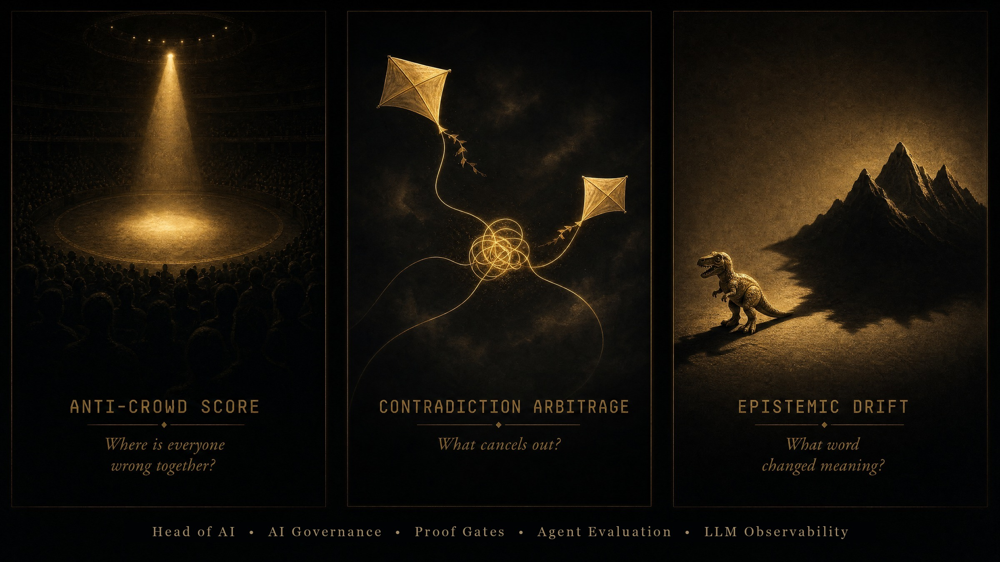
</p>

<div align="center">
  <h1>Mike Rodgers</h1>
  <p><strong>I turn AI pilots into production systems you can defend in a board meeting.</strong></p>
</div>

<p align="center">
  Head of AI · Forward-Deployed AI Engineering · Denver · <a href="mailto:mrodgersjs@gmail.com">mrodgersjs@gmail.com</a> · <a href="https://www.linkedin.com/in/mike-rodgers-ai/">LinkedIn</a> · <a href="https://rodgersintelligence.com/">rodgersintelligence.com</a>
</p>

<p align="center"><strong>Forward Deployed Engineer · Enterprise AI Solutions Architect · Deployment Strategist</strong><br />7 years building AI/ML systems (since 2019) and 15+ years delivering enterprise technology into regulated healthcare, financial services, and industrial environments (20+ years in live operations from a Caterpillar fabrication line to five hospital systems, a $6B health-tech business unit, and 13 client AI deployments). Seeking a full-time IC/Lead Forward Deployed Engineer or Enterprise AI Solutions Architect role (US remote, hybrid, or onsite; 25–50% travel).</p>

<p align="center"><code>Python · TypeScript · Rust · C++17 · SQL · Dart/Flutter · LangChain · LangGraph · CrewAI · Dify.ai · n8n · MCP · PostgreSQL/pgvector · Docker/Kubernetes</code></p>

<div align="center">

[](https://github.com/mrodgersjs-web?tab=repositories)
[](https://github.com/mrodgersjs-web?tab=repositories)
[](https://github.com/mrodgersjs-web/mrodgersjs-web/tree/main/steward/scoreboard)
[](https://github.com/mrodgersjs-web/rigforge/actions/workflows/smoke.yml)

</div>

## Track record

Before the repos, the operating record. Programs I have led add up to $35M in combined impact.

- **Health systems & clinical AI — Advocate Health, formerly Aurora Health Care (06/2013–2020; VP 2018–2020, Director 2016–2018, Manager 06/2013–2016).** Initiated clinical AI/ML work in **2019** across radiology image reads and EHR patient-care workflows (**~15% faster read prioritization**); ran a **6-project digital-health Center of Excellence**; scaled clinical teletriage across **5 health systems and 14 emergency departments** (ED waits cut from roughly three hours to 15 minutes for **130,000+ patients**; Emergency Care Innovation of the Year).
- **Teams and ventures — 83 Tech Harbor (Advocate Health engineering subsidiary).** Founded and scaled 83 Tech Harbor to **28 direct reports** (software, data, and AI engineers, architects, and managers; **3 promoted to leadership**; Scrum/Agile sprints), managing **$27M in operating budgets** and **$28M in venture investments**; launched **5 revenue workstreams** delivering **$16M estimated downstream digital-health revenue**, **$5M Surgical/ED value-stream transformations**, and **$3.4M time-to-fill savings**.
- **Enterprise AI — Oracle Health, formerly Cerner (07/2021–03/2026, Senior Director, Strategy, Marketing & Competitive Intelligence — $6B business unit).** Designed and operated an internal AI competitive-intelligence system processing **150+ market signals a day** across every segment, replacing external consultant spend and closing **FY24 and FY25** revenue and budget gaps. Led a **12-use-case AI/analytics intake (top 4 funded)** with **8 Finance business cases**, managed **3 AI/analytics vendor evaluations** with Procurement, Risk, and Legal (including system integrators), owned BU executive pipeline/value/spend/risk KPIs, guided an AI capability through formal security, privacy, HIPAA, and compliance review, partnered with enterprise architecture and BI teams on data-readiness assessments and shared Power BI / Tableau extensions, and delivered frontline AI features, a staff AI literacy program, C-suite 2030 vision, and Cerner post-acquisition integration.
- **Startups — EmOpti, Inc. (2020–2021, Vice President, Business Development).** Vendor-side clinical telehealth deployment with **Advocate Health, HCA, and Jefferson Memorial** across **6 end-user focus groups** and roadmap sessions, delivering **$1M in year-one new revenue** and supporting a **$10M Series A** during COVID-19.
- **Now — Rodgers Intelligence Group (01/2025–Present, Forward Deployed Engineer & Founder; part-time alongside Oracle Health through 03/2026, full-time since 04/2026).** Delivered **13 client AI deployments** (**6 live client AI applications** under written reference architecture, product owner across all 6) across banking/financial services, payments/e-commerce, quote-to-cash, healthcare, and HR (**4+ client HR/employee-support AI assistants**, Workday HCM/HR AI integrations, classic ML classification/forecasting/scoring). Drove **up to 80% end-user adoption** via walkthroughs and super-user networks, achieved **~20% measured cut** in AI run cost, manual handling, or review cycle time, passed **8 IT activate/buy/build feasibility reviews**, vetted **6 third-party AI vendors** for model risk (data, security, bias), delivered written client AI governance frameworks, model/tool catalogs, approved-use policies, evaluation harnesses, per-app SLAs, active-user/containment telemetry, audit-exam control evidence, and operator runbooks, and dedicate **~30% of engineering time** to feedback-driven self-learning systems.
- **Earlier industrial engineering & lean operations (2004–06/2013).** **Actuant Corporation** (07/2008–06/2013, CI Manager/Engineer): **20% cost cut** via value streams, **$12M acquisition integration**, **$3.4M restructuring savings**. **Caterpillar Inc.** (06/2005–07/2008, Mfg Engineer/Supervisor): **$1.8M line expansion**, FMEAs, **$200K+ inventory cut**, **18 direct reports** on **150/195-ton mining truck** fabrication line. **Becton, Dickinson & Company** (2004–2005, Plant Six Sigma Black Belt): **$500K verified savings** and **ISO 9000** process validation and quality approvals.

<sub>Client names and single-tenant telemetry are withheld under NDA; verifiable system benchmarks and dated CI receipts below are the part you can check yourself.</sub>

> **One operator. Four machines. Every receipt public.**

```bash
# Run the front of the estate in one line (READMEs of every pinned system carry the same path):
git clone https://github.com/mrodgersjs-web/mrodgersjs-web.git && (cd mrodgersjs-web && python3 -m unittest discover -s steward -t . -v)
```

## What this estate measures

| | Public | With CI | Licensed |
|---|---|---|---|
| Public surface on GitHub (`mrodgersjs-web`) | **456 public repos** (36 original + 420 forks) | **33 of 36** original systems | **34 of 36** original MIT |
| The owned fleet behind them | **366 repos owned** (local + GitHub census) | Actions on every release surface | licensed at ship |

Languages on this profile: **Python (6+ years daily production)**, **TypeScript / JavaScript**, **SQL**, **Rust (including WASM)**, **C++17**, **Dart / Flutter**, **Bash / Shell**, and **YAML**. The GitHub account holds **456 public repos** (36 original systems plus 420 research/upstream forks) and **118 private** originals (574 total on GitHub); the local + GitHub census counts **366 owned codebases** (census script and method at [`steward/fleet.json`](steward/fleet.json)) plus 441 vendored research clones. Where each capability lives in the estate: [skills-to-project matrix](https://github.com/mrodgersjs-web/fde-portfolio/blob/main/SKILLS-MATRIX.md). **3 public MCP servers** ship inside these systems, alongside **3 patent families in preparation** ([patents](https://github.com/mrodgersjs-web/patents): `RIG-DE-001`, `RIG-LAT-002`, `RIG-PHR-003`). Nothing here is a demo directory.

## The fleet behind the profile

Not a repo list — an infrastructure. The machine-readable inventory is [`steward/fleet.json`](steward/fleet.json), re-censusable with the script beside it.

| Layer | What runs | The proof |
|---|---|---|
| Compute & GPUs | **3x RTX PRO 6000 Blackwell GPUs** (tensor-parallel-3 inference) + Mac Studio 256GB (model serving, agent cluster) + MacBook cockpit + QNAP NAS + OWC container volume | **522.988 tok/s median**, **1,446.4 tok/s aggregate at concurrency 8**; `node_uname_info` on Prometheus, 100 launchd services, docker contexts |
| OS & virtualization | macOS hosts; **Ubuntu 24.04 LTS** on three Colima VMs (2/16/8 vCPU profiles); Linux GPU server; QTS (Debian family) on the NAS | `os-release` captured from the offload VM; `colima list` |
| Containers & orchestration | Docker Engine (macOS + Ubuntu VMs), Kubernetes (cloud/enterprise stack), launchd watchdog network, **Temporal** for durable workflows; **66/66 container images** migrated across Mac Studio hosts | image IDs, table-count parity, dual scheduled receipts across **21 migrated routines**, systemd/launchd unit lists |
| Model serving & routing | **LiteLLM gateway** + behavioral probes across **6 agent clients**; validated **43 model roles** and **31 fallback chains** offline; cleared **15/15 and 12/12 native catalog checks**; resolved **4x context-window mismatches** | temperature-0 probes, **10 automated tool-call cycles** after parser-template repair; run proofs in [agentic-workflows](https://github.com/mrodgersjs-web/agentic-workflows) |
| Web, mobile & data | Internal Vercel web platform (**56 routes**: **31 Next.js/React pages**, **23 TypeScript APIs**), **1,147 Python modules**, **159 test suites**; Postgres/PostgREST RLS, single-flight cache, **61,987-page / 116,158-chunk pgvector** index at **100% embedding coverage**; TransformFit **Flutter/Dart** AI coach + Supabase Edge Functions + ES256 Sign in with Apple JWT (**5/5 live coach voice routes**, HTTP 200 in **1.4s–3.6s**) | six-check schema-validated ingestion gate; live Vercel console (`rig-os-agency-demo.vercel.app`); separate governed stack with **252 automated tests** and fail-closed control plane |
| Network & edge | **Tailscale** tailnet-only for every service (`tailscale serve`, never 0.0.0.0); **Cloudflare** edge; **Vercel** production hosting | `dig NS`, TLS negative checks, documented outage postmortems |
| Observability & proof | **OpenTelemetry** (OTel traces, logs, metrics), Prometheus + node_exporter + Grafana dashboards, **HMAC-SHA256 cryptographic ProofPackets**, fail-closed release gates | signed receipts in [proof-studio](https://github.com/mrodgersjs-web/proof-studio) and [rigforge](https://github.com/mrodgersjs-web/rigforge), incident notes in commit history |
| Agent tooling & MCP | **3 public MCP servers** + tested stdio servers (**555- and 276-line implementations**) governing **48 external tool servers** behind one orchestration/permission layer; LangChain, LangGraph, CrewAI, Dify.ai, n8n, Flowise, Trigger.dev | `.unref()` leak fix verified across **21 live tools** (exit 0, zero residual processes); n8n [execution 21, success](https://github.com/mrodgersjs-web/agentic-workflows/blob/main/results/n8n-run.json); LangGraph [HELLO-AGENT-LANGGRAPH-OK](https://github.com/mrodgersjs-web/agentic-workflows/blob/main/results/langgraph-run.json) |
| Cloud platforms | **AWS** (incl. Bedrock), **Google Cloud**, **Azure** (incl. Azure AI), and **OCI**; OpenAI API, PyTorch, Workday HCM/HR AI integrations, SQL Server (SSIS), Power BI, Tableau, Microsoft 365 Copilot / Copilot Studio, Power Platform | [resume cloud line](https://github.com/mrodgersjs-web/resume/blob/main/RESUME.md) (no checked-in AWS/Azure/GCP/OCI execution receipt in this public fleet) |
| CI/CD | GitHub Actions on **33 of 36** original public systems, fmt/clippy/sanitizer matrices, gitleaks, catalog verify, TDD (**159- and 252-test suites**) | the badges on this page, all live |

### Fleet homelab & architecture diagrams

Redacted public-safe topology generated with [homelab-diagram](https://github.com/mrodgersjs-web/homelab-diagram) and collision-checked system diagrams generated with [open-diagram](https://github.com/mrodgersjs-web/open-diagram) (0 layout problems). [Full high-res visual gallery →](docs/architecture-and-floorplans.md)

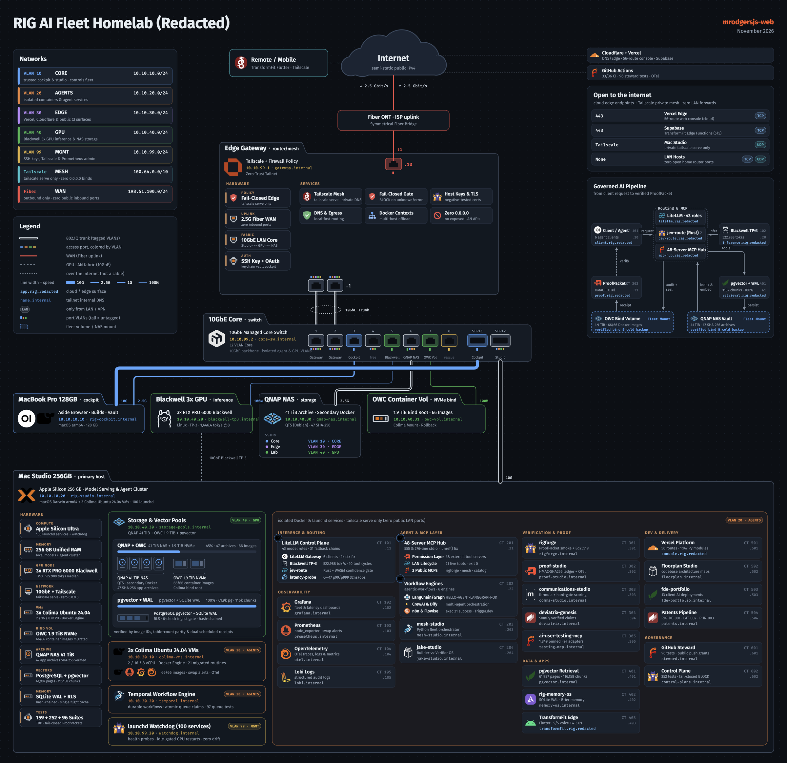

| Control Plane Architecture (Request to ProofPacket) | Enterprise FDE Delivery Architecture (13 Deployments) |
|---|---|
| 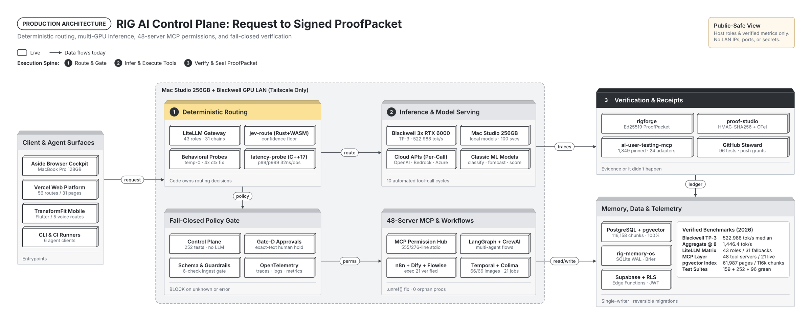 | 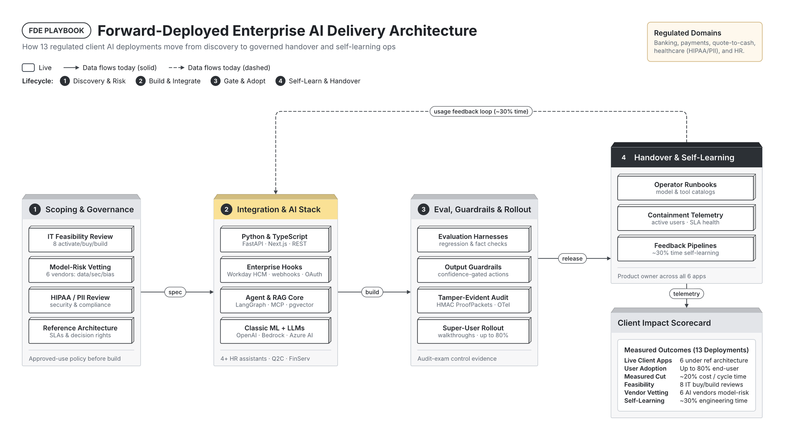 |

### Selected production builds & verified systems (receipt-backed telemetry)

Every build below carries dated verification telemetry and states its scope honestly:

- **Blackwell Multi-GPU Inference Serving (Gate Design & Verification, 2026).** Certified tensor-parallel-3 model serving across **3 RTX PRO 6000 Blackwell GPUs** using idle-gated restarts and temperature-0 probes, measuring **522.988 tok/s median** and **1,446.4 tok/s aggregate at concurrency 8**; traced a production tool-call failure to the parser template and proved the fix across **10 automated tool-call cycles**.
- **Multi-Client Model Routing Control Plane (Architecture & Verification, 2026).** Replaced config-presence checks with behavioral probes (chat, streaming, multi-turn tool continuation, embeddings, vision) across **6 agent clients** and a LiteLLM gateway; resolved **4x context-window mismatches**, validated **43 model roles** and **31 fallback chains** offline, and cleared **15/15 and 12/12 native catalog checks**.
- **MCP Server Lifecycle Fix & 48-Server Permission Layer (Author & Operator, 2025–2026).** Authored tested stdio MCP servers (**555- and 276-line implementations**) governing **48 external tool servers** behind one orchestration/permission layer; diagnosed and fixed orphaned Node MCP server process leaks (`.unref()` timer fix), verifying **21 live tools** across full LAN lifecycle cycles with exit code 0 and zero residual processes.
- **Production Multi-Agent Web Platform & pgvector Retrieval (Sole Builder & Operator, 2025–2026).** Built and operate an internal Vercel web platform (**56 routes**: **31 Next.js/React pages**, **23 TypeScript APIs**), **1,147 Python modules**, **159 test suites**, Postgres/PostgREST RLS, single-flight read cache, and a six-check schema-validated ingestion gate that blocked a corrupt corpus prior to production; run a **61,987-page / 116,158-chunk pgvector** single-writer index at **100% embedding coverage**.
- **Governed Delivery Stack & 66-Image Fleet Migration (Architect & Verifier, 2025–2026).** Built a separate governed multi-agent delivery stack with **252 automated tests** and a fail-closed control plane (returns BLOCK on any error or unknown state with no LLM in the decision path); migrated **66/66 container images**, auth databases, vector stores, TLS overlays, and **21 scheduled routines** across Mac Studio hosts verified by image IDs, table-count parity, and dual scheduled receipts (row-level parity kept explicitly open). Verified **47 application archives** on QNAP storage with SHA-256 checks before removal.
- **TransformFit AI Coach Mobile App & Edge Backend (Full-Stack Builder, 2026).** Built cross-platform **Flutter** mobile AI coach backed by Supabase PostgreSQL, live Edge Functions (`coach-chat`, `generate-plan`), and ES256 Sign in with Apple JWT auth; verified **5/5 live coach voice routes** returning HTTP 200 in **1.4s–3.6s** end to end.
- **Public Open-Source Systems & Patent Pipeline.** [proof-studio](https://github.com/mrodgersjs-web/proof-studio) (Python MIT CLI/MCP ProofPacket verification with HMAC-SHA256 ledger + OpenTelemetry), [mesh-studio](https://github.com/mrodgersjs-web/mesh-studio) (Python fleet orchestrator), [jev-route](https://github.com/mrodgersjs-web/jev-route) (Rust + WASM deterministic routing policy), [latency-probe](https://github.com/mrodgersjs-web/latency-probe) (C++17 serving-latency histograms), `rig-memory-os` (hash-chained SQLite WAL memory + MCP), [fde-portfolio](https://github.com/mrodgersjs-web/fde-portfolio) (discovery-to-handover playbooks), [jake-studio](https://github.com/mrodgersjs-web/jake-studio) (Builder-vs-Verifier OS), and [patents](https://github.com/mrodgersjs-web/patents) (**3 patent families in preparation**: `RIG-DE-001`, `RIG-LAT-002`, `RIG-PHR-003`).

I set architecture, priorities, and acceptance criteria; AI coding agents help implement and verify. Internal RIG systems are separate from the 13 client deployments above. [Technical case studies and their evidence limits →](docs/fleet-case-studies.md) · [Capabilities by role →](docs/career-capabilities.md) · [The public field record, with per-case not-proven lines →](https://github.com/mrodgersjs-web/fde-portfolio/blob/main/CASE-STUDIES.md)

## Pinned systems

| System | What it demonstrates | Verify |
|---|---|---|
| [**rigforge**](https://github.com/mrodgersjs-web/rigforge) | Builds and checks ProofPacket evidence through a reproducible smoke path. | `git clone https://github.com/mrodgersjs-web/rigforge.git && (cd rigforge && python3 -m venv .venv && . .venv/bin/activate && bash scripts/smoke.sh)` |
| [**proof-studio**](https://github.com/mrodgersjs-web/proof-studio) | Verifies signed completion evidence (HMAC-SHA256 ledger + OpenTelemetry) and detects tampering. | `git clone https://github.com/mrodgersjs-web/proof-studio.git && (cd proof-studio && python3 -m venv .venv && . .venv/bin/activate && bash scripts/smoke.sh)` |
| [**communications-studio**](https://github.com/mrodgersjs-web/communications-studio) | Scores a draft message against formulas and hard gates, then emits or rejects it, with pytest as the claim under test. | `git clone https://github.com/mrodgersjs-web/communications-studio.git && (cd communications-studio && python3 -m venv .venv && . .venv/bin/activate && bash scripts/smoke.sh)` |
| [**deviatrix-genesis**](https://github.com/mrodgersjs-web/deviatrix-genesis) | Runs an idea through three diamonds, three expeditions and seven stages, with a verifier that signs each sealed proof packet. | `git clone https://github.com/mrodgersjs-web/deviatrix-genesis.git && (cd deviatrix-genesis && python3 -m venv .venv && . .venv/bin/activate && pip install sympy && PYTHONPATH=. python3 -m unittest deviatrix_genesis.tests.test_deviatrix deviatrix_genesis.v3.tests.test_v3 deviatrix_genesis.v4.tests.test_memory_export deviatrix_genesis.v5.tests.test_v5)` |
| [**ai-user-testing-mcp**](https://github.com/mrodgersjs-web/ai-user-testing-mcp) | The strongest thing here. A governed AI user-testing monorepo: 1,849 catalogued resources pinned to exact commits, a sandboxed runner, 24 reviewed adapters, evidence sealed as a ProofPacket. CI runs build, tests and a catalog verify, plus gitleaks and a gitlink audit. | `git clone https://github.com/mrodgersjs-web/ai-user-testing-mcp.git && (cd ai-user-testing-mcp && pnpm install --frozen-lockfile && pnpm build && pnpm test)` — see a green run at [workflow run 14](https://github.com/mrodgersjs-web/ai-user-testing-mcp/actions/workflows/ci.yml) |
| [**jev-route**](https://github.com/mrodgersjs-web/jev-route) | The compiled-language answer: a deterministic routing policy as a single dependency-free Rust binary (+ WASM), with the benchmark checked in and CI-enforced. Task and candidates in, choice + confidence + fallback verdict out. | `git clone https://github.com/mrodgersjs-web/jev-route.git && (cd jev-route && cargo test --release && cargo run --release -- validate --fixture fixtures/benchmark.json)` |

Also live, also verifiable, not pinned (six pins is the cap): [mesh-studio](https://github.com/mrodgersjs-web/mesh-studio), [jake-studio](https://github.com/mrodgersjs-web/jake-studio), [latency-probe](https://github.com/mrodgersjs-web/latency-probe), [fde-portfolio](https://github.com/mrodgersjs-web/fde-portfolio), [patents](https://github.com/mrodgersjs-web/patents). Same drill: clone, venv, smoke.


<sub>rigforge in action: an agent reports "BUILD COMPLETE", the signature check rejects the forged packet. Reproduce it with the command above.</sub>

### Codebase Floorplans — how every pinned repo works

Interactive architecture maps generated with Floorplan (100% file and route coverage across all six pinned systems):

| [rigforge](https://github.com/mrodgersjs-web/rigforge) (73 files · 23 endpoints) | [proof-studio](https://github.com/mrodgersjs-web/proof-studio) (81 files · 23 endpoints) |
|---|---|
| 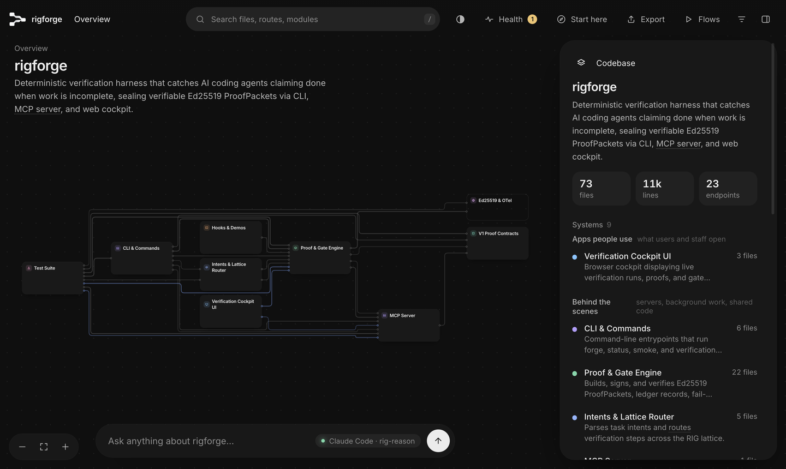 | 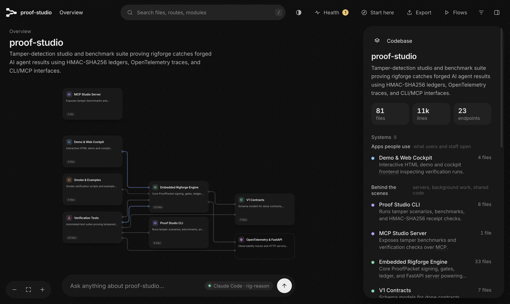 |

| [communications-studio](https://github.com/mrodgersjs-web/communications-studio) (40 files · 6 modules) | [deviatrix-genesis](https://github.com/mrodgersjs-web/deviatrix-genesis) (89 files · 8 modules) |
|---|---|
| 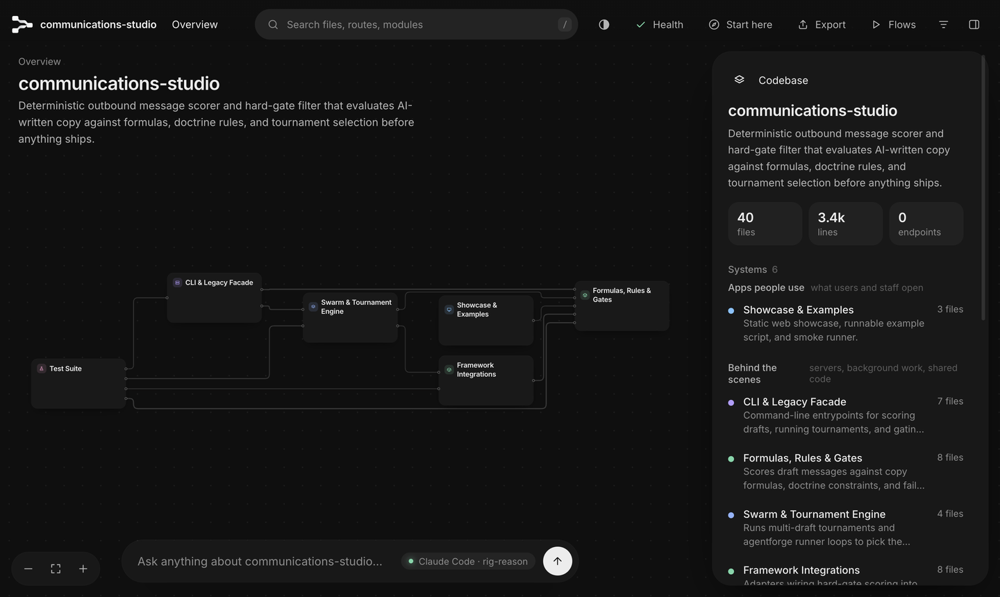 | 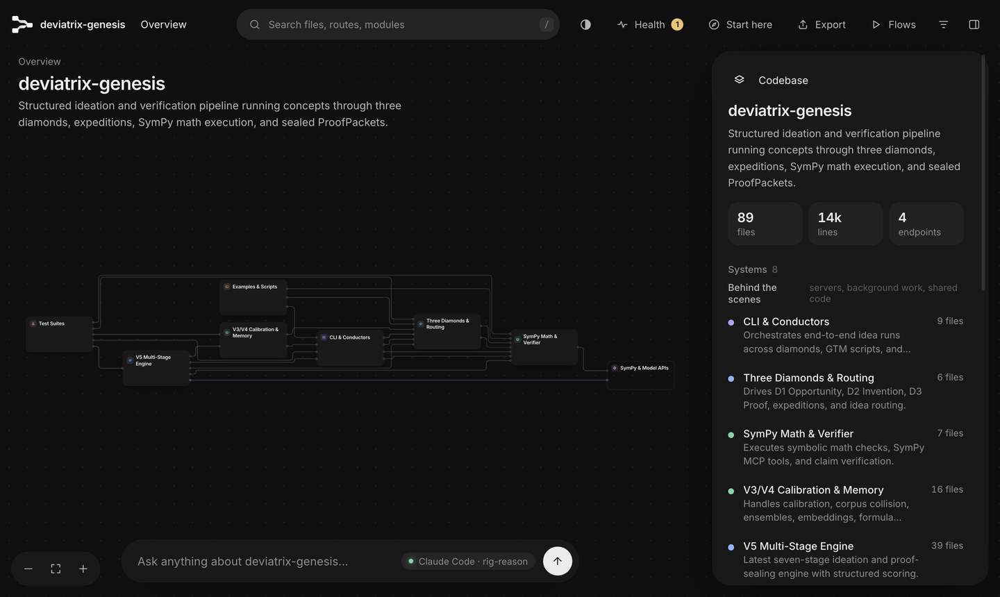 |

| [ai-user-testing-mcp](https://github.com/mrodgersjs-web/ai-user-testing-mcp) (163 files · 1,849 pinned) | [jev-route](https://github.com/mrodgersjs-web/jev-route) (Rust + WASM · 11 files) |
|---|---|
| 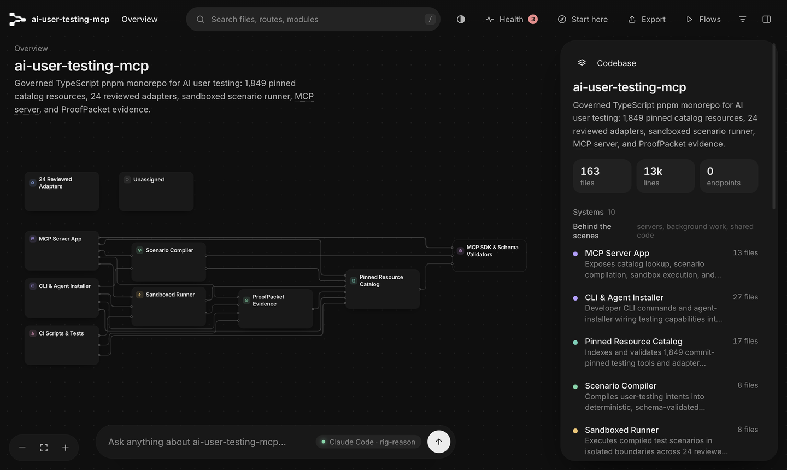 | 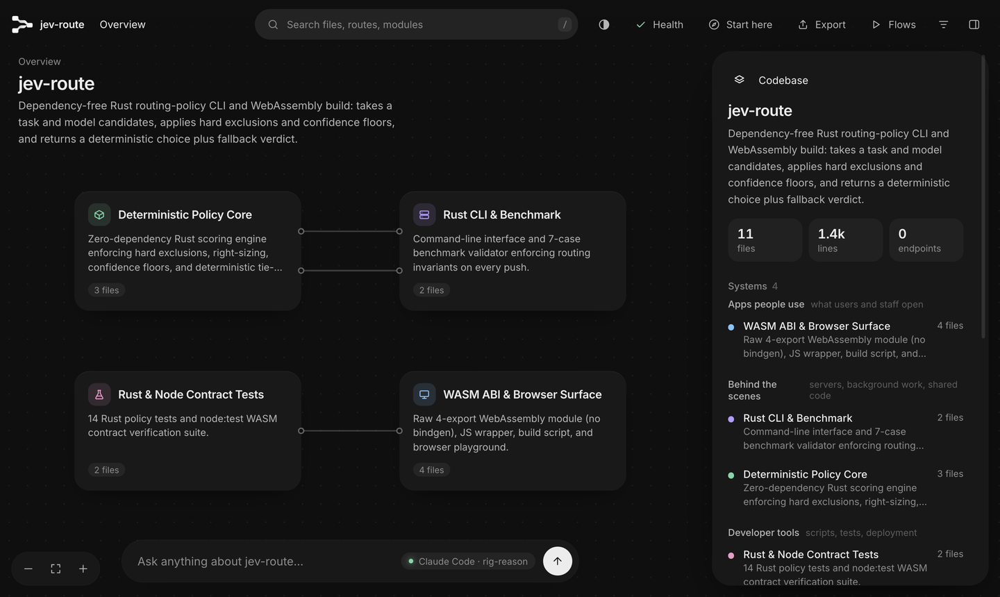 |

### Animated demos — remaining top repositories

| [mesh-studio](https://github.com/mrodgersjs-web/mesh-studio) (Fleet Orchestrator + MCP) | [jake-studio](https://github.com/mrodgersjs-web/jake-studio) (Builder-vs-Verifier OS) |
|---|---|
| 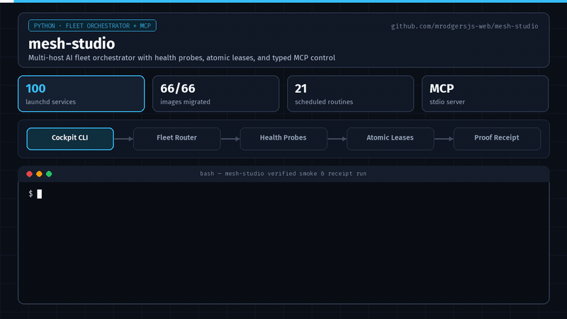 | 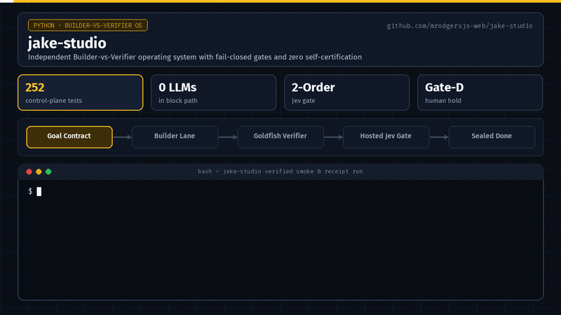 |

| [latency-probe](https://github.com/mrodgersjs-web/latency-probe) (C++17 · 32 ns/observe) | [agentic-workflows](https://github.com/mrodgersjs-web/agentic-workflows) (6-Engine Router) |
|---|---|
| 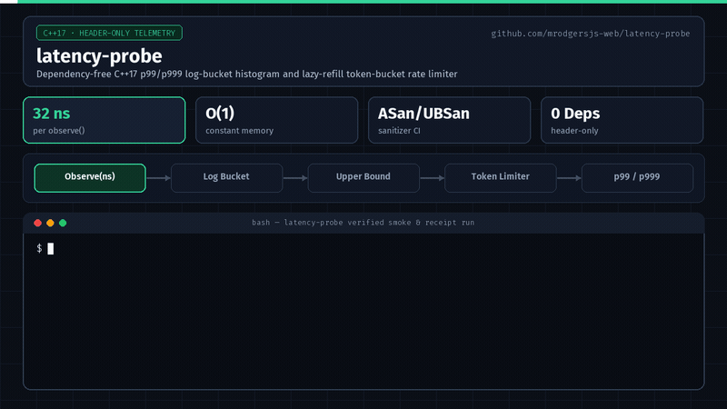 | 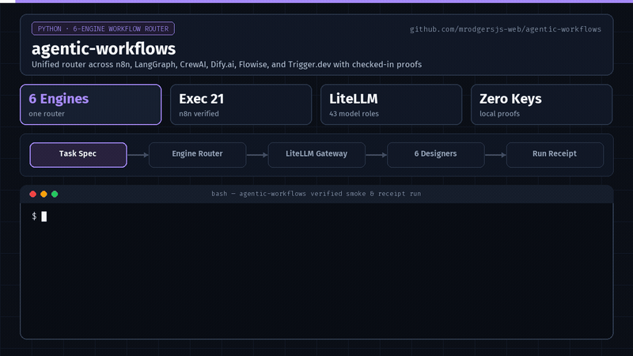 |

| [fde-portfolio](https://github.com/mrodgersjs-web/fde-portfolio) (13 Client Deployments) | [rig-os-agency](https://github.com/mrodgersjs-web/rig-os-agency) (Next.js 16 · 56 Routes) |
|---|---|
| 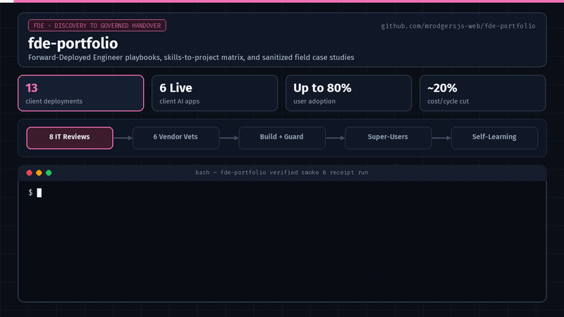 |  |

## Which requirement each system answers

Cross-checked against the requirement language in 108 live Head-of-AI, VP-AI, Forward-Deployed-Engineer and AI-infra postings, October 2026. The percentages are how often that requirement appeared, not how much I rate it.


| The posting says | Frequency at this tier | What I have that answers it |
|---|---|---|
| "eval infrastructure" · reliability, observability, drift | 60% leadership · 32% FDE | [rig-enhanced-evals](https://github.com/mrodgersjs-web/rig-enhanced-evals), [rig-enhanced-guardrails](https://github.com/mrodgersjs-web/rig-enhanced-guardrails) — schema, format, toxicity and fact checks that sign a receipt + OpenTelemetry (OTel traces, logs, metrics) |
| "write and review production-grade code across frontend and backend using JavaScript or Python" | 50% FDE · named in OpenAI and Anthropic leadership reqs | [ai-user-testing-mcp](https://github.com/mrodgersjs-web/ai-user-testing-mcp) (pnpm workspace, CI-tested), [rig-os-agency](https://github.com/mrodgersjs-web/rig-os-agency) (Next.js console), [mrodgersjs-web-teammate](https://github.com/mrodgersjs-web/mrodgersjs-web-teammate) (`npx mrodgersjs-web`), internal Vercel platform (56 routes, 1,147 Python modules, 159 test suites) |
| "agents, tool-calling, orchestration" | 58% leadership · 41% FDE | [agentic-workflows](https://github.com/mrodgersjs-web/agentic-workflows) — six designers (n8n, Flowise, Dify, Trigger.dev, LangGraph, CrewAI), one router, checked-in run proofs · [rig-agent-firm](https://github.com/mrodgersjs-web/rig-agent-firm), [mesh-studio](https://github.com/mrodgersjs-web/mesh-studio) · 48-server MCP permission layer |
| "retrieval, data integration, ontology" | 27% leadership · 45% FDE | `rig-memory-os` (hash-chained SQLite WAL memory + MCP, Brier-scored predictions; private while client identifiers are stripped) + live 61,987-page / 116,158-chunk PostgreSQL/pgvector index at 100% embedding coverage |
| "governance, model risk, compliance, approval boundaries" | 73% leadership | [doctrine](https://github.com/mrodgersjs-web/doctrine), [proof-gate-action](https://github.com/mrodgersjs-web/proof-gate-action), [rig-doctrine-overlay](https://github.com/mrodgersjs-web/rig-doctrine-overlay) · HIPAA/PII compliance, 8 IT feasibility reviews, 6 AI vendors vetted for model risk |
| "measurable business value, ROI, cost" | 61% leadership | [fde-portfolio](https://github.com/mrodgersjs-web/fde-portfolio) — discovery to handoff as data · [resume](https://github.com/mrodgersjs-web/resume) with the sourced numbers (13 client deployments, up to 80% adoption, ~20% cost/cycle cut, $35M career impact) |
| "did it actually ship?" | every tier | [rigforge](https://github.com/mrodgersjs-web/rigforge), [proof-studio](https://github.com/mrodgersjs-web/proof-studio), [doneseal](https://github.com/mrodgersjs-web/doneseal) — hash-verifiable, HMAC-SHA256 / Ed25519-signed completion evidence |
| "at least one systems language such as Go, Rust, or C/C++" | 0% leadership · 46% of infra reqs name Rust, 42% name C++ | [jev-route](https://github.com/mrodgersjs-web/jev-route) (Rust CLI + wasm) and [latency-probe](https://github.com/mrodgersjs-web/latency-probe) (C++17 histogram + token bucket, sanitizer matrix CI) — both dependency-free, both with checked-in benchmarks |

## Languages, stated plainly

**Python (6+ years daily production)** — the working language of the systems above: FastAPI/Flask APIs, agent harnesses, MCP servers, PyTorch & classic ML (classification, forecasting, scoring), evals, data plumbing, CI, 1,147 production modules, 159- and 252-test suites, and this page's own stdlib steward.

**TypeScript / JavaScript** — the delivery surface for the Forward-Deployed bar: Next.js, React, Vite, Node.js, Supabase Edge Functions, REST APIs, webhooks, OAuth, ES256 JWT auth. Ten TypeScript codebases exist in the estate (incl. the 56-route Vercel platform with 31 Next.js/React pages and 23 TypeScript APIs); `ai-user-testing-mcp`, `rig-os-agency`, and [mrodgersjs-web-teammate](https://github.com/mrodgersjs-web/mrodgersjs-web-teammate) (`npx`-installable) are public and CI-covered.

**SQL** — PostgreSQL, pgvector (61,987-page / 116,158-chunk index at 100% embedding coverage), PostgREST RLS, SQL Server (SSIS), SQLite WAL (hash-chained memory store), single-flight caching, Power BI, and Tableau.

**Rust (including WebAssembly / WASM)** — `jev-route`: the deterministic routing policy that governs this fleet, as a standalone dependency-free binary and a WebAssembly build (`wasm/`, raw four-export ABI, no bindgen, `node:test` contract suite). Hard exclusions, scored right-sizing, confidence floor, deterministic tie-breaks; 14 tests and a 7-case benchmark gate every push.

**C++17** — `latency-probe`: header-only C++17 p99/p999 serving-latency histogram and token-bucket limiter. Constant-memory log buckets with an upper-bound guarantee (never underestimates), lazy-refill limiter, 32ns/observe benchmark checked in, CI on gcc and clang across Linux and macOS plus an ASan/UBSan job.

**Dart / Flutter, Bash / Shell, YAML** — cross-platform TransformFit mobile AI coach (Flutter + Supabase PostgreSQL + Edge Functions, 5/5 live voice routes at 1.4s–3.6s), operational automation scripts, GitHub Actions CI/CD pipelines, and declarative workflow/gate specifications.


## How I work

> Code owns decisions. LLMs assist transformation. Gates decide if it ships.

- Deterministic before agentic. Any rule that can be a function does not get a prompt.
- Every claim names its source, every completion carries a receipt, every migration is reversible.
- Configured, responds, and accepted are three different milestones. I record each separately, and I write down the ones still open.
- Test through the client that will actually use the result, not the API that proves it exists.
- Local-first and private by default. A hosted model is a per-call decision, not a default.


## How a recruiter should spend 10 minutes

1. **0–2 minutes.** Open [`rigforge`](https://github.com/mrodgersjs-web/rigforge) and its [latest smoke receipt](https://github.com/mrodgersjs-web/rigforge/actions/workflows/smoke.yml).
2. **2–4 minutes.** Select the pinned system closest to the role you are hiring for.
3. **4–7 minutes.** Copy its Verify command and run the public smoke path on your own machine.
4. **7–9 minutes.** Inspect the linked receipt's state, date and commit SHA.
5. **9–10 minutes.** Read the Boundaries line below and decide whether those boundaries matter for your role.

## Recent receipts

<!-- recent_receipts starts -->
Steward score. **62 of 100 checks green**, 33 red, 5 not measured. Measured `2026-11-27`.

| Pinned system | Latest release | Latest smoke run |
| --- | --- | --- |
| [rigforge](https://github.com/mrodgersjs-web/rigforge) | [v1.1.0](https://github.com/mrodgersjs-web/rigforge/releases/tag/v1.1.0) · `2026-10-20` | [success](https://github.com/mrodgersjs-web/rigforge/actions/runs/45306883902) · `2026-11-24` · `413e511` |
| [proof-studio](https://github.com/mrodgersjs-web/proof-studio) | [v1.0.0](https://github.com/mrodgersjs-web/proof-studio/releases/tag/v1.0.0) · `2026-10-20` | [success](https://github.com/mrodgersjs-web/proof-studio/actions/runs/45306895215) · `2026-11-24` · `8f808f0` |
| [communications-studio](https://github.com/mrodgersjs-web/communications-studio) | [v11.1.0](https://github.com/mrodgersjs-web/communications-studio/releases/tag/v11.1.0) · `2026-10-20` | [success](https://github.com/mrodgersjs-web/communications-studio/actions/runs/45306904835) · `2026-11-24` · `a96f96b` |
| [deviatrix-genesis](https://github.com/mrodgersjs-web/deviatrix-genesis) | [v0.2.0](https://github.com/mrodgersjs-web/deviatrix-genesis/releases/tag/v0.2.0) · `2026-10-20` | [success](https://github.com/mrodgersjs-web/deviatrix-genesis/actions/runs/45309885480) · `2026-11-24` · `5b00262` |
| [ai-user-testing-mcp](https://github.com/mrodgersjs-web/ai-user-testing-mcp) | no release | [success](https://github.com/mrodgersjs-web/ai-user-testing-mcp/actions/runs/40980588870) · `2026-10-30` · `61b969a` |
| [jev-route](https://github.com/mrodgersjs-web/jev-route) | no release | [success](https://github.com/mrodgersjs-web/jev-route/actions/runs/40990218966) · `2026-10-30` · `394239f` |
<!-- recent_receipts ends -->


## Competencies

| Area | What it covers and where to check it |
|---|---|
| **Python** | 6+ years daily production: FastAPI, Flask, PyTorch, classic ML (classification, forecasting, scoring), harnesses, MCP servers (555- and 276-line stdio implementations), evals, 1,147 internal modules, 159- and 252-test suites, and the nightly profile steward. |
| **TypeScript** | `ai-user-testing-mcp` (pnpm monorepo, CI-tested), `rig-os-agency` (Next.js 16 console), `mrodgersjs-web-teammate` (`npx`-installable), plus Next.js/React/Vite/Node.js/Supabase Edge Functions (56-route Vercel platform: 31 pages, 23 TS APIs) and REST/webhook/OAuth/ES256 JWT integrations. |
| **Postgres** | PostgreSQL, pgvector (61,987-page / 116,158-chunk single-writer index at 100% embedding coverage), PostgREST RLS, single-flight caching, SQL Server (SSIS), and SQLite WAL; migrations are reversible by rule, not by hope. |
| **AWS** | Hands-on cloud for AI features and agents, named with Google Cloud as a pair in the career record. Includes **AWS Bedrock**. No public execution receipt in this fleet. Check the [resume cloud line](https://github.com/mrodgersjs-web/resume/blob/main/RESUME.md). |
| **Azure** | Azure and Azure AI, Microsoft 365 Copilot / Copilot Studio, and Power Platform in the career record: built AI features and agents on AWS and Azure. No public execution receipt in this fleet. |
| **OCI** | Named on the public resume cloud line alongside AWS, Google Cloud, and Azure. Not a fleet proof: no public run receipt. |
| **LangChain** | LangGraph has a checked-in run ([HELLO-AGENT-LANGGRAPH-OK](https://github.com/mrodgersjs-web/agentic-workflows/blob/main/results/langgraph-run.json), 2026-10-28). LangChain, CrewAI, and Dify.ai are hands-on across client deployments and evals; public langchain entries on this account are forks. |
| **n8n** | Checked-in workflow run, execution 21, status success ([n8n-run.json](https://github.com/mrodgersjs-web/agentic-workflows/blob/main/results/n8n-run.json)), paired with MCP orchestration, human-in-the-loop approvals, and self-learning feedback pipelines. |

### Full technical skills & production capabilities

- **Languages:** Python (6+ years daily production), TypeScript / JavaScript, SQL, Rust (including WebAssembly / WASM), C++17, Dart / Flutter, Bash / Shell, YAML.
- **Agent & Workflow Frameworks:** LangChain, LangGraph, CrewAI, Dify.ai, n8n, Model Context Protocol (MCP) servers, multi-agent orchestration, tool calling, deterministic confidence-gated routing, output guardrails, human-in-the-loop approvals, self-learning feedback pipelines.
- **LLM Serving, RAG & Classic ML:** OpenAI API, AWS Bedrock, Azure AI, PyTorch, RAG, hybrid/vector search, LiteLLM gateway routing, multi-GPU self-hosted inference (tensor-parallel-3 Blackwell serving, temperature-0 behavioral probes, tool-call parser qualification), classic ML (classification, forecasting, scoring).
- **Full-Stack, APIs & Data:** Next.js, React, Vite, FastAPI, Flask, Node.js, Flutter, Supabase Edge Functions, REST APIs, webhooks, OAuth, Sign in with Apple ES256 JWT auth, idempotency, Workday HCM/HR AI integrations, PostgreSQL, pgvector, PostgREST RLS, SQL Server (SSIS), SQLite WAL, single-flight caching, Power BI, Tableau.
- **Cloud, DevOps & Observability:** AWS, Google Cloud, Azure, OCI, Cloudflare, Vercel, Docker, Kubernetes, CI/CD, GitHub Actions, OpenTelemetry (OTel traces, logs, metrics), HMAC-SHA256 cryptographic ProofPackets, fail-closed release gates, TDD (159- and 252-test suites), Cursor, GitHub Copilot, v0, Microsoft 365 Copilot / Copilot Studio, Power Platform.
- **Governance & Delivery:** HIPAA/PII compliance, AI governance frameworks, model-risk vendor vetting (data, security, bias), audit-exam control evidence, Lean Portfolio Management, Scrum/Agile, FMEA, Lean/Six Sigma Black Belt.

## Credentials

- B.S. Industrial Engineering, Iowa State University, with Distinction
- Lean/Six Sigma Black Belt
- Project Management Certification & Lean Facilitator/Coordinator Certification (Actuant Corporation)
- ISO 9000 Process Validation & Quality Approvals (Becton, Dickinson & Company)
- Manufacturers Professional Development Program (consistently promoted through annual rankings)
- U.S. Army National Guard (1998–2004), Radio/COMSEC Repairer (MOS 35E), honorable
- Executive Board Member & Chairman, Milwaukee Tech Hub Coalition (09/2017–06/2020) — 40% YoY market reach growth; launched Founder's Circle (75+ local tech startup founders)

GitHub Achievements: Pull Shark x2, Quickdraw. 141 commits of original work on the public `rig-os-agency` fork. MIT-licensed original public surface: 34 of 36.


## Boundaries, stated once

I deploy, serve, and govern pretrained models — no foundation-model training runs. Multi-GPU inference serving benchmarks above reflect certified tensor-parallel-3 serving of pretrained models on internal Blackwell GPUs, not foundation-model training. `rig-memory-os` is the strongest retrieval artifact in the estate and remains private while client identifiers get stripped. Client deployment names and single-tenant telemetry stay under NDA; internal RIG operating results are not customer production scale or a current uptime report, and where a case study left acceptance work open, it says so. Public release surfaces carry a license, a description, and a build or smoke path that CI has actually run.


## Let's talk

Hiring a Forward Deployed Engineer, Enterprise AI Solutions Architect, or Head of AI to take agents from demo to production? [Email me](mailto:mrodgersjs@gmail.com) with the role and the system your team needs built or fixed, or reach me at [**rodgersintelligence.com**](https://rodgersintelligence.com/).
