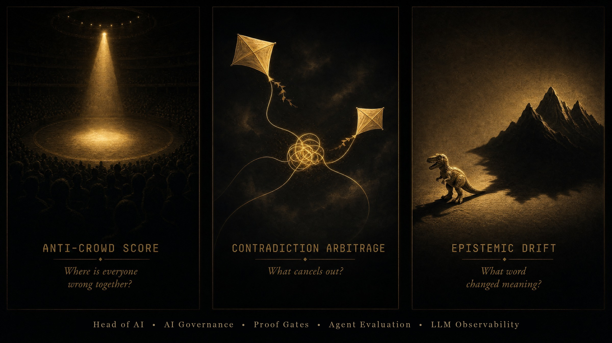

<p align="center">
  
</p>

<div align="center">
  <h1>Mike Rodgers</h1>
  <p><strong>I turn AI pilots into production systems you can defend in a board meeting.</strong></p>
</div>

<p align="center">
  Head of AI · Forward-Deployed AI Engineering · Denver · <a href="mailto:mrodgersjs@gmail.com">mrodgersjs@gmail.com</a> · <a href="https://www.linkedin.com/in/mike-rodgers-ai/">LinkedIn</a> · <a href="https://rodgersintelligence.com/">rodgersintelligence.com</a>
</p>

<p align="center">20+ years taking technology into live operations: a Caterpillar fabrication line, five hospital systems, a $6B health-tech business unit, and now my own AI fleet.</p>

<div align="center">

[](https://github.com/mrodgersjs-web?tab=repositories)
[](https://github.com/mrodgersjs-web?tab=repositories)
[](https://github.com/mrodgersjs-web/mrodgersjs-web/tree/main/steward/scoreboard)
[](https://github.com/mrodgersjs-web/rigforge/actions/workflows/smoke.yml)

</div>

## Track record

Before the repos, the operating record. Programs I have led add up to $35M in combined impact.

- **Health systems.** Led teletriage across five hospital systems and 14 emergency departments: ED waits from roughly three hours to 15 minutes for 130,000+ patients. Emergency Care Innovation of the Year.
- **Teams and ventures.** Founded and scaled 83 Tech Harbor: 28 direct reports, $27M in operating budgets, $28M in venture investments.
- **Enterprise AI.** At Oracle Health, built the internal AI competitive-intelligence capability that processed 150+ market signals a day and was adopted across every market segment.
- **Startups.** At EmOpti, delivered $1M in first-year revenue and supported a $10M Series A.
- **Now.** Founded Rodgers Intelligence Group (RIG) in 2025: this fleet, plus client work in governed AI for regulated operations.

<sub>Figures are from my resume, available on request. Public code and dated CI receipts below are the part you can check yourself.</sub>

> **One operator. Four machines. Every receipt public.**

```bash
# Run the front of the estate in one line (READMEs of every pinned system carry the same path):
git clone https://github.com/mrodgersjs-web/mrodgersjs-web.git && (cd mrodgersjs-web && python3 -m unittest discover -s steward -t . -v)
```

## What this estate measures

| | Public | With CI | Licensed |
|---|---|---|---|
| Systems you can clone and run today | **34 public repos** | **33 of 34** | **34 of 34** |
| The private fleet behind them | **366 repos owned** | Actions on every release surface | licensed at ship |

Languages on this profile: Python, TypeScript, JavaScript, Rust, and C++. The fleet that runs my company counts 366 repositories I wrote or own (118 on GitHub under two handles, 34 of them public on this handle, 248 local and in-flight; the census script and method ship at [`steward/fleet.json`](steward/fleet.json)), plus 441 vendored research clones I run against but did not write. Where each capability lives in the estate: [skills-to-project matrix](https://github.com/mrodgersjs-web/fde-portfolio/blob/main/SKILLS-MATRIX.md). 3 public MCP servers ship inside these repositories. Nothing here is a demo directory.

## The fleet behind the profile

Not a repo list — an infrastructure. The machine-readable inventory is [`steward/fleet.json`](steward/fleet.json), re-censusable with the script beside it.

| Layer | What runs | The proof |
|---|---|---|
| Compute | Mac Studio 256GB (model serving, agent cluster) + MacBook cockpit + QNAP NAS + OWC container volume | `node_uname_info` on Prometheus, 100 launchd services, docker contexts |
| OS & virtualization | macOS hosts; **Ubuntu 24.04 LTS** on three Colima VMs (2/16/8 vCPU profiles); QTS (Debian family) on the NAS | `os-release` captured from the offload VM; `colima list` |
| Containers & orchestration | Docker Engine (macOS + Ubuntu VMs), launchd watchdog network, **Temporal** for durable workflows — no kubernetes, and I won't claim it | systemd/launchd unit lists, Temporal UI, restart policies |
| Model serving | **LiteLLM router** fronting local models (`long-context-local` and aliases); the designer farm runs against it with zero cloud keys | run proofs in [agentic-workflows](https://github.com/mrodgersjs-web/agentic-workflows) |
| Network | **Tailscale** tailnet-only for every service; published ports via `tailscale serve`, never 0.0.0.0 | this very URL space; documented outage postmortems |
| Edge | **Cloudflare** installed and ready (zone migration pending — stated as pending, not claimed as running); **Vercel** live: the console demo at rig-os-agency-demo.vercel.app | `dig NS`, the demo itself |
| Observability | Prometheus + node_exporter + Grafana dashboards; swap-pressure alerts that caught a real thrash before ssh died | metrics endpoints, incident notes in commit history |
| Agent tooling | **MCP** (3 public servers + a six-designer driver), n8n, Flowise, Dify, Trigger.dev, LangGraph core, CrewAI, LangChain ecosystem in evals | each named tool has a repo, config, or run log — no exceptions |
| CI/CD | GitHub Actions on 33 of 34 public repos, fmt/clippy/sanitizer matrices, gitleaks, catalog verify | the badges on this page, all live |

### Recent operating work

Dated results from the October 30 audit, each with what it did not prove:

- Moved **66 container images** across hosts with rollback data retained and database and service checks. Table counts and live endpoints did not prove row-level parity, so parity stayed open.
- Fixed an **MCP process leak** of orphaned stdio servers, then tested disconnects and two LAN cycles with 21 tools exposed.
- Qualified inference routes **test by test**: chat, streaming, tools, continuation, embeddings, vision, context limits. A route that chats but fails tools does not get used for tools.
- Verified **47 application archives** on QNAP storage with SHA-256 checks before anything was removed; bounded extraction, so full restoration stayed open.

I set architecture, priorities, and acceptance criteria; AI coding agents help implement and verify. This is internal RIG work, not customer production. [Technical case studies and their evidence limits →](docs/fleet-case-studies.md) · [Capabilities by role →](docs/career-capabilities.md) · [The public field record, with per-case not-proven lines →](https://github.com/mrodgersjs-web/fde-portfolio/blob/main/CASE-STUDIES.md)

## Pinned systems

| System | What it demonstrates | Verify |
|---|---|---|
| [**rigforge**](https://github.com/mrodgersjs-web/rigforge) | Builds and checks ProofPacket evidence through a reproducible smoke path. | `git clone https://github.com/mrodgersjs-web/rigforge.git && (cd rigforge && python3 -m venv .venv && . .venv/bin/activate && bash scripts/smoke.sh)` |
| [**proof-studio**](https://github.com/mrodgersjs-web/proof-studio) | Verifies signed completion evidence and detects tampering. | `git clone https://github.com/mrodgersjs-web/proof-studio.git && (cd proof-studio && python3 -m venv .venv && . .venv/bin/activate && bash scripts/smoke.sh)` |
| [**communications-studio**](https://github.com/mrodgersjs-web/communications-studio) | Scores a draft message against formulas and hard gates, then emits or rejects it, with pytest as the claim under test. | `git clone https://github.com/mrodgersjs-web/communications-studio.git && (cd communications-studio && python3 -m venv .venv && . .venv/bin/activate && bash scripts/smoke.sh)` |
| [**deviatrix-genesis**](https://github.com/mrodgersjs-web/deviatrix-genesis) | Runs an idea through three diamonds, three expeditions and seven stages, with a verifier that signs each sealed proof packet. | `git clone https://github.com/mrodgersjs-web/deviatrix-genesis.git && (cd deviatrix-genesis && python3 -m venv .venv && . .venv/bin/activate && pip install sympy && PYTHONPATH=. python3 -m unittest deviatrix_genesis.tests.test_deviatrix deviatrix_genesis.v3.tests.test_v3 deviatrix_genesis.v4.tests.test_memory_export deviatrix_genesis.v5.tests.test_v5)` |
| [**ai-user-testing-mcp**](https://github.com/mrodgersjs-web/ai-user-testing-mcp) | The strongest thing here. A governed AI user-testing monorepo: 1,849 catalogued resources pinned to exact commits, a sandboxed runner, 24 reviewed adapters, evidence sealed as a ProofPacket. CI runs build, tests and a catalog verify, plus gitleaks and a gitlink audit. | `git clone https://github.com/mrodgersjs-web/ai-user-testing-mcp.git && (cd ai-user-testing-mcp && pnpm install --frozen-lockfile && pnpm build && pnpm test)` — see a green run at [workflow run 14](https://github.com/mrodgersjs-web/ai-user-testing-mcp/actions/workflows/ci.yml) |
| [**jev-route**](https://github.com/mrodgersjs-web/jev-route) | The compiled-language answer: a deterministic routing policy as a single dependency-free Rust binary, with the benchmark checked in and CI-enforced. Task and candidates in, choice + confidence + fallback verdict out. | `git clone https://github.com/mrodgersjs-web/jev-route.git && (cd jev-route && cargo test --release && cargo run --release -- validate --fixture fixtures/benchmark.json)` |

Also live, also verifiable, not pinned (six pins is the cap): [mesh-studio](https://github.com/mrodgersjs-web/mesh-studio), [jake-studio](https://github.com/mrodgersjs-web/jake-studio). Same drill: clone, venv, smoke.


<sub>rigforge in action: an agent reports "BUILD COMPLETE", the signature check rejects the forged packet. Reproduce it with the command above.</sub>

## Which requirement each system answers

Cross-checked against the requirement language in 108 live Head-of-AI, VP-AI, Forward-Deployed-Engineer and AI-infra postings, October 2026. The percentages are how often that requirement appeared, not how much I rate it.


| The posting says | Frequency at this tier | What I have that answers it |
|---|---|---|
| "eval infrastructure" · reliability, observability, drift | 60% leadership · 32% FDE | [rig-enhanced-evals](https://github.com/mrodgersjs-web/rig-enhanced-evals), [rig-enhanced-guardrails](https://github.com/mrodgersjs-web/rig-enhanced-guardrails) — schema, format, toxicity and fact checks that sign a receipt |
| "write and review production-grade code across frontend and backend using JavaScript or Python" | 50% FDE · named in OpenAI and Anthropic leadership reqs | [ai-user-testing-mcp](https://github.com/mrodgersjs-web/ai-user-testing-mcp) (pnpm workspace, CI-tested), [rig-os-agency](https://github.com/mrodgersjs-web/rig-os-agency) (Next.js console), [mrodgersjs-web-teammate](https://github.com/mrodgersjs-web/mrodgersjs-web-teammate) (`npx mrodgersjs-web`) |
| "agents, tool-calling, orchestration" | 58% leadership · 41% FDE | [agentic-workflows](https://github.com/mrodgersjs-web/agentic-workflows) — six designers (n8n, Flowise, Dify, Trigger.dev, LangGraph, CrewAI), one router, checked-in run proofs · [rig-agent-firm](https://github.com/mrodgersjs-web/rig-agent-firm), [mesh-studio](https://github.com/mrodgersjs-web/mesh-studio) |
| "retrieval, data integration, ontology" | 27% leadership · 45% FDE | `rig-memory-os` — Brier-scored prediction memory with signed provenance and paged retrieval. Private today; it ships once client identifiers are stripped |
| "governance, model risk, compliance, approval boundaries" | 73% leadership | [doctrine](https://github.com/mrodgersjs-web/doctrine), [proof-gate-action](https://github.com/mrodgersjs-web/proof-gate-action), [rig-doctrine-overlay](https://github.com/mrodgersjs-web/rig-doctrine-overlay) |
| "measurable business value, ROI, cost" | 61% leadership | [fde-portfolio](https://github.com/mrodgersjs-web/fde-portfolio) — discovery to handoff as data · [resume](https://github.com/mrodgersjs-web/resume) with the sourced numbers |
| "did it actually ship?" | every tier | [rigforge](https://github.com/mrodgersjs-web/rigforge), [proof-studio](https://github.com/mrodgersjs-web/proof-studio), [doneseal](https://github.com/mrodgersjs-web/doneseal) — hash-verifiable, Ed25519-signed completion evidence |
| "at least one systems language such as Go, Rust, or C/C++" | 0% leadership · 46% of infra reqs name Rust, 42% name C++ | [jev-route](https://github.com/mrodgersjs-web/jev-route) (Rust CLI + wasm) and [latency-probe](https://github.com/mrodgersjs-web/latency-probe) (C++17 histogram + token bucket, sanitizer matrix CI) — both dependency-free, both with checked-in benchmarks |

## Languages, stated plainly

**Python** — the working language of the systems above: harnesses, MCP servers, evals, data plumbing, CI, and this page's own stdlib steward.

**TypeScript** — the delivery surface, and the half of the Forward-Deployed bar my public profile used to hide. Ten TypeScript repositories exist in the estate; `ai-user-testing-mcp` and `rig-os-agency` are public and CI-covered, so the claim is checkable instead of asserted.

**JavaScript** — [mrodgersjs-web-teammate](https://github.com/mrodgersjs-web/mrodgersjs-web-teammate), installable with `npx`, with a green CI run, plus the `jev-route-wasm` package (JS wrapper, node:test contract suite, browser playground) heading to npm.

**Rust** — `jev-route`: the routing policy that governs this fleet, as a standalone dependency-free binary and a WebAssembly build (`wasm/`, raw four-export ABI, no bindgen, node test suite). Task and candidates in, choice + confidence + fallback verdict out; hard exclusions, scored right-sizing, a confidence floor, deterministic tie-breaks. 14 tests and a 7-case benchmark gate every push.

**C++** — `latency-probe`: header-only C++17 p99/p999 histogram and token-bucket limiter, the primitives you'd write yourself before reaching for a library. Constant-memory log buckets with an upper-bound guarantee (never underestimates), lazy-refill limiter, 32ns/observe benchmark checked in, CI on gcc and clang across Linux and macOS plus an ASan/UBSan job.


## How I work

> Code owns decisions. LLMs assist transformation. Gates decide if it ships.

- Deterministic before agentic. Any rule that can be a function does not get a prompt.
- Every claim names its source, every completion carries a receipt, every migration is reversible.
- Configured, responds, and accepted are three different milestones. I record each separately, and I write down the ones still open.
- Test through the client that will actually use the result, not the API that proves it exists.
- Local-first and private by default. A hosted model is a per-call decision, not a default.


## How a recruiter should spend 10 minutes

1. **0–2 minutes.** Open [`rigforge`](https://github.com/mrodgersjs-web/rigforge) and its [latest smoke receipt](https://github.com/mrodgersjs-web/rigforge/actions/workflows/smoke.yml).
2. **2–4 minutes.** Select the pinned system closest to the role you are hiring for.
3. **4–7 minutes.** Copy its Verify command and run the public smoke path on your own machine.
4. **7–9 minutes.** Inspect the linked receipt's state, date and commit SHA.
5. **9–10 minutes.** Read the Boundaries line below and decide whether those boundaries matter for your role.

## Recent receipts

<!-- recent_receipts starts -->
Steward score. **94 of 100 checks green**, 1 red, 5 not measured. Measured `2026-10-30`.

| Pinned system | Latest release | Latest smoke run |
| --- | --- | --- |
| [rigforge](https://github.com/mrodgersjs-web/rigforge) | [v1.1.0](https://github.com/mrodgersjs-web/rigforge/releases/tag/v1.1.0) · `2026-10-20` | [success](https://github.com/mrodgersjs-web/rigforge/actions/runs/40978301697) · `2026-10-30` · `413e511` |
| [proof-studio](https://github.com/mrodgersjs-web/proof-studio) | [v1.0.0](https://github.com/mrodgersjs-web/proof-studio/releases/tag/v1.0.0) · `2026-10-20` | [success](https://github.com/mrodgersjs-web/proof-studio/actions/runs/40977587451) · `2026-10-30` · `8f808f0` |
| [communications-studio](https://github.com/mrodgersjs-web/communications-studio) | [v11.1.0](https://github.com/mrodgersjs-web/communications-studio/releases/tag/v11.1.0) · `2026-10-20` | [success](https://github.com/mrodgersjs-web/communications-studio/actions/runs/40977564667) · `2026-10-30` · `a96f96b` |
| [deviatrix-genesis](https://github.com/mrodgersjs-web/deviatrix-genesis) | [v0.2.0](https://github.com/mrodgersjs-web/deviatrix-genesis/releases/tag/v0.2.0) · `2026-10-20` | [success](https://github.com/mrodgersjs-web/deviatrix-genesis/actions/runs/40977569733) · `2026-10-30` · `5b00262` |
| [ai-user-testing-mcp](https://github.com/mrodgersjs-web/ai-user-testing-mcp) | no release | [success](https://github.com/mrodgersjs-web/ai-user-testing-mcp/actions/runs/40980588870) · `2026-10-30` · `61b969a` |
| [jev-route](https://github.com/mrodgersjs-web/jev-route) | no release | [success](https://github.com/mrodgersjs-web/jev-route/actions/runs/40990218966) · `2026-10-30` · `394239f` |
<!-- recent_receipts ends -->


## Competencies

| Area | What it covers and where to check it |
|---|---|
| **Python** | Harnesses, MCP servers, evals, the nightly profile steward itself. The working language of every pinned system that isn't TypeScript. |
| **TypeScript** | `ai-user-testing-mcp` (pnpm monorepo, CI-tested), `rig-os-agency` (Next.js 16 console), `mrodgersjs-web-teammate` (`npx`-installable). The delivery surface for the Forward-Deployed bar. |
| **Postgres** | Agency data layer behind the console, catalog persistence, and the prediction store; migrations are reversible by rule, not by hope. |

Rust and JavaScript ride alongside: `jev-route` ships the routing policy as a dependency-free binary, and the JavaScript claim is the npx surface above.

## Credentials

- U.S. Army Counterintelligence veteran
- B.S. Industrial Engineering, Iowa State University
- Six Sigma Black Belt
- Project Management Professional (PMP)
- Executive Board Member and Chairman, Milwaukee Tech Hub Coalition (2017–2020)

GitHub Achievements: Pull Shark x2, Quickdraw. 141 commits of original work on the public `rig-os-agency` fork. MIT-licensed public surface, 34 of 34.


## Boundaries, stated once

I deploy and govern systems other people trained: no distributed serving layer, no training runs. `rig-memory-os` is the strongest retrieval artifact in the estate and is still private while client identifiers get stripped. Everything public here has a license, a description, and a build or smoke path that CI has actually run. Public repositories here are deliberate release surfaces, and each one that clears its security, licensing and documentation boundary ships. Five shipped across 29 October: the console's CI, a Rust CLI with a wasm build, a C++17 probe, and the six-designer workflow farm.

Internal RIG operating results are not customer production scale or a current uptime report. Where a case study left acceptance work open, it says so.


## Let's talk

Hiring a Head of AI, or someone to take agents from demo to production? [Email me](mailto:mrodgersjs@gmail.com) with the role and the system your team needs built or fixed, or reach me at [**rodgersintelligence.com**](https://rodgersintelligence.com/).
