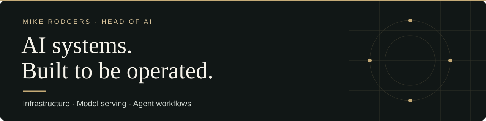

  

# Mike Rodgers

**AI leadership · Forward-deployed engineering · AI infrastructure**

I design and operate AI systems for RIG, my internal engineering environment. My work connects model serving, application integration, and the controls needed to recover when something fails.

I direct the architecture, priorities, and acceptance criteria, and use AI coding agents for implementation, diagnostics, and verification. The projects below show that work through public code and dated operational case studies.

[Email me](mailto:mrodgersjs@gmail.com) · [LinkedIn](https://www.linkedin.com/in/mike-rodgers-ai/) · [Rodgers Intelligence Group](https://rodgersintelligence.com/) · Denver

[Selected work](#selected-work) · [Fleet case studies](docs/fleet-case-studies.md) · [Capabilities by role](docs/career-capabilities.md) · [Recent receipts](#recent-receipts)

## What I bring to a team

| Your team needs | Work to explore |
| --- | --- |
| AI infrastructure that can be operated and recovered | Multi-node inference, container migration, storage verification, and service recovery. [Fleet operations](docs/fleet-case-studies.md#fleet-infrastructure-and-recovery) |
| Agents that work through real tools and applications | MCP lifecycle repairs, schema compatibility, native client checks, and account isolation. [Integration work](docs/fleet-case-studies.md#protocols-applications-and-workflows) |
| Evidence for a release decision | Testable acceptance criteria, negative tests, rollback records, and explicit incomplete results. [Public projects](#selected-work) |
| Technical direction grounded in implementation | Architecture and delivery decisions tied to operating constraints. [Role and technology map](docs/career-capabilities.md) |

## Selected work

Six public repositories, each with its own implementation and verification instructions. Open the project that matches the problem you are hiring for.

| Project | Engineering focus |
| --- | --- |
| [**rigforge**](https://github.com/mrodgersjs-web/rigforge) | Reproducible checks and evidence packets for build completion. |
| [**proof-studio**](https://github.com/mrodgersjs-web/proof-studio) | Signed completion evidence and tamper detection. |
| [**communications-studio**](https://github.com/mrodgersjs-web/communications-studio) | Explicit quality rules and acceptance gates for draft messages. |
| [**deviatrix-genesis**](https://github.com/mrodgersjs-web/deviatrix-genesis) | Staged idea development with verification and recorded evidence. |
| [**ai-user-testing-mcp**](https://github.com/mrodgersjs-web/ai-user-testing-mcp) | Tool adapters, a sandboxed runner, catalog validation, and CI in a TypeScript monorepo. |
| [**jev-route**](https://github.com/mrodgersjs-web/jev-route) | A deterministic Rust routing policy with exclusions, confidence thresholds, and fallback decisions. |

## Operating experience beyond the public repos

The October 30, 2026 audit reviewed historical RIG work across Apple Silicon hosts, a Linux GPU server, and NAS storage. Selected results include:

- **Container migration.** The migration report recorded 66 original image IDs at the destination, retained rollback data, and checked database and service behavior. Full application parity remained open.
- **MCP reliability.** A stdio lifecycle repair addressed orphaned server processes. Historical tests covered disconnects, extraction, and two LAN cycles with 21 tools exposed.
- **Inference qualification.** Separate tests covered chat, streaming, tools, continuation, embeddings, vision, and context limits. Routes that passed chat but failed tools stayed unqualified for that use.
- **QNAP storage protection.** The archive audit verified 47 application archives. Recovery testing included bounded extraction, with full application restoration still untested.

[Read the technical case studies and their evidence limits →](docs/fleet-case-studies.md)

These are internal RIG operating results. They do not establish customer production scale, continuous uptime, or current fleet health. Original operational records remain private; the case studies are sanitized summaries.

## How I work

I define what a successful result must demonstrate before implementation starts. I prefer deterministic rules where a function can make the decision, and test model behavior through the client that will use it. Changes retain rollback evidence and respect active workloads.

A configured route, a successful API request, and an accepted application workflow are different milestones. I record each separately.

## Recent receipts

The steward refreshes this block from public GitHub records. A successful run applies to the linked workflow and commit. It does not certify the private fleet or every behavior in a project.

<!-- recent_receipts starts -->
Steward score. **94/100 green**. Measured `2026-10-30`.

| Pinned system | Latest release | Latest smoke run |
| --- | --- | --- |
| [rigforge](https://github.com/mrodgersjs-web/rigforge) | [v1.1.0](https://github.com/mrodgersjs-web/rigforge/releases/tag/v1.1.0) · `2026-10-20` | [success](https://github.com/mrodgersjs-web/rigforge/actions/runs/40978301697) · `2026-10-30` · `413e511` |
| [proof-studio](https://github.com/mrodgersjs-web/proof-studio) | [v1.0.0](https://github.com/mrodgersjs-web/proof-studio/releases/tag/v1.0.0) · `2026-10-20` | [success](https://github.com/mrodgersjs-web/proof-studio/actions/runs/40977587451) · `2026-10-30` · `8f808f0` |
| [communications-studio](https://github.com/mrodgersjs-web/communications-studio) | [v11.1.0](https://github.com/mrodgersjs-web/communications-studio/releases/tag/v11.1.0) · `2026-10-20` | [success](https://github.com/mrodgersjs-web/communications-studio/actions/runs/40977564667) · `2026-10-30` · `a96f96b` |
| [deviatrix-genesis](https://github.com/mrodgersjs-web/deviatrix-genesis) | [v0.2.0](https://github.com/mrodgersjs-web/deviatrix-genesis/releases/tag/v0.2.0) · `2026-10-20` | [success](https://github.com/mrodgersjs-web/deviatrix-genesis/actions/runs/40977569733) · `2026-10-30` · `5b00262` |
| [ai-user-testing-mcp](https://github.com/mrodgersjs-web/ai-user-testing-mcp) | no release | [success](https://github.com/mrodgersjs-web/ai-user-testing-mcp/actions/runs/40980588870) · `2026-10-30` · `61b969a` |
| [jev-route](https://github.com/mrodgersjs-web/jev-route) | no release | [success](https://github.com/mrodgersjs-web/jev-route/actions/runs/40990218966) · `2026-10-30` · `394239f` |
<!-- recent_receipts ends -->

## Background

- U.S. Army Counterintelligence veteran
- B.S. Industrial Engineering, Iowa State University
- Six Sigma Black Belt
- Project Management Professional (PMP)

## Let's talk

Hiring for AI leadership, forward-deployed engineering, or AI infrastructure? [Email me](mailto:mrodgersjs@gmail.com) with the role and the system your team needs to build or improve.
