# Fleet Diagrams, Codebase Floorplans & Live Repo Demos

[Profile](../README.md) · [Capabilities by role](career-capabilities.md) · [Fleet case studies](fleet-case-studies.md)

Every visual on this page is generated from real codebases, verified inventories, and checkable receipts. All homelab and architecture diagrams use redacted placeholder networks (`10.10.x.x` / `198.51.100.0/24`) with zero private LAN IPs, ports, or secrets.

## 1. RIG AI Fleet Homelab Network Diagram

Generated with [`mrodgersjs-web/homelab-diagram`](https://github.com/mrodgersjs-web/homelab-diagram) (redacted public-safe render).

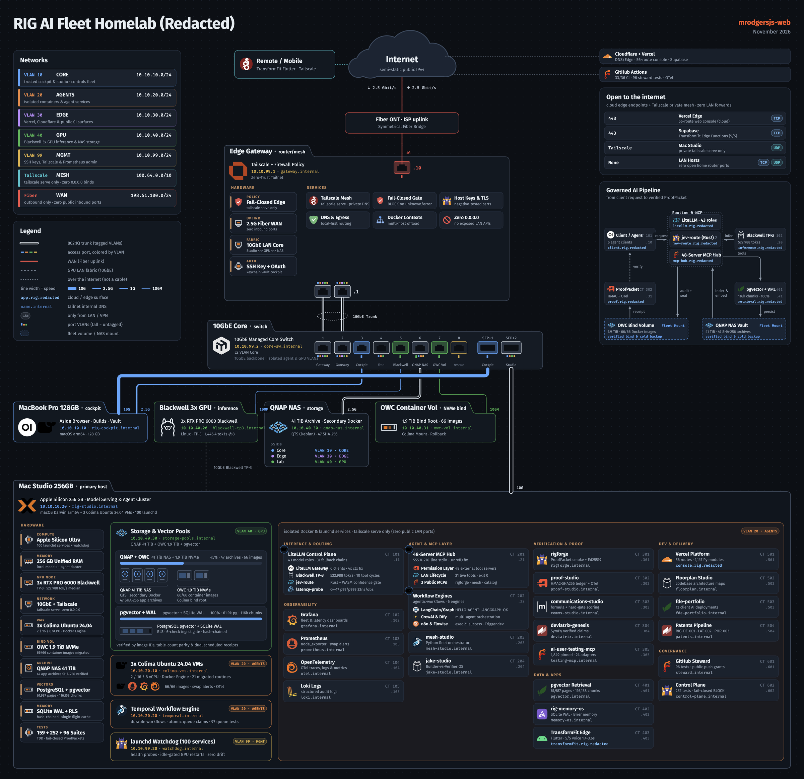

## 2. System & Delivery Architecture Diagrams

Generated with [`mrodgersjs-web/open-diagram`](https://github.com/mrodgersjs-web/open-diagram) with **0 layout problems** verified before render.

### RIG AI Control Plane (Request to Signed ProofPacket)

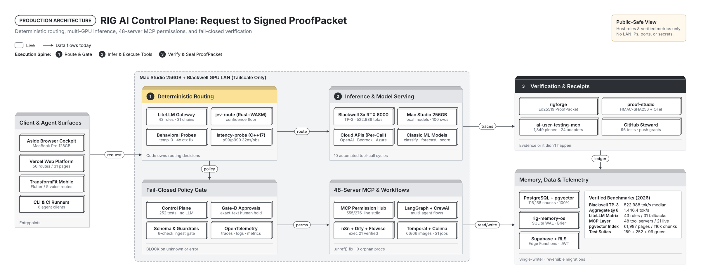

### Forward-Deployed Enterprise AI Delivery Architecture (13 Client Deployments)

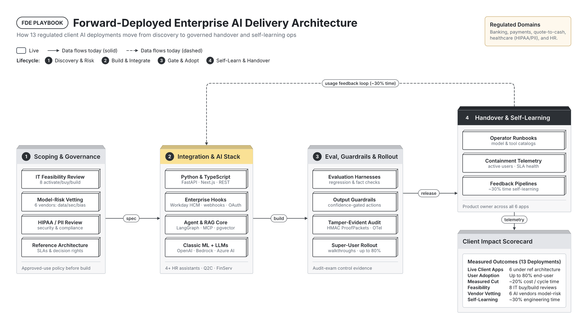

## 3. Codebase Floorplans — How Every Pinned Repo Works

Interactive codebase maps generated with Floorplan (100% file and route coverage across all 6 pinned repositories).

| Pinned Repository | Architecture Map (Floorplan) |
|---|---|
| [**rigforge**](https://github.com/mrodgersjs-web/rigforge) 73 files · 23 endpoints · 9 subsystems · Ed25519 ProofPacket CLI, MCP & Cockpit | 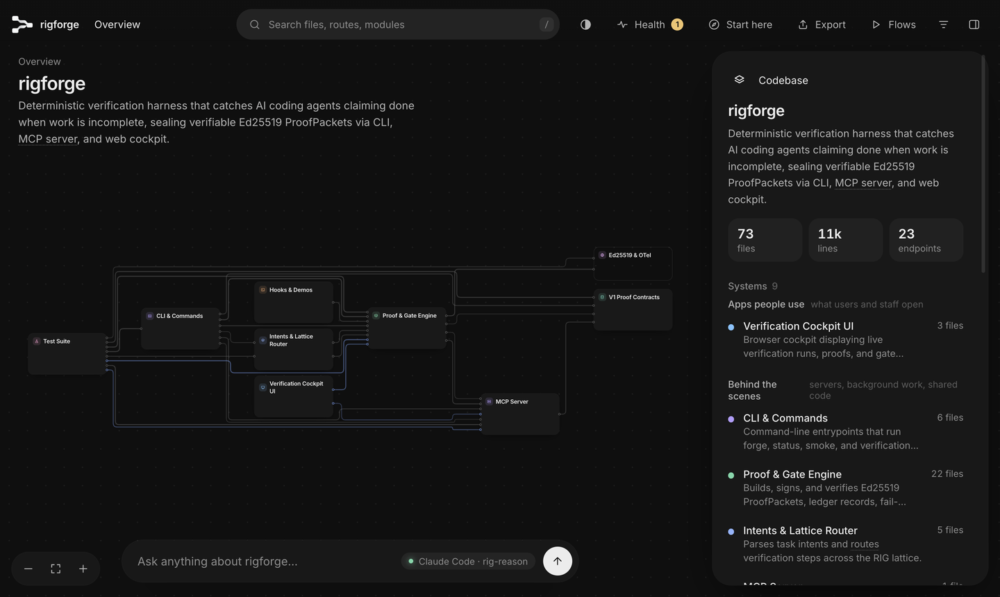 |
| [**proof-studio**](https://github.com/mrodgersjs-web/proof-studio) 81 files · 23 endpoints · 8 subsystems · HMAC-SHA256 tamper benchmarks & OTel | 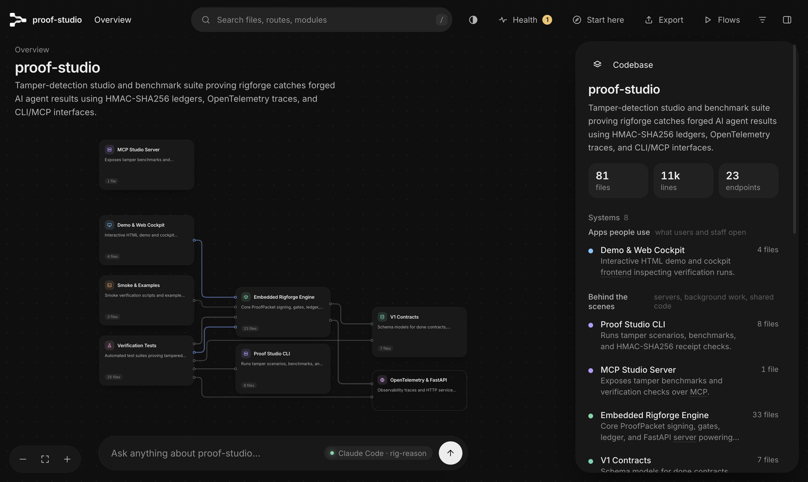 |
| [**communications-studio**](https://github.com/mrodgersjs-web/communications-studio) 40 files · 6 subsystems · Formula scoring, hard gates, tournaments & adapters | 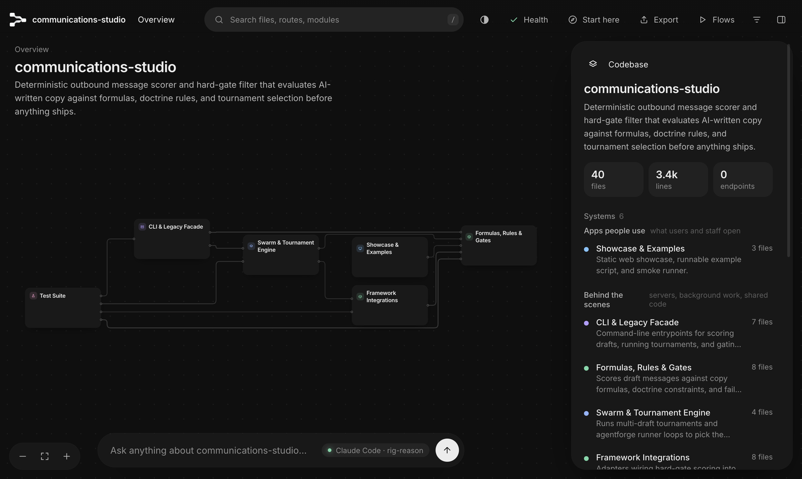 |
| [**deviatrix-genesis**](https://github.com/mrodgersjs-web/deviatrix-genesis) 89 files · 4 endpoints · 8 subsystems · Three Diamonds, SymPy MCP & V5 engine | 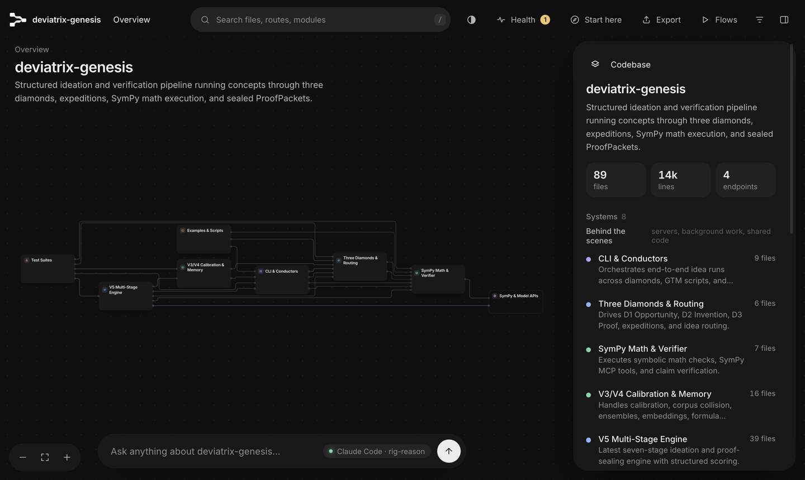 |
| [**ai-user-testing-mcp**](https://github.com/mrodgersjs-web/ai-user-testing-mcp) 163 files · 9 subsystems · 1,849 pinned resources, 24 adapters, sandbox runner | 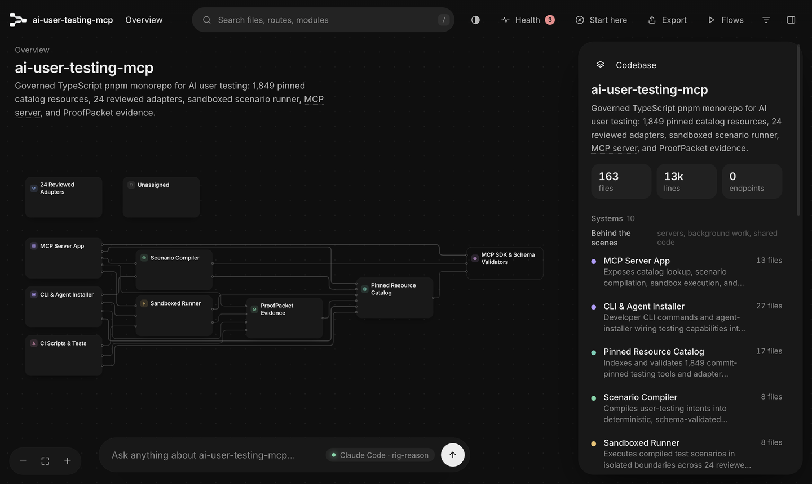 |
| [**jev-route**](https://github.com/mrodgersjs-web/jev-route) 11 files · 4 subsystems · Zero-dep Rust policy core + 4-export WASM ABI | 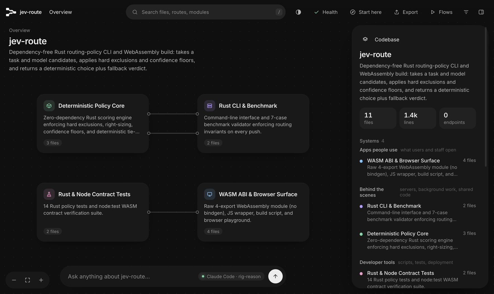 |

## 4. Animated Demos — Remaining Top Public Repositories

| Repository | Animated Architecture & Verified Smoke Run |
|---|---|
| [**mesh-studio**](https://github.com/mrodgersjs-web/mesh-studio) Python fleet orchestrator + MCP (100 launchd services, 66/66 images, 21 routines) | 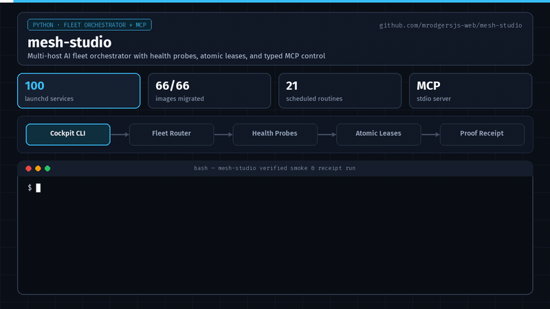 [Watch HD 720p MP4](../assets/demos/mesh-studio-demo.mp4) |
| [**jake-studio**](https://github.com/mrodgersjs-web/jake-studio) Independent Builder-vs-Verifier OS (252 control-plane tests, fail-closed gates) | 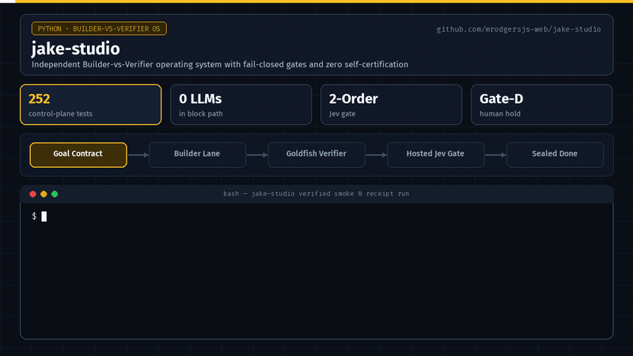 [Watch HD 720p MP4](../assets/demos/jake-studio-demo.mp4) |
| [**latency-probe**](https://github.com/mrodgersjs-web/latency-probe) Header-only C++17 p99/p999 histogram (32 ns/observe, ASan/UBSan CI) | 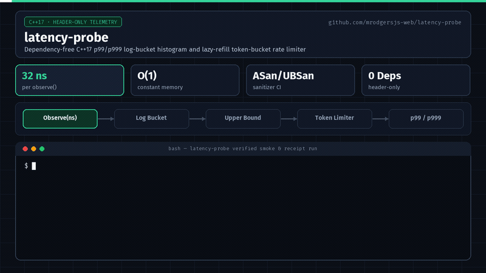 [Watch HD 720p MP4](../assets/demos/latency-probe-demo.mp4) |
| [**agentic-workflows**](https://github.com/mrodgersjs-web/agentic-workflows) 6-engine workflow router (n8n exec 21, LangGraph, CrewAI, Dify, Flowise, Trigger.dev) | 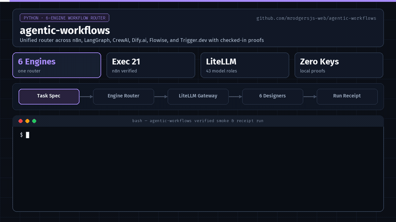 [Watch HD 720p MP4](../assets/demos/agentic-workflows-demo.mp4) |
| [**fde-portfolio**](https://github.com/mrodgersjs-web/fde-portfolio) FDE playbooks & field record (13 client deployments, 6 live apps, up to 80% adoption) | 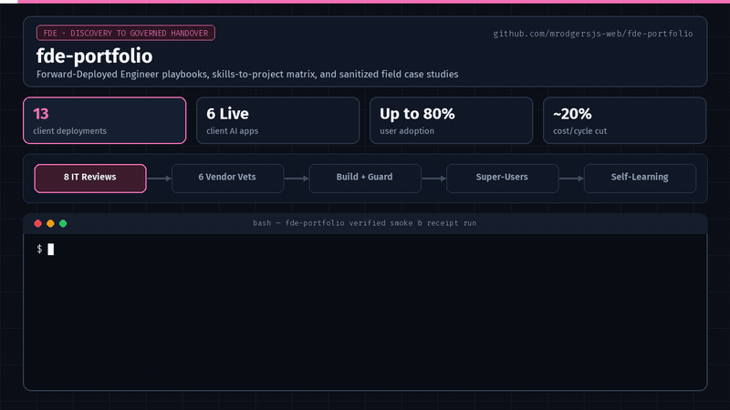 [Watch HD 720p MP4](../assets/demos/fde-portfolio-demo.mp4) |
| [**rig-os-agency**](https://github.com/mrodgersjs-web/rig-os-agency) Next.js 16 + TypeScript console (56 routes, 116k pgvector chunks, 159 test suites) |  [Watch HD 720p MP4](../assets/demos/rig-os-agency-demo.mp4) |

[Return to profile](../README.md)
