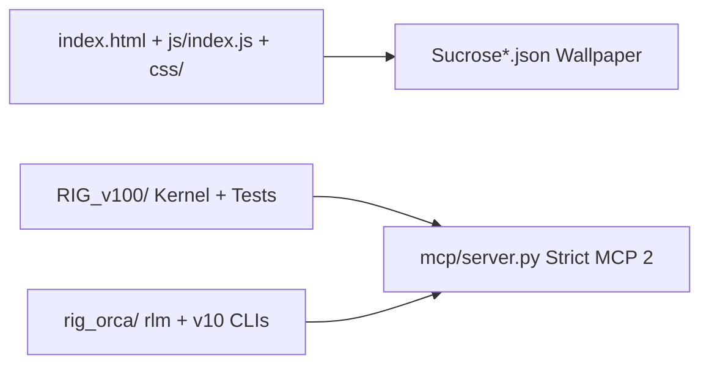

# Senior Architect Scan-Mode Note: `NeoMatrix`

## 1. Synthesis (Reader Priority — Rule 19)
- **Primary Recommendation:** Resolve the dual-purpose repo boundary by adding a root `pyproject.toml` + pytest CI for `RIG_v100`/`rig_orca` (or splitting from the legacy wallpaper assets), and commit the 3 dirty MCP 2 files.
- **MCP 2 (`2026-07-28`) Status:** `Strict MCP 2`
- **Critical / High Findings:** [High] Separation of Concerns — Unrelated Subsystems Co-located Without Root Manifest (`Root contains both static wallpaper assets (`index.html`, `SucroseCompatible.json`, `js/in`)

## 2. Pass Level, Scope & Promotion Gate
- **Pass Level:** `Scan Mode` (Rule 0 default)
- **Scope:** Repository `NeoMatrix` at `/Users/rig128gb/Developer/NeoMatrix` (`lang=Python`, `private=True`, `inManifest38=True`)
- **Focus/Full Promotion Trigger:** Focus Mode recommended — Trigger: two unrelated subsystems (legacy HTML/JS Sucrose wallpaper app + Python `RIG_v100`/`rig_orca` agent runtimes) coexist in one repository without root package manifests. Risk of staying in Scan Mode: boundary confusion and brittle dependency resolution.
- **Architecture Areas Classified:** Frontend / Browser Visual App (`index.html`, `css/`, `js/index.js`, `fonts/`, `images/`, `Sucrose*.json`); AI / Agent Runtimes (`RIG_v100/`, `rig_orca/rlm/cli.py`, `rig_orca/v10/cli.py`); MCP Surface (`mcp/server.py` Strict MCP 2); Tests & Quality Gates (`RIG_v100/tests/`, `rig_orca/tests/`, `.github/workflows/rig-lattice.yml`); Database / Package Manifests (Not observed at root)

## 3. Evidence Checked & Skipped Areas
- **Evidence Files Checked (6):** `.github/workflows/rig-lattice.yml`, `AGENTS.md`, `README.md`, `RIG_v100/docs/archetype_executors.md`, `mcp/server.py`, `openspec/changes/finish-v100-promotion-gate/design.md`
- **Root Entries:** 24 items (`.github/, .rig/, AGENTS.md, CONTRIBUTING.md, LICENSE, README.md, RIG_v100/, SucroseCompatible.json, SucroseInfo.json, SucroseProperties.json, build/, css/...`)
- **Last Commit:** `ff4b9d5 2026-10-10 17:39:02 -0600 Merge pull request #1 from mrodgersjs-web/fix/rig-lattice-skip-until-published`
- **Git Working Tree:** `3` dirty/untracked entries (`M .github/workflows/rig-lattice.yml`, `M mcp/server.py`, `M rig.repos.json`)
- **Workflows:** `.github/workflows/rig-lattice.yml`
- **MCP Files:** `mcp/server.py`
- **Existing Architecture Docs:** `AGENTS.md`, `RIG_v100/docs/archetype_executors.md`, `openspec/changes/finish-v100-promotion-gate/design.md`
- **Skipped Areas (Scan-Mode Budget):** Deep line-by-line function bodies, runtime execution, and external network/service probes (not executed in read-only Scan Mode).

## 4. Confirmed Facts (`Direct`)
- Local checkout exists at `/Users/rig128gb/Developer/NeoMatrix` (branch `master`) with 24 top-level entries and 381 sampled files (depth <= 3).
- Build/package manifests observed: Not observed.
- Top-level source/tool directories observed: `mcp/`.
- Entrypoints observed: `index.html`, `js/index.js`, `mcp/server.py`, `rig_orca/rlm/cli.py`, `rig_orca/v10/cli.py`.
- Tests observed: 12 sampled test file(s) (`RIG_v100/tests/test_kernel.py`, `RIG_v100/tests/test_live.py`, `rig_orca/tests/fixtures.py`, `rig_orca/tests/test_a1_router_probe.py`).
- MCP 2 (`2026-07-28`) status: `Strict MCP 2`.
- Committed/untracked secret-file candidates observed: None identified.

## 5. Inferences & Assumptions (`Inferred` / `Assumed`)
- Inferred: Forked from `IPdotSetAF/NeoMatrix` (Sucrose HTML/JS wallpaper) and later overlaid with RIG Python agent modules (`RIG_v100/`, `rig_orca/`) and `mcp/server.py`.

## 6. System Map (Mermaid)

## 7. Findings (Debt, Separation of Concerns, Convention Drift, Flow Conflicts, MCP 2)
- **[High | Direct] Separation of Concerns — Unrelated Subsystems Co-located Without Root Manifest**
  - *Evidence:* Root contains both static wallpaper assets (`index.html`, `SucroseCompatible.json`, `js/index.js`) and Python agent runtimes (`RIG_v100/`, `rig_orca/`, `mcp/server.py`) with no root `pyproject.toml` or `package.json`.
  - *Impact:* Unclear ownership, non-reproducible Python dependency installation, and mixed deployment/packaging boundaries.
  - *Proposed Smallest Safe Correction (Requires Approval):* Define explicit package boundary (`pyproject.toml` for `RIG_v100`/`rig_orca`) or split RIG Python runtimes into their own repo on approval.
- **[Medium | Direct] Convention Drift — Uncommitted MCP 2 & Lattice Retrofit**
  - *Evidence:* 3 dirty files: `M .github/workflows/rig-lattice.yml`, `M mcp/server.py`, `M rig.repos.json`.
  - *Impact:* Local MCP 2 updates are not committed to git history.
  - *Proposed Smallest Safe Correction (Requires Approval):* Review `git diff` and commit the 3 modified files after running `RIG_v100/tests/`.
- **[Medium | Direct] Architecture Debt — No Python Test CI Workflow**
  - *Evidence:* 12+ test files exist (`RIG_v100/tests/`, `rig_orca/tests/`) but only `rig-lattice.yml` is in `.github/workflows/`.
  - *Impact:* Existing test suite is not enforced automatically on push/PR.
  - *Proposed Smallest Safe Correction (Requires Approval):* Add a `ci.yml` workflow running pytest over `RIG_v100/tests/` and `rig_orca/tests/`.

## 8. Open Questions, Risks & Safe Next Actions
- **Open Questions:** Is the upstream Sucrose HTML/JS wallpaper still needed in this repository, or should the repo be split?
- **Risks:** Missing root `pyproject.toml` causes environment-dependent test and CLI failures.
- **Safe Next Actions (Proposed, Read-Only Until Approved):**
  - Commit the 3 dirty MCP 2 / lattice files.
  - Add `pyproject.toml` and wire existing pytest suites into CI.

## 9. Step-8 Validation Gate
1. **Claim traceability:** Yes — every file path, manifest, workflow, test file, git status count, and MCP 2 status (`Strict MCP 2`) traces directly to inspected local files at `/Users/rig128gb/Developer/NeoMatrix`; inferences and assumptions are explicitly labeled.
2. **Scope alignment:** Yes — bounded strictly to Scan Mode (Rule 0) read-only inspection of `NeoMatrix`; no files inside the target repository were modified.
3. **Handoff readiness:** Yes — open questions, risks, promotion gate status, and proposed smallest safe next actions are explicitly listed (or marked `None identified`).
