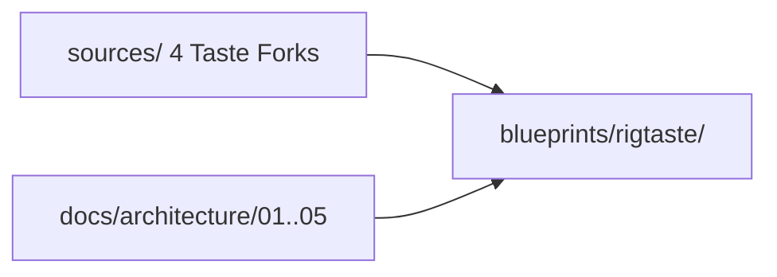

# Senior Architect Scan-Mode Note: `RIGTaste`

## 1. Synthesis (Reader Priority — Rule 19)
- **Primary Recommendation:** Complete blueprint validation and resolve the 7 dirty files before writing any runtime orchestration code.
- **MCP 2 (`2026-07-28`) Status:** `No MCP surface observed`
- **Critical / High Findings:** None identified.

## 2. Pass Level, Scope & Promotion Gate
- **Pass Level:** `Scan Mode` (Rule 0 default)
- **Scope:** Repository `RIGTaste` at `/Users/rig128gb/Developer/RIGTaste` (`lang=JavaScript`, `private=True`)
- **Focus/Full Promotion Trigger:** None (design-phase consolidation repo; 7 dirty files)
- **Architecture Areas Classified:** Documentation & Architecture (docs/architecture/01..05, blueprints/rigtaste/), Shared Sources (sources/design-taste, taste-skill, tasteful-llm, tasteful-ui-skill), Backend/Frontend/Tests (Not observed — pre-build)

## 3. Evidence Checked & Skipped Areas
- **Evidence Files Checked (1):** `README.md`
- **Root Entries:** 6 items | **Last Commit:** `2730a10 2026-11-24 20:18:01 -0700 Remove the owner's secrets path from the RIGTaste blueprint's examples and env tables` | **Dirty Files:** `7`
- **Workflows:** Not observed
- **MCP Files:** Not observed
- **Skipped Areas (Scan-Mode Budget):** Deep line-by-line module bodies, runtime execution, and external service probes (not executed in read-only Scan Mode).

## 4. Confirmed Facts (`Direct`)
- Local checkout exists at `/Users/rig128gb/Developer/RIGTaste` with 6 top-level entries.
- Build/package manifests observed: Not observed.
- Top-level code/tool directories observed: Not observed.
- Test directories observed: Not observed.
- MCP 2 (`2026-07-28`) status: `No MCP surface observed`.

## 5. Inferences & Assumptions (`Inferred` / `Assumed`)
- Inferred: Intentionally pre-build per README.md ('Nothing in those layers is built until the architecture... is approved').

## 6. System Map (Mermaid)

## 7. Findings (Debt, Separation of Concerns, Convention Drift, Flow Conflicts)
- **[Low | Direct] Convention Drift — Uncommitted Blueprint Edits**
  - *Evidence:* 7 dirty files in git status following recent secret-path removal commit 2730a10.
  - *Impact & Proposed Smallest Safe Correction:* Blueprint state not yet sealed; proposed: review and commit pending blueprint edits.

## 8. Open Questions, Risks & Safe Next Actions
- **Open Questions:** When will blueprints/rigtaste/ be promoted to implementation via /the-architect?
- **Risks:** None identified beyond pre-build status.
- **Safe Next Actions (Proposed, Read-Only Until Approved):**
  - Review git diff on the 7 dirty files and commit.

## 9. Step-8 Validation Gate
1. **Claim traceability:** Yes — every file path, manifest, workflow, test directory, and MCP 2 status (`No MCP surface observed`) traces directly to inspected local files at `/Users/rig128gb/Developer/RIGTaste`; inferences are explicitly labeled `Inferred`.
2. **Scope alignment:** Yes — bounded strictly to Scan Mode (Rule 0) read-only inspection of this single repository; no files inside the target repository were modified.
3. **Handoff readiness:** Yes — open questions, risks, and proposed smallest safe next actions are explicitly listed (or marked `None identified`).
