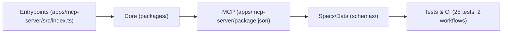

# Senior Architect Scan-Mode Note: `ai-user-testing-mcp`

## 1. Synthesis (Reader Priority — Rule 19)
- **Primary Recommendation:** Maintain current Scan-Mode baseline; no immediate architectural changes required.
- **MCP 2 (`2026-07-28`) Status:** `Strict MCP 2`
- **Critical / High Findings:** None identified.

## 2. Pass Level, Scope & Promotion Gate
- **Pass Level:** `Scan Mode` (Rule 0 default)
- **Scope:** Repository `ai-user-testing-mcp` at `/Users/rig128gb/Developer/ai-user-testing-mcp` (`lang=TypeScript`, `private=False`)
- **Focus/Full Promotion Trigger:** Focus/Full Mode candidate — 5 architecture areas, 861 files, or High/Critical findings (0).
- **Architecture Areas Classified:** Backend/CLI, AI/Agents, MCP Surface, Infrastructure, Tests & Quality Gates

## 3. Evidence Checked & Skipped Areas
- **Evidence Files Checked (37):** `README.md`, `package.json`, `apps/mcp-server/src/index.ts`, `packages/agent-installer/src/index.ts`, `packages/catalog/src/index.ts`, `packages/cli/src/index.ts`, `packages/evidence/src/index.ts`, `.github/workflows/ci.yml`, `.github/workflows/weekly-catalog-refresh.yml`, `openspec/changes/build-ai-user-testing-mcp/design.md`, `openspec/schemas/behavior-driven/templates/design.md`, `sources/nested/adrianmo/adrianmo--jmeter-backend-azure`, `apps/mcp-server/package.json`, `apps/mcp-server/scripts/gen-testdata-lock.ts`, `apps/mcp-server/src/context.ts`, `apps/mcp-server/src/errors.ts`
- **Root Entries:** 33 items | **Tracked Files:** 861 | **Last Commit:** `4176e84 2026-10-19 21:48:51 -0600 adapters: add tester-army-e2e (agentic web + iOS e2e runner) as reviewed default for browser e2e` | **Dirty Entries:** `0`
- **Workflows:** `.github/workflows/ci.yml`, `.github/workflows/weekly-catalog-refresh.yml`
- **MCP Files:** `apps/mcp-server/package.json`, `apps/mcp-server/scripts/gen-testdata-lock.ts`, `apps/mcp-server/src/context.ts`, `apps/mcp-server/src/errors.ts`, `apps/mcp-server/src/index.ts`, `apps/mcp-server/src/resources.ts`
- **Skipped Areas (Scan-Mode Budget):** Deep line-by-line module bodies, runtime execution, and external service probes (not executed in read-only Scan Mode).

## 4. Confirmed Facts (`Direct`)
- Local checkout exists at `/Users/rig128gb/Developer/ai-user-testing-mcp` on branch `main` with 33 top-level entries.
- Build/package manifests observed: `package.json`.
- Entrypoints observed: `apps/mcp-server/src/index.ts`, `packages/agent-installer/src/index.ts`, `packages/catalog/src/index.ts`, `packages/cli/src/index.ts`, `packages/evidence/src/index.ts`, `packages/runner/src/index.ts`.
- Test files/suites observed: 25 (`adapters/appium-xcuitest/adapter.json`, `adapters/appium-xcuitest/fixtures/passing.mjs`, `adapters/appium-xcuitest/fixtures/planted-failing.mjs`, `adapters/appium-xcuitest/fixtures/unavailable.mjs`).
- Existing architecture docs observed: `openspec/changes/build-ai-user-testing-mcp/design.md`, `openspec/schemas/behavior-driven/templates/design.md`, `sources/nested/adrianmo/adrianmo--jmeter-backend-azure`.
- MCP 2 (`2026-07-28`) status: `Strict MCP 2`.

## 5. Inferences & Assumptions (`Inferred` / `Assumed`)
- `Inferred`: Primary runtime behavior aligns with the observed manifests and entrypoint layout.

## 6. System Map (Mermaid)

## 7. Findings (Debt, Separation of Concerns, Convention Drift, Flow Conflicts)
- None identified.

## 8. Open Questions, Risks & Safe Next Actions
- **Open Questions:** None identified.
- **Risks:** None identified beyond standard Scan-Mode inspection limits.
- **Safe Next Actions (Proposed, Read-Only Until Approved):**
  - Run the existing test suite locally to verify baseline health.

## 9. Step-8 Validation Gate
1. **Claim traceability:** Yes — every file path, manifest, workflow, test directory, and MCP 2 status (`Strict MCP 2`) traces directly to inspected local files at `/Users/rig128gb/Developer/ai-user-testing-mcp`; inferences are explicitly labeled `Inferred`.
2. **Scope alignment:** Yes — bounded strictly to Scan Mode (Rule 0) read-only inspection of this single repository; no files inside the target repository were modified.
3. **Handoff readiness:** Yes — open questions, risks, and proposed smallest safe next actions are explicitly listed (or marked `None identified`).
