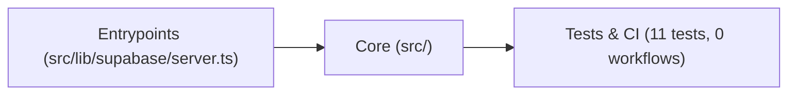

# Senior Architect Scan-Mode Note: `alex-recruiting-rebuilt`

## 1. Synthesis (Reader Priority — Rule 19)
- **Primary Recommendation:** Confirm .gitignore covers all local .env* files.
- **MCP 2 (`2026-07-28`) Status:** `No MCP surface observed`
- **Critical / High Findings:** None identified.

## 2. Pass Level, Scope & Promotion Gate
- **Pass Level:** `Scan Mode` (Rule 0 default)
- **Scope:** Repository `alex-recruiting-rebuilt` at `/Users/rig128gb/Developer/alex-recruiting-rebuilt` (`lang=TypeScript`, `private=True`)
- **Focus/Full Promotion Trigger:** Focus/Full Mode candidate — 5 architecture areas, 298 files, or High/Critical findings (0).
- **Architecture Areas Classified:** Frontend, Backend/CLI, Database, AI/Agents, Tests & Quality Gates

## 3. Evidence Checked & Skipped Areas
- **Evidence Files Checked (16):** `README.md`, `next.config.ts`, `package.json`, `tsconfig.json`, `src/lib/supabase/server.ts`, `openspec/changes/coach-evaluation-motion/design.md`, `openspec/changes/family-design-review/design.md`, `openspec/changes/recruiting-conversion/design.md`, `openspec/schemas/behavior-driven/templates/design.md`
- **Root Entries:** 31 items | **Tracked Files:** 298 | **Last Commit:** `bdd8aa4 2026-11-26 08:40:49 -0700 chore(recruit): remove 30-second football cut from film library` | **Dirty Entries:** `2`
- **Workflows:** Not observed
- **MCP Files:** Not observed
- **Skipped Areas (Scan-Mode Budget):** Deep line-by-line module bodies, runtime execution, and external service probes (not executed in read-only Scan Mode).

## 4. Confirmed Facts (`Direct`)
- Local checkout exists at `/Users/rig128gb/Developer/alex-recruiting-rebuilt` on branch `codex/jacob-family-hub-20260907` with 31 top-level entries.
- Build/package manifests observed: `next.config.ts`, `package.json`, `tsconfig.json`.
- Entrypoints observed: `src/lib/supabase/server.ts`.
- Test files/suites observed: 11 (`supabase/tests/fixtures/rollback_coach_canonical_identity.sql`, `supabase/tests/jacob_coach_canonical_identity_contract.sql`, `supabase/tests/jacob_design_feedback_contract.sql`, `supabase/tests/jacob_family_hub_contract.sql`).
- Existing architecture docs observed: `openspec/changes/coach-evaluation-motion/design.md`, `openspec/changes/family-design-review/design.md`, `openspec/changes/recruiting-conversion/design.md`, `openspec/schemas/behavior-driven/templates/design.md`.
- MCP 2 (`2026-07-28`) status: `No MCP surface observed`.

## 5. Inferences & Assumptions (`Inferred` / `Assumed`)
- `Inferred`: Untracked root env files (.env.local) are local runtime configs excluded from version control.

## 6. System Map (Mermaid)

## 7. Findings (Debt, Separation of Concerns, Convention Drift, Flow Conflicts)
- **[Low | Direct] Secret Hygiene — Local Env Files Present**
  - *Evidence:* Untracked local env files present at root: .env.local (not in git ls-files).
  - *Impact & Proposed Smallest Safe Correction:* Normal for local dev, but requires .gitignore verification so secrets are never staged. Proposed: Confirm .gitignore covers all local .env* files.
- **[Medium | Direct] Architecture Debt — Missing CI Workflow**
  - *Evidence:* No .github/workflows/ CI files observed despite executable entrypoints/manifests (next.config.ts, package.json, tsconfig.json).
  - *Impact & Proposed Smallest Safe Correction:* Changes lack automated CI verification on push/PR. Proposed: Add minimal CI workflow running tests/linting.

## 8. Open Questions, Risks & Safe Next Actions
- **Open Questions:** None identified.
- **Risks:** None identified beyond standard Scan-Mode inspection limits.
- **Safe Next Actions (Proposed, Read-Only Until Approved):**
  - Run the existing test suite locally to verify baseline health.

## 9. Step-8 Validation Gate
1. **Claim traceability:** Yes — every file path, manifest, workflow, test directory, and MCP 2 status (`No MCP surface observed`) traces directly to inspected local files at `/Users/rig128gb/Developer/alex-recruiting-rebuilt`; inferences are explicitly labeled `Inferred`.
2. **Scope alignment:** Yes — bounded strictly to Scan Mode (Rule 0) read-only inspection of this single repository; no files inside the target repository were modified.
3. **Handoff readiness:** Yes — open questions, risks, and proposed smallest safe next actions are explicitly listed (or marked `None identified`).
