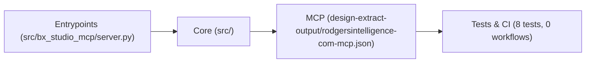

# Senior Architect Scan-Mode Note: `behavioral-science-studio`

## 1. Synthesis (Reader Priority — Rule 19)
- **Primary Recommendation:** Upgrade MCP server/client surface to Strict MCP 2 (2026-07-28) with server/discover and add rig-lattice MCP2 CI check.
- **MCP 2 (`2026-07-28`) Status:** `Legacy MCP v1 (upgrade needed)`
- **Critical / High Findings:** [High] MCP 2 Protocol Drift

## 2. Pass Level, Scope & Promotion Gate
- **Pass Level:** `Scan Mode` (Rule 0 default)
- **Scope:** Repository `behavioral-science-studio` at `/Users/rig128gb/Developer/behavioral-science-studio` (`lang=Python`, `private=True`)
- **Focus/Full Promotion Trigger:** Focus/Full Mode candidate — 5 architecture areas, 336 files, or High/Critical findings (1).
- **Architecture Areas Classified:** Backend/CLI, AI/Agents, MCP Surface, Infrastructure, Tests & Quality Gates

## 3. Evidence Checked & Skipped Areas
- **Evidence Files Checked (18):** `README.md`, `pyproject.toml`, `src/bx_studio_mcp/server.py`, `design-extract-output/rodgersintelligence-com-DESIGN.md`, `lattices/rig-offerings-mirror-20261023/influence_architecture.yaml`, `design-extract-output/rodgersintelligence-com-mcp.json`, `src/bx_studio_mcp/__init__.py`, `src/bx_studio_mcp/agui.py`, `src/bx_studio_mcp/client.py`
- **Root Entries:** 37 items | **Tracked Files:** 336 | **Last Commit:** `9456583 2026-11-03 12:40:51 -0700 A test that froze a measurement, rewritten to assert the invariant instead` | **Dirty Entries:** `36`
- **Workflows:** Not observed
- **MCP Files:** `design-extract-output/rodgersintelligence-com-mcp.json`, `src/bx_studio_mcp/__init__.py`, `src/bx_studio_mcp/agui.py`, `src/bx_studio_mcp/client.py`, `src/bx_studio_mcp/corpus.py`, `src/bx_studio_mcp/jobs_advice.py`
- **Skipped Areas (Scan-Mode Budget):** Deep line-by-line module bodies, runtime execution, and external service probes (not executed in read-only Scan Mode).

## 4. Confirmed Facts (`Direct`)
- Local checkout exists at `/Users/rig128gb/Developer/behavioral-science-studio` on branch `main` with 37 top-level entries.
- Build/package manifests observed: `pyproject.toml`.
- Entrypoints observed: `src/bx_studio_mcp/server.py`.
- Test files/suites observed: 8 (`tests/conftest.py`, `tests/test_agui.py`, `tests/test_bx_skill_family.py`, `tests/test_inspector_smoke.py`).
- Existing architecture docs observed: `design-extract-output/rodgersintelligence-com-DESIGN.md`, `lattices/rig-offerings-mirror-20261023/influence_architecture.yaml`.
- MCP 2 (`2026-07-28`) status: `Legacy MCP v1 (upgrade needed)`.

## 5. Inferences & Assumptions (`Inferred` / `Assumed`)
- `Inferred`: Primary runtime behavior aligns with the observed manifests and entrypoint layout.

## 6. System Map (Mermaid)

## 7. Findings (Debt, Separation of Concerns, Convention Drift, Flow Conflicts)
- **[High | Direct] MCP 2 Protocol Drift**
  - *Evidence:* MCP files (design-extract-output/rodgersintelligence-com-mcp.json, src/bx_studio_mcp/__init__.py, src/bx_studio_mcp/agui.py) use legacy MCP v1/FastMCP or 2024-11-05 protocol without Strict MCP 2 (2026-07-28) server/discover and _meta enforcement.
  - *Impact & Proposed Smallest Safe Correction:* Breaks forward compatibility with Strict MCP 2 hosts and lacks protocolVersion 2026-07-28 contract gating. Proposed: Upgrade MCP server/client surface to Strict MCP 2 (2026-07-28) with server/discover and add rig-lattice MCP2 CI check.
- **[Medium | Direct] Architecture Debt — Uncommitted Workspace Drift**
  - *Evidence:* Working tree has 36 uncommitted/untracked entries in git status.
  - *Impact & Proposed Smallest Safe Correction:* High uncommitted surface increases risk of drift between local state and pushed repo. Proposed: Triage, commit, or gitignore uncommitted files before handoff.
- **[Medium | Direct] Architecture Debt — Missing CI Workflow**
  - *Evidence:* No .github/workflows/ CI files observed despite executable entrypoints/manifests (pyproject.toml).
  - *Impact & Proposed Smallest Safe Correction:* Changes lack automated CI verification on push/PR. Proposed: Add minimal CI workflow running tests/linting.

## 8. Open Questions, Risks & Safe Next Actions
- **Open Questions:** What is the target timeline for migrating legacy MCP v1/FastMCP endpoints to Strict MCP 2 (`2026-07-28`)?
- **Risks:** 36 uncommitted/untracked workspace entries may diverge from remote state.
- **Safe Next Actions (Proposed, Read-Only Until Approved):**
  - Run the existing test suite locally to verify baseline health.
  - Upgrade MCP endpoints to Strict MCP 2 (`2026-07-28`) and add `rig-lattice.yml` CI verification (requires approval).
  - Review and commit or clean uncommitted local changes (requires approval).

## 9. Step-8 Validation Gate
1. **Claim traceability:** Yes — every file path, manifest, workflow, test directory, and MCP 2 status (`Legacy MCP v1 (upgrade needed)`) traces directly to inspected local files at `/Users/rig128gb/Developer/behavioral-science-studio`; inferences are explicitly labeled `Inferred`.
2. **Scope alignment:** Yes — bounded strictly to Scan Mode (Rule 0) read-only inspection of this single repository; no files inside the target repository were modified.
3. **Handoff readiness:** Yes — open questions, risks, and proposed smallest safe next actions are explicitly listed (or marked `None identified`).
