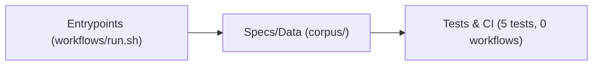

# Senior Architect Scan-Mode Note: `bravesales`

## 1. Synthesis (Reader Priority — Rule 19)
- **Primary Recommendation:** Add minimal CI workflow running tests/linting.
- **MCP 2 (`2026-07-28`) Status:** `No MCP surface observed`
- **Critical / High Findings:** None identified.

## 2. Pass Level, Scope & Promotion Gate
- **Pass Level:** `Scan Mode` (Rule 0 default)
- **Scope:** Repository `bravesales` at `/Users/rig128gb/Developer/bravesales` (`lang=JavaScript`, `private=True`)
- **Focus/Full Promotion Trigger:** Focus/Full Mode candidate — 3 architecture areas, 1810 files, or High/Critical findings (0).
- **Architecture Areas Classified:** Backend/CLI, AI/Agents, Tests & Quality Gates

## 3. Evidence Checked & Skipped Areas
- **Evidence Files Checked (21):** `README.md`, `workflows/run.sh`, `ARCHITECTURE.md`, `agents/portable-packs/derived/fred/digital-home-blueprint/SKILL.md`, `agents/portable-packs/derived/fred/digital-home-blueprint/sources.md`, `agents/portable-packs/derived/roger/marketing-engine-architecture/SKILL.md`
- **Root Entries:** 18 items | **Tracked Files:** 1810 | **Last Commit:** `b9ac247 2026-11-24 17:23:17 -0700 corpus: note the lesson notes in the classroom README` | **Dirty Entries:** `10`
- **Workflows:** Not observed
- **MCP Files:** Not observed
- **Skipped Areas (Scan-Mode Budget):** Deep line-by-line module bodies, runtime execution, and external service probes (not executed in read-only Scan Mode).

## 4. Confirmed Facts (`Direct`)
- Local checkout exists at `/Users/rig128gb/Developer/bravesales` on branch `main` with 18 top-level entries.
- Build/package manifests observed: Not observed.
- Entrypoints observed: `workflows/run.sh`.
- Test files/suites observed: 5 (`agents/portable-packs/verify-packs.test.mjs`, `corpus/bravebrand-classroom/courses/33-premium-member-vault-access-premium-tools-here/08-skill-vault-7-clients-proof/03-41-testimonial-harvest.md`, `corpus/bravebrand-classroom/courses/33-premium-member-vault-access-premium-tools-here/resources/testimonial-harvest-v1.2.zip`, `corpus/good/thumbs/070-darkmoon-ai-pentest-platform.jpg`).
- Existing architecture docs observed: `ARCHITECTURE.md`, `agents/portable-packs/derived/fred/digital-home-blueprint/SKILL.md`, `agents/portable-packs/derived/fred/digital-home-blueprint/sources.md`, `agents/portable-packs/derived/roger/marketing-engine-architecture/SKILL.md`.
- MCP 2 (`2026-07-28`) status: `No MCP surface observed`.

## 5. Inferences & Assumptions (`Inferred` / `Assumed`)
- `Inferred`: Repository functions primarily as a documentation, corpus, or script-driven workspace without a standard package manifest.

## 6. System Map (Mermaid)

## 7. Findings (Debt, Separation of Concerns, Convention Drift, Flow Conflicts)
- **[Medium | Direct] Architecture Debt — Missing CI Workflow**
  - *Evidence:* No .github/workflows/ CI files observed despite executable entrypoints/manifests (workflows/run.sh).
  - *Impact & Proposed Smallest Safe Correction:* Changes lack automated CI verification on push/PR. Proposed: Add minimal CI workflow running tests/linting.

## 8. Open Questions, Risks & Safe Next Actions
- **Open Questions:** None identified.
- **Risks:** None identified beyond standard Scan-Mode inspection limits.
- **Safe Next Actions (Proposed, Read-Only Until Approved):**
  - Run the existing test suite locally to verify baseline health.

## 9. Step-8 Validation Gate
1. **Claim traceability:** Yes — every file path, manifest, workflow, test directory, and MCP 2 status (`No MCP surface observed`) traces directly to inspected local files at `/Users/rig128gb/Developer/bravesales`; inferences are explicitly labeled `Inferred`.
2. **Scope alignment:** Yes — bounded strictly to Scan Mode (Rule 0) read-only inspection of this single repository; no files inside the target repository were modified.
3. **Handoff readiness:** Yes — open questions, risks, and proposed smallest safe next actions are explicitly listed (or marked `None identified`).
