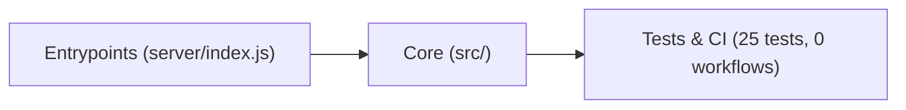

# Senior Architect Scan-Mode Note: `clients-ai-jobs`

## 1. Synthesis (Reader Priority — Rule 19)
- **Primary Recommendation:** Triage, commit, or gitignore uncommitted files before handoff.
- **MCP 2 (`2026-07-28`) Status:** `No MCP surface observed`
- **Critical / High Findings:** None identified.

## 2. Pass Level, Scope & Promotion Gate
- **Pass Level:** `Scan Mode` (Rule 0 default)
- **Scope:** Repository `clients-ai-jobs` at `/Users/rig128gb/Developer/clients-ai-jobs` (`lang=JavaScript`, `private=True`)
- **Focus/Full Promotion Trigger:** Focus/Full Mode candidate — 5 architecture areas, 649 files, or High/Critical findings (0).
- **Architecture Areas Classified:** Frontend, Backend/CLI, Database, AI/Agents, Tests & Quality Gates

## 3. Evidence Checked & Skipped Areas
- **Evidence Files Checked (23):** `README.md`, `package.json`, `tsconfig.json`, `vite.config.ts`, `server/index.js`, `MIRROR-DESIGN.md`, `docs/ARCHITECTURE-metaskill-stepskills.md`, `docs/architecture/ORCHESTRATOR.md`, `docs/architecture/PERMISSIONS.md`
- **Root Entries:** 52 items | **Tracked Files:** 649 | **Last Commit:** `bc7f8cf 2026-11-23 15:23:51 -0700 step 8: intel-page-b` | **Dirty Entries:** `28`
- **Workflows:** Not observed
- **MCP Files:** Not observed
- **Skipped Areas (Scan-Mode Budget):** Deep line-by-line module bodies, runtime execution, and external service probes (not executed in read-only Scan Mode).

## 4. Confirmed Facts (`Direct`)
- Local checkout exists at `/Users/rig128gb/Developer/clients-ai-jobs` on branch `main` with 52 top-level entries.
- Build/package manifests observed: `package.json`, `tsconfig.json`, `vite.config.ts`.
- Entrypoints observed: `server/index.js`.
- Test files/suites observed: 25 (`docs/evidence/D28-7-EVIDENCE-TEST-20261028.md`, `heartbeat/HEARTBEAT-LATEST.md`, `public/free-assets/pdfs/rig-client-intake-test-kit.pdf`, `tests/FAKE-SERVER-PROOF.json`).
- Existing architecture docs observed: `MIRROR-DESIGN.md`, `docs/ARCHITECTURE-metaskill-stepskills.md`, `docs/architecture/ORCHESTRATOR.md`, `docs/architecture/PERMISSIONS.md`.
- MCP 2 (`2026-07-28`) status: `No MCP surface observed`.

## 5. Inferences & Assumptions (`Inferred` / `Assumed`)
- `Inferred`: Primary runtime behavior aligns with the observed manifests and entrypoint layout.

## 6. System Map (Mermaid)

## 7. Findings (Debt, Separation of Concerns, Convention Drift, Flow Conflicts)
- **[Medium | Direct] Architecture Debt — Uncommitted Workspace Drift**
  - *Evidence:* Working tree has 28 uncommitted/untracked entries in git status.
  - *Impact & Proposed Smallest Safe Correction:* High uncommitted surface increases risk of drift between local state and pushed repo. Proposed: Triage, commit, or gitignore uncommitted files before handoff.
- **[Medium | Direct] Architecture Debt — Missing CI Workflow**
  - *Evidence:* No .github/workflows/ CI files observed despite executable entrypoints/manifests (package.json, tsconfig.json, vite.config.ts).
  - *Impact & Proposed Smallest Safe Correction:* Changes lack automated CI verification on push/PR. Proposed: Add minimal CI workflow running tests/linting.
- **[Low | Direct] Convention Note — Localhost MCP Client Binding**
  - *Evidence:* `.mcp.json` references local AgentsRoom HTTP endpoints (`127.0.0.1:63231`) with no in-repo MCP server.
  - *Impact & Proposed Smallest Safe Correction:* Couples local dev tooling to a fixed localhost port. Proposed: Keep `.mcp.json` documented as local-only client config.

## 8. Open Questions, Risks & Safe Next Actions
- **Open Questions:** None identified.
- **Risks:** 28 uncommitted/untracked workspace entries may diverge from remote state.
- **Safe Next Actions (Proposed, Read-Only Until Approved):**
  - Run the existing test suite locally to verify baseline health.
  - Review and commit or clean uncommitted local changes (requires approval).

## 9. Step-8 Validation Gate
1. **Claim traceability:** Yes — every file path, manifest, workflow, test directory, and MCP 2 status (`No MCP surface observed`) traces directly to inspected local files at `/Users/rig128gb/Developer/clients-ai-jobs`; inferences are explicitly labeled `Inferred`.
2. **Scope alignment:** Yes — bounded strictly to Scan Mode (Rule 0) read-only inspection of this single repository; no files inside the target repository were modified.
3. **Handoff readiness:** Yes — open questions, risks, and proposed smallest safe next actions are explicitly listed (or marked `None identified`).
