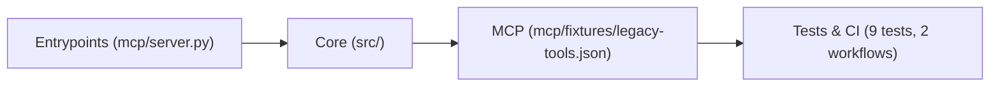

# Senior Architect Scan-Mode Note: `design-studio`

## 1. Synthesis (Reader Priority — Rule 19)
- **Primary Recommendation:** Document or consolidate `rigds_mcp/` vs `mcp/server.py` ownership.
- **MCP 2 (`2026-07-28`) Status:** `Strict MCP 2`
- **Critical / High Findings:** None identified.

## 2. Pass Level, Scope & Promotion Gate
- **Pass Level:** `Scan Mode` (Rule 0 default)
- **Scope:** Repository `design-studio` at `/Users/rig128gb/Developer/design-studio` (`lang=Python`, `private=False`)
- **Focus/Full Promotion Trigger:** Focus/Full Mode candidate — 5 architecture areas, 84 files, or High/Critical findings (0).
- **Architecture Areas Classified:** Backend/CLI, AI/Agents, MCP Surface, Infrastructure, Tests & Quality Gates

## 3. Evidence Checked & Skipped Areas
- **Evidence Files Checked (20):** `README.md`, `pyproject.toml`, `mcp/server.py`, `rigds_mcp/server.py`, `src/tokens_toolkit/cli.py`, `.github/workflows/ci.yml`, `.github/workflows/rig-lattice.yml`, `assets/architecture.svg`, `docs/architecture.md`, `skills/rig-design-studio-satori-apple/workflows/design.md`, `mcp/fixtures/legacy-tools.json`, `mcp/references/SECTION-CATALOG.md`, `mcp/test_contract.py`
- **Root Entries:** 30 items | **Tracked Files:** 84 | **Last Commit:** `63d6d8c 2026-10-20 00:24:31 -0600 fix: install tokens_toolkit from src/ so the quickstart CLI works` | **Dirty Entries:** `5`
- **Workflows:** `.github/workflows/ci.yml`, `.github/workflows/rig-lattice.yml`
- **MCP Files:** `mcp/fixtures/legacy-tools.json`, `mcp/references/SECTION-CATALOG.md`, `mcp/server.py`, `mcp/test_contract.py`, `mcp/test_wheel.py`, `rigds_mcp/__init__.py`
- **Skipped Areas (Scan-Mode Budget):** Deep line-by-line module bodies, runtime execution, and external service probes (not executed in read-only Scan Mode).

## 4. Confirmed Facts (`Direct`)
- Local checkout exists at `/Users/rig128gb/Developer/design-studio` on branch `ghup/2026-10-19` with 30 top-level entries.
- Build/package manifests observed: `pyproject.toml`.
- Entrypoints observed: `mcp/server.py`, `rigds_mcp/server.py`, `src/tokens_toolkit/cli.py`.
- Test files/suites observed: 9 (`mcp/test_contract.py`, `mcp/test_wheel.py`, `tests/conftest.py`, `tests/test_checklists.py`).
- Existing architecture docs observed: `assets/architecture.svg`, `docs/architecture.md`, `skills/rig-design-studio-satori-apple/workflows/design.md`.
- MCP 2 (`2026-07-28`) status: `Strict MCP 2`.

## 5. Inferences & Assumptions (`Inferred` / `Assumed`)
- `Inferred`: Primary runtime behavior aligns with the observed manifests and entrypoint layout.

## 6. System Map (Mermaid)

## 7. Findings (Debt, Separation of Concerns, Convention Drift, Flow Conflicts)
- **[Medium | Direct] Separation of Concerns — Dual MCP Server Surfaces**
  - *Evidence:* Both `mcp/server.py` (Strict MCP 2) and `rigds_mcp/server.py` coexist in the repository.
  - *Impact & Proposed Smallest Safe Correction:* Dual MCP server entrypoints can confuse consumers about which surface is canonical. Proposed: Document or consolidate `rigds_mcp/` vs `mcp/server.py` ownership.

## 8. Open Questions, Risks & Safe Next Actions
- **Open Questions:** None identified.
- **Risks:** None identified beyond standard Scan-Mode inspection limits.
- **Safe Next Actions (Proposed, Read-Only Until Approved):**
  - Run the existing test suite locally to verify baseline health.

## 9. Step-8 Validation Gate
1. **Claim traceability:** Yes — every file path, manifest, workflow, test directory, and MCP 2 status (`Strict MCP 2`) traces directly to inspected local files at `/Users/rig128gb/Developer/design-studio`; inferences are explicitly labeled `Inferred`.
2. **Scope alignment:** Yes — bounded strictly to Scan Mode (Rule 0) read-only inspection of this single repository; no files inside the target repository were modified.
3. **Handoff readiness:** Yes — open questions, risks, and proposed smallest safe next actions are explicitly listed (or marked `None identified`).

## Post-Upgrade MCP 2 Reconciliation (2026-11-26)

- **Status:** Upgraded from `Strict MCP 2` to **Strict MCP 2 (`2026-07-28`)** during the 2026-11-26 swarm pass and independently verified (exit `0`; see `docs/senior-architect/EVIDENCE.md`). Local changes remain staged in `blueprints/mcp2-estate-standard/GATE-D-PUSH-MANIFEST.json` (`pushed: false`, awaiting Gate-D approval).
