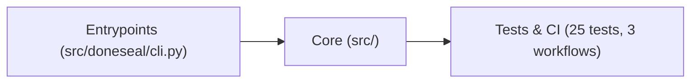

# Senior Architect Scan-Mode Note: `doneseal`

## 1. Synthesis (Reader Priority — Rule 19)
- **Primary Recommendation:** Maintain current Scan-Mode baseline; no immediate architectural changes required.
- **MCP 2 (`2026-07-28`) Status:** `No MCP surface observed`
- **Critical / High Findings:** None identified.

## 2. Pass Level, Scope & Promotion Gate
- **Pass Level:** `Scan Mode` (Rule 0 default)
- **Scope:** Repository `doneseal` at `/Users/rig128gb/Developer/doneseal` (`lang=Python`, `private=True`)
- **Focus/Full Promotion Trigger:** None identified (Scan Mode sufficient for current bounded scope).
- **Architecture Areas Classified:** Backend/CLI, Infrastructure, Tests & Quality Gates

## 3. Evidence Checked & Skipped Areas
- **Evidence Files Checked (10):** `README.md`, `pyproject.toml`, `src/doneseal/cli.py`, `.github/workflows/action-selftest.yml`, `.github/workflows/ci.yml`, `.github/workflows/release.yml`
- **Root Entries:** 15 items | **Tracked Files:** 101 | **Last Commit:** `9754ef6 2026-10-10 20:15:04 -0600 Merge pull request #2 from mrodgersjs-web/loop/2026-10-10-launch-prep` | **Dirty Entries:** `0`
- **Workflows:** `.github/workflows/action-selftest.yml`, `.github/workflows/ci.yml`, `.github/workflows/release.yml`
- **MCP Files:** Not observed
- **Skipped Areas (Scan-Mode Budget):** Deep line-by-line module bodies, runtime execution, and external service probes (not executed in read-only Scan Mode).

## 4. Confirmed Facts (`Direct`)
- Local checkout exists at `/Users/rig128gb/Developer/doneseal` on branch `main` with 15 top-level entries.
- Build/package manifests observed: `pyproject.toml`.
- Entrypoints observed: `src/doneseal/cli.py`.
- Test files/suites observed: 25 (`.github/workflows/action-selftest.yml`, `scripts/mutation_test.py`, `tests/conftest.py`, `tests/fixtures/legacy/forged-signature.json`).
- Existing architecture docs observed: Not observed.
- MCP 2 (`2026-07-28`) status: `No MCP surface observed`.

## 5. Inferences & Assumptions (`Inferred` / `Assumed`)
- `Inferred`: Primary runtime behavior aligns with the observed manifests and entrypoint layout.

## 6. System Map (Mermaid)

## 7. Findings (Debt, Separation of Concerns, Convention Drift, Flow Conflicts)
- None identified.

## 8. Open Questions, Risks & Safe Next Actions
- **Open Questions:** None identified.
- **Risks:** None identified beyond standard Scan-Mode inspection limits.
- **Safe Next Actions (Proposed, Read-Only Until Approved):**
  - Run the existing test suite locally to verify baseline health.

## 9. Step-8 Validation Gate
1. **Claim traceability:** Yes — every file path, manifest, workflow, test directory, and MCP 2 status (`No MCP surface observed`) traces directly to inspected local files at `/Users/rig128gb/Developer/doneseal`; inferences are explicitly labeled `Inferred`.
2. **Scope alignment:** Yes — bounded strictly to Scan Mode (Rule 0) read-only inspection of this single repository; no files inside the target repository were modified.
3. **Handoff readiness:** Yes — open questions, risks, and proposed smallest safe next actions are explicitly listed (or marked `None identified`).
