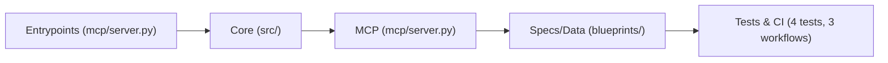

# Senior Architect Scan-Mode Note: `fde-portfolio`

## 1. Synthesis (Reader Priority — Rule 19)
- **Primary Recommendation:** Maintain current Scan-Mode baseline; no immediate architectural changes required.
- **MCP 2 (`2026-07-28`) Status:** `Strict MCP 2`
- **Critical / High Findings:** None identified.

## 2. Pass Level, Scope & Promotion Gate
- **Pass Level:** `Scan Mode` (Rule 0 default)
- **Scope:** Repository `fde-portfolio` at `/Users/rig128gb/Developer/fde-portfolio` (`lang=Python`, `private=False`)
- **Focus/Full Promotion Trigger:** Focus/Full Mode candidate — 5 architecture areas, 70 files, or High/Critical findings (0).
- **Architecture Areas Classified:** Backend/CLI, AI/Agents, MCP Surface, Infrastructure, Tests & Quality Gates

## 3. Evidence Checked & Skipped Areas
- **Evidence Files Checked (18):** `README.md`, `pyproject.toml`, `mcp/server.py`, `src/fde_portfolio/cli.py`, `.github/workflows/ci.yml`, `.github/workflows/rig-lattice.yml`, `.github/workflows/smoke.yml`, `assets/architecture.svg`, `blueprints/fde-field-record-blueprint.md`, `docs/adr/0001-evidence-tiers.md`, `docs/adr/0002-behavioral-requalification.md`
- **Root Entries:** 30 items | **Tracked Files:** 70 | **Last Commit:** `5f57d28 2026-11-24 12:38:57 -0700 docs: failure taxonomy, ADRs 0001-0003, runbook; README leads with field record, census line relabeled as ` | **Dirty Entries:** `3`
- **Workflows:** `.github/workflows/ci.yml`, `.github/workflows/rig-lattice.yml`, `.github/workflows/smoke.yml`
- **MCP Files:** `mcp/server.py`
- **Skipped Areas (Scan-Mode Budget):** Deep line-by-line module bodies, runtime execution, and external service probes (not executed in read-only Scan Mode).

## 4. Confirmed Facts (`Direct`)
- Local checkout exists at `/Users/rig128gb/Developer/fde-portfolio` on branch `aside/tier2-portfolio-20261123` with 30 top-level entries.
- Build/package manifests observed: `pyproject.toml`.
- Entrypoints observed: `mcp/server.py`, `src/fde_portfolio/cli.py`.
- Test files/suites observed: 4 (`tests/test_cli.py`, `tests/test_playbooks.py`, `tests/test_render_headings.py`, `tests/test_repo_hygiene.py`).
- Existing architecture docs observed: `assets/architecture.svg`, `blueprints/fde-field-record-blueprint.md`, `docs/adr/0001-evidence-tiers.md`, `docs/adr/0002-behavioral-requalification.md`.
- MCP 2 (`2026-07-28`) status: `Strict MCP 2`.

## 5. Inferences & Assumptions (`Inferred` / `Assumed`)
- `Inferred`: Primary runtime behavior aligns with the observed manifests and entrypoint layout.

## 6. System Map (Mermaid)

## 7. Findings (Debt, Separation of Concerns, Convention Drift, Flow Conflicts)
- None identified.

## 8. Open Questions, Risks & Safe Next Actions
- **Open Questions:** None identified.
- **Risks:** None identified beyond standard Scan-Mode inspection limits.
- **Safe Next Actions (Proposed, Read-Only Until Approved):**
  - Run the existing test suite locally to verify baseline health.

## 9. Step-8 Validation Gate
1. **Claim traceability:** Yes — every file path, manifest, workflow, test directory, and MCP 2 status (`Strict MCP 2`) traces directly to inspected local files at `/Users/rig128gb/Developer/fde-portfolio`; inferences are explicitly labeled `Inferred`.
2. **Scope alignment:** Yes — bounded strictly to Scan Mode (Rule 0) read-only inspection of this single repository; no files inside the target repository were modified.
3. **Handoff readiness:** Yes — open questions, risks, and proposed smallest safe next actions are explicitly listed (or marked `None identified`).
