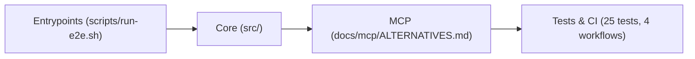

# Senior Architect Scan-Mode Note: `gbrain`

## 1. Synthesis (Reader Priority — Rule 19)
- **Primary Recommendation:** Upgrade MCP server/client surface to Strict MCP 2 (2026-07-28) with server/discover and add rig-lattice MCP2 CI check.
- **MCP 2 (`2026-07-28`) Status:** `Legacy MCP v1 (upgrade needed)`
- **Critical / High Findings:** [High] MCP 2 Protocol Drift

## 2. Pass Level, Scope & Promotion Gate
- **Pass Level:** `Scan Mode` (Rule 0 default)
- **Scope:** Repository `gbrain` at `/Users/rig128gb/Developer/gbrain` (`lang=TypeScript`, `private=True`)
- **Focus/Full Promotion Trigger:** Focus/Full Mode candidate — 5 architecture areas, 2235 files, or High/Critical findings (1).
- **Architecture Areas Classified:** Backend/CLI, AI/Agents, MCP Surface, Infrastructure, Tests & Quality Gates

## 3. Evidence Checked & Skipped Areas
- **Evidence Files Checked (65):** `README.md`, `package.json`, `tsconfig.json`, `scripts/run-e2e.sh`, `scripts/run-heavy.sh`, `scripts/run-serial-tests.sh`, `scripts/run-slow-tests.sh`, `scripts/run-unit-parallel.sh`, `.github/workflows/e2e.yml`, `.github/workflows/heavy-tests.yml`, `.github/workflows/release.yml`, `.github/workflows/test.yml`, `DESIGN.md`, `admin/DESIGN.md`, `docs/architecture/RETRIEVAL.md`, `docs/architecture/brains-and-sources.md`, `docs/mcp/ALTERNATIVES.md`, `docs/mcp/CHATGPT.md`, `docs/mcp/CLAUDE_CODE.md`, `docs/mcp/CLAUDE_COWORK.md`
- **Root Entries:** 38 items | **Tracked Files:** 2235 | **Last Commit:** `856d902 2026-09-08 23:02:41 -0600 chore(docs): regenerate llms artifacts for README banner` | **Dirty Entries:** `0`
- **Workflows:** `.github/workflows/e2e.yml`, `.github/workflows/heavy-tests.yml`, `.github/workflows/release.yml`, `.github/workflows/test.yml`
- **MCP Files:** `docs/mcp/ALTERNATIVES.md`, `docs/mcp/CHATGPT.md`, `docs/mcp/CLAUDE_CODE.md`, `docs/mcp/CLAUDE_COWORK.md`, `docs/mcp/CLAUDE_DESKTOP.md`, `docs/mcp/DEPLOY.md`
- **Skipped Areas (Scan-Mode Budget):** Deep line-by-line module bodies, runtime execution, and external service probes (not executed in read-only Scan Mode).

## 4. Confirmed Facts (`Direct`)
- Local checkout exists at `/Users/rig128gb/Developer/gbrain` on branch `master` with 38 top-level entries.
- Build/package manifests observed: `package.json`, `tsconfig.json`.
- Entrypoints observed: `scripts/run-e2e.sh`, `scripts/run-heavy.sh`, `scripts/run-serial-tests.sh`, `scripts/run-slow-tests.sh`, `scripts/run-unit-parallel.sh`, `scripts/run-unit-shard.sh`.
- Test files/suites observed: 25 (`.env.testing.example`, `.github/workflows/heavy-tests.yml`, `.github/workflows/test.yml`, `docker-compose.test.yml`).
- Existing architecture docs observed: `DESIGN.md`, `admin/DESIGN.md`, `docs/architecture/RETRIEVAL.md`, `docs/architecture/brains-and-sources.md`.
- MCP 2 (`2026-07-28`) status: `Legacy MCP v1 (upgrade needed)`.

## 5. Inferences & Assumptions (`Inferred` / `Assumed`)
- `Inferred`: Primary runtime behavior aligns with the observed manifests and entrypoint layout.

## 6. System Map (Mermaid)

## 7. Findings (Debt, Separation of Concerns, Convention Drift, Flow Conflicts)
- **[High | Direct] MCP 2 Protocol Drift**
  - *Evidence:* MCP files (docs/mcp/ALTERNATIVES.md, docs/mcp/CHATGPT.md, docs/mcp/CLAUDE_CODE.md) use legacy MCP v1/FastMCP or 2024-11-05 protocol without Strict MCP 2 (2026-07-28) server/discover and _meta enforcement.
  - *Impact & Proposed Smallest Safe Correction:* Breaks forward compatibility with Strict MCP 2 hosts and lacks protocolVersion 2026-07-28 contract gating. Proposed: Upgrade MCP server/client surface to Strict MCP 2 (2026-07-28) with server/discover and add rig-lattice MCP2 CI check.

## 8. Open Questions, Risks & Safe Next Actions
- **Open Questions:** What is the target timeline for migrating legacy MCP v1/FastMCP endpoints to Strict MCP 2 (`2026-07-28`)?
- **Risks:** Legacy MCP v1 surface may fail Strict MCP 2 host validation.
- **Safe Next Actions (Proposed, Read-Only Until Approved):**
  - Run the existing test suite locally to verify baseline health.
  - Upgrade MCP endpoints to Strict MCP 2 (`2026-07-28`) and add `rig-lattice.yml` CI verification (requires approval).

## 9. Step-8 Validation Gate
1. **Claim traceability:** Yes — every file path, manifest, workflow, test directory, and MCP 2 status (`Legacy MCP v1 (upgrade needed)`) traces directly to inspected local files at `/Users/rig128gb/Developer/gbrain`; inferences are explicitly labeled `Inferred`.
2. **Scope alignment:** Yes — bounded strictly to Scan Mode (Rule 0) read-only inspection of this single repository; no files inside the target repository were modified.
3. **Handoff readiness:** Yes — open questions, risks, and proposed smallest safe next actions are explicitly listed (or marked `None identified`).
