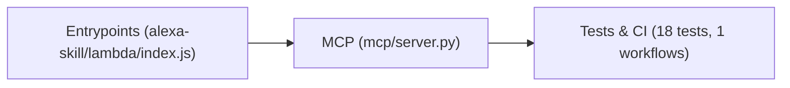

# Senior Architect Scan-Mode Note: `home-assistant-big-birch`

## 1. Synthesis (Reader Priority — Rule 19)
- **Primary Recommendation:** Confirm .gitignore covers all local .env* files.
- **MCP 2 (`2026-07-28`) Status:** `Strict MCP 2`
- **Critical / High Findings:** None identified.

## 2. Pass Level, Scope & Promotion Gate
- **Pass Level:** `Scan Mode` (Rule 0 default)
- **Scope:** Repository `home-assistant-big-birch` at `/Users/rig128gb/Developer/home-assistant-big-birch` (`lang=Python`, `private=True`)
- **Focus/Full Promotion Trigger:** Focus/Full Mode candidate — 5 architecture areas, 148 files, or High/Critical findings (0).
- **Architecture Areas Classified:** Backend/CLI, AI/Agents, MCP Surface, Infrastructure, Tests & Quality Gates

## 3. Evidence Checked & Skipped Areas
- **Evidence Files Checked (16):** `README.md`, `alexa-skill/lambda/index.js`, `big-birch-agent/app.py`, `mcp/server.py`, `.github/workflows/rig-lattice.yml`, `config/blueprints/automation/homeassistant/motion_light.yaml`, `config/blueprints/automation/homeassistant/notify_leaving_zone.yaml`, `config/blueprints/script/homeassistant/confirmable_notification.yaml`, `openspec/changes/echo-show-jarvis-v1/design.md`
- **Root Entries:** 31 items | **Tracked Files:** 148 | **Last Commit:** `db8976f 2026-10-10 17:37:35 -0600 Merge pull request #1 from mrodgersjs-web/fix/rig-lattice-skip-until-published` | **Dirty Entries:** `5`
- **Workflows:** `.github/workflows/rig-lattice.yml`
- **MCP Files:** `mcp/server.py`
- **Skipped Areas (Scan-Mode Budget):** Deep line-by-line module bodies, runtime execution, and external service probes (not executed in read-only Scan Mode).

## 4. Confirmed Facts (`Direct`)
- Local checkout exists at `/Users/rig128gb/Developer/home-assistant-big-birch` on branch `main` with 31 top-level entries.
- Build/package manifests observed: Not observed.
- Entrypoints observed: `alexa-skill/lambda/index.js`, `big-birch-agent/app.py`, `mcp/server.py`.
- Test files/suites observed: 18 (`acceptance-tests/.gherkin-lintrc`, `acceptance-tests/.gitignore`, `acceptance-tests/README.md`, `acceptance-tests/cucumber.cjs`).
- Existing architecture docs observed: `config/blueprints/automation/homeassistant/motion_light.yaml`, `config/blueprints/automation/homeassistant/notify_leaving_zone.yaml`, `config/blueprints/script/homeassistant/confirmable_notification.yaml`, `openspec/changes/echo-show-jarvis-v1/design.md`.
- MCP 2 (`2026-07-28`) status: `Strict MCP 2`.

## 5. Inferences & Assumptions (`Inferred` / `Assumed`)
- `Inferred`: Untracked root env files (.env) are local runtime configs excluded from version control.

## 6. System Map (Mermaid)

## 7. Findings (Debt, Separation of Concerns, Convention Drift, Flow Conflicts)
- **[Low | Direct] Secret Hygiene — Local Env Files Present**
  - *Evidence:* Untracked local env files present at root: .env (not in git ls-files).
  - *Impact & Proposed Smallest Safe Correction:* Normal for local dev, but requires .gitignore verification so secrets are never staged. Proposed: Confirm .gitignore covers all local .env* files.

## 8. Open Questions, Risks & Safe Next Actions
- **Open Questions:** None identified.
- **Risks:** None identified beyond standard Scan-Mode inspection limits.
- **Safe Next Actions (Proposed, Read-Only Until Approved):**
  - Run the existing test suite locally to verify baseline health.

## 9. Step-8 Validation Gate
1. **Claim traceability:** Yes — every file path, manifest, workflow, test directory, and MCP 2 status (`Strict MCP 2`) traces directly to inspected local files at `/Users/rig128gb/Developer/home-assistant-big-birch`; inferences are explicitly labeled `Inferred`.
2. **Scope alignment:** Yes — bounded strictly to Scan Mode (Rule 0) read-only inspection of this single repository; no files inside the target repository were modified.
3. **Handoff readiness:** Yes — open questions, risks, and proposed smallest safe next actions are explicitly listed (or marked `None identified`).
