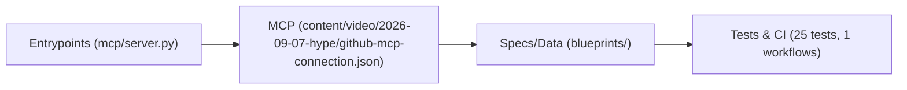

# Senior Architect Scan-Mode Note: `jacob-x-studio`

## 1. Synthesis (Reader Priority — Rule 19)
- **Primary Recommendation:** Triage, commit, or gitignore uncommitted files before handoff.
- **MCP 2 (`2026-07-28`) Status:** `Strict MCP 2`
- **Critical / High Findings:** None identified.

## 2. Pass Level, Scope & Promotion Gate
- **Pass Level:** `Scan Mode` (Rule 0 default)
- **Scope:** Repository `jacob-x-studio` at `/Users/rig128gb/Developer/jacob-x-studio` (`lang=HTML`, `private=True`)
- **Focus/Full Promotion Trigger:** Focus/Full Mode candidate — 6 architecture areas, 3320 files, or High/Critical findings (0).
- **Architecture Areas Classified:** Frontend, Backend/CLI, AI/Agents, MCP Surface, Infrastructure, Tests & Quality Gates

## 3. Evidence Checked & Skipped Areas
- **Evidence Files Checked (45):** `README.md`, `mcp/server.py`, `skills/vendor-x/x-use/src/main.py`, `skills/vendor-x/x-use/src/xuse/cli.py`, `skills/vendor-x/x-use/src/xuse/mcp/server.py`, `.github/workflows/rig-lattice.yml`, `architecture/goal-system/handoff.json`, `architecture/goal-system/jacob-growth.architecture.json`, `architecture/goal-system/jacob-growth.html`, `architecture/goal-system/jacob-growth.visual-check.1440x900.dark.png`, `content/video/2026-09-07-hype/github-mcp-connection.json`, `skills/vendor-x/x-skills/.codex-marketplace/x-skills/references/mcp-read-layer.md`, `skills/vendor-x/x-skills/.codex-marketplace/x-skills/scripts/check_mcp_mapping.py`
- **Root Entries:** 38 items | **Tracked Files:** 3320 | **Last Commit:** `77cd494 2026-10-10 20:11:11 -0600 Merge pull request #1 from mrodgersjs-web/fix/rig-lattice-skip-until-published` | **Dirty Entries:** `731`
- **Workflows:** `.github/workflows/rig-lattice.yml`
- **MCP Files:** `content/video/2026-09-07-hype/github-mcp-connection.json`, `mcp/server.py`, `skills/vendor-x/x-skills/.codex-marketplace/x-skills/references/mcp-read-layer.md`, `skills/vendor-x/x-skills/.codex-marketplace/x-skills/scripts/check_mcp_mapping.py`, `skills/vendor-x/x-skills/references/mcp-read-layer.md`, `skills/vendor-x/x-skills/scripts/check_mcp_mapping.py`
- **Skipped Areas (Scan-Mode Budget):** Deep line-by-line module bodies, runtime execution, and external service probes (not executed in read-only Scan Mode).

## 4. Confirmed Facts (`Direct`)
- Local checkout exists at `/Users/rig128gb/Developer/jacob-x-studio` on branch `main` with 38 top-level entries.
- Build/package manifests observed: Not observed.
- Entrypoints observed: `mcp/server.py`, `skills/vendor-x/x-use/src/main.py`, `skills/vendor-x/x-use/src/xuse/cli.py`, `skills/vendor-x/x-use/src/xuse/mcp/server.py`.
- Test files/suites observed: 25 (`automation/daily/test_census.py`, `automation/daily/test_coach_identity_resolver.py`, `automation/daily/test_coach_reporting.py`, `automation/daily/test_drafts.py`).
- Existing architecture docs observed: `architecture/goal-system/handoff.json`, `architecture/goal-system/jacob-growth.architecture.json`, `architecture/goal-system/jacob-growth.html`, `architecture/goal-system/jacob-growth.visual-check.1440x900.dark.png`.
- MCP 2 (`2026-07-28`) status: `Strict MCP 2`.

## 5. Inferences & Assumptions (`Inferred` / `Assumed`)
- `Inferred`: Repository functions primarily as a documentation, corpus, or script-driven workspace without a standard package manifest.

## 6. System Map (Mermaid)

## 7. Findings (Debt, Separation of Concerns, Convention Drift, Flow Conflicts)
- **[Medium | Direct] Architecture Debt — Uncommitted Workspace Drift**
  - *Evidence:* Working tree has 731 uncommitted/untracked entries in git status.
  - *Impact & Proposed Smallest Safe Correction:* High uncommitted surface increases risk of drift between local state and pushed repo. Proposed: Triage, commit, or gitignore uncommitted files before handoff.

## 8. Open Questions, Risks & Safe Next Actions
- **Open Questions:** None identified.
- **Risks:** 731 uncommitted/untracked workspace entries may diverge from remote state.
- **Safe Next Actions (Proposed, Read-Only Until Approved):**
  - Run the existing test suite locally to verify baseline health.
  - Review and commit or clean uncommitted local changes (requires approval).

## 9. Step-8 Validation Gate
1. **Claim traceability:** Yes — every file path, manifest, workflow, test directory, and MCP 2 status (`Strict MCP 2`) traces directly to inspected local files at `/Users/rig128gb/Developer/jacob-x-studio`; inferences are explicitly labeled `Inferred`.
2. **Scope alignment:** Yes — bounded strictly to Scan Mode (Rule 0) read-only inspection of this single repository; no files inside the target repository were modified.
3. **Handoff readiness:** Yes — open questions, risks, and proposed smallest safe next actions are explicitly listed (or marked `None identified`).
