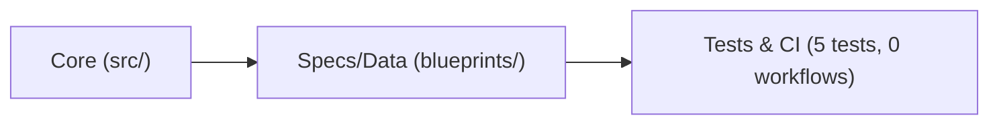

# Senior Architect Scan-Mode Note: `jacob-x-weekly`

## 1. Synthesis (Reader Priority — Rule 19)
- **Primary Recommendation:** Triage, commit, or gitignore uncommitted files before handoff.
- **MCP 2 (`2026-07-28`) Status:** `No MCP surface observed`
- **Critical / High Findings:** None identified.

## 2. Pass Level, Scope & Promotion Gate
- **Pass Level:** `Scan Mode` (Rule 0 default)
- **Scope:** Repository `jacob-x-weekly` at `/Users/rig128gb/Developer/jacob-x-weekly` (`lang=None`, `private=True`)
- **Focus/Full Promotion Trigger:** None identified (Scan Mode sufficient for current bounded scope).
- **Architecture Areas Classified:** Backend/CLI, AI/Agents, Tests & Quality Gates

## 3. Evidence Checked & Skipped Areas
- **Evidence Files Checked (11):** `README.md`, `blueprints/orchestrator-architecture/blueprint.md`, `blueprints/orchestrator-architecture/epics/E1-state.md`, `blueprints/orchestrator-architecture/epics/E2-orchestrator.md`, `blueprints/orchestrator-architecture/epics/E3-corpus-and-command.md`
- **Root Entries:** 16 items | **Tracked Files:** 38 | **Last Commit:** `9e2cb74 2026-09-14 14:47:12 -0600 ops: weekly schedule (Mon/Wed/Fri 6pm CT)` | **Dirty Entries:** `29`
- **Workflows:** Not observed
- **MCP Files:** Not observed
- **Skipped Areas (Scan-Mode Budget):** Deep line-by-line module bodies, runtime execution, and external service probes (not executed in read-only Scan Mode).

## 4. Confirmed Facts (`Direct`)
- Local checkout exists at `/Users/rig128gb/Developer/jacob-x-weekly` on branch `main` with 16 top-level entries.
- Build/package manifests observed: Not observed.
- Entrypoints observed: Not observed.
- Test files/suites observed: 5 (`tests/__init__.py`, `tests/test_corpus.py`, `tests/test_gate.py`, `tests/test_orchestrator.py`).
- Existing architecture docs observed: `blueprints/orchestrator-architecture/blueprint.md`, `blueprints/orchestrator-architecture/epics/E1-state.md`, `blueprints/orchestrator-architecture/epics/E2-orchestrator.md`, `blueprints/orchestrator-architecture/epics/E3-corpus-and-command.md`.
- MCP 2 (`2026-07-28`) status: `No MCP surface observed`.

## 5. Inferences & Assumptions (`Inferred` / `Assumed`)
- `Inferred`: Repository functions primarily as a documentation, corpus, or script-driven workspace without a standard package manifest.

## 6. System Map (Mermaid)

## 7. Findings (Debt, Separation of Concerns, Convention Drift, Flow Conflicts)
- **[Medium | Direct] Architecture Debt — Uncommitted Workspace Drift**
  - *Evidence:* Working tree has 29 uncommitted/untracked entries in git status.
  - *Impact & Proposed Smallest Safe Correction:* High uncommitted surface increases risk of drift between local state and pushed repo. Proposed: Triage, commit, or gitignore uncommitted files before handoff.

## 8. Open Questions, Risks & Safe Next Actions
- **Open Questions:** None identified.
- **Risks:** 29 uncommitted/untracked workspace entries may diverge from remote state.
- **Safe Next Actions (Proposed, Read-Only Until Approved):**
  - Run the existing test suite locally to verify baseline health.
  - Review and commit or clean uncommitted local changes (requires approval).

## 9. Step-8 Validation Gate
1. **Claim traceability:** Yes — every file path, manifest, workflow, test directory, and MCP 2 status (`No MCP surface observed`) traces directly to inspected local files at `/Users/rig128gb/Developer/jacob-x-weekly`; inferences are explicitly labeled `Inferred`.
2. **Scope alignment:** Yes — bounded strictly to Scan Mode (Rule 0) read-only inspection of this single repository; no files inside the target repository were modified.
3. **Handoff readiness:** Yes — open questions, risks, and proposed smallest safe next actions are explicitly listed (or marked `None identified`).
