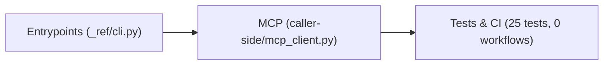

# Senior Architect Scan-Mode Note: `jake-brain-wire`

## 1. Synthesis (Reader Priority — Rule 19)
- **Primary Recommendation:** Upgrade MCP server/client surface to Strict MCP 2 (2026-07-28) with server/discover and add rig-lattice MCP2 CI check.
- **MCP 2 (`2026-07-28`) Status:** `Legacy MCP v1 (upgrade needed)`
- **Critical / High Findings:** [High] MCP 2 Protocol Drift

## 2. Pass Level, Scope & Promotion Gate
- **Pass Level:** `Scan Mode` (Rule 0 default)
- **Scope:** Repository `jake-brain-wire` at `/Users/rig128gb/rig-builds/jake-brain-wire` (`lang=Python`, `private=True`)
- **Focus/Full Promotion Trigger:** Focus/Full Mode candidate — 3 architecture areas, 358 files, or High/Critical findings (1).
- **Architecture Areas Classified:** Backend/CLI, MCP Surface, Tests & Quality Gates

## 3. Evidence Checked & Skipped Areas
- **Evidence Files Checked (15):** `_ref/cli.py`, `docs/designs/review-p1/raw/s7-design.md`, `docs/designs/review-p1r2/raw/s7-design.md`, `docs/designs/review-r3/raw/s7-design.md`, `docs/designs/review-r4/raw/s7-design.md`, `caller-side/mcp_client.py`, `evidence/w1-tmp/count_today_mcp_calls.py`, `mcp-copy/jake_brain_mcp.py`
- **Root Entries:** 31 items | **Tracked Files:** 358 | **Last Commit:** `a9a3eda 2026-11-09 17:49:05 -0600 Initial import: jake-brain-wire (consolidation 2026-11-09)` | **Dirty Entries:** `22`
- **Workflows:** Not observed
- **MCP Files:** `caller-side/mcp_client.py`, `evidence/w1-tmp/count_today_mcp_calls.py`, `mcp-copy/jake_brain_mcp.py`
- **Skipped Areas (Scan-Mode Budget):** Deep line-by-line module bodies, runtime execution, and external service probes (not executed in read-only Scan Mode).

## 4. Confirmed Facts (`Direct`)
- Local checkout exists at `/Users/rig128gb/rig-builds/jake-brain-wire` on branch `main` with 31 top-level entries.
- Build/package manifests observed: Not observed.
- Entrypoints observed: `_ref/cli.py`.
- Test files/suites observed: 25 (`caller-side/__pycache__/test_ceo_brain.cpython-311.pyc`, `caller-side/__pycache__/test_ceo_brain.cpython-312.pyc`, `caller-side/test_ceo_brain.py`, `evidence/W2-citation-tests-after.log`).
- Existing architecture docs observed: `docs/designs/review-p1/raw/s7-design.md`, `docs/designs/review-p1r2/raw/s7-design.md`, `docs/designs/review-r3/raw/s7-design.md`, `docs/designs/review-r4/raw/s7-design.md`.
- MCP 2 (`2026-07-28`) status: `Legacy MCP v1 (upgrade needed)`.

## 5. Inferences & Assumptions (`Inferred` / `Assumed`)
- `Inferred`: Repository functions primarily as a documentation, corpus, or script-driven workspace without a standard package manifest.

## 6. System Map (Mermaid)

## 7. Findings (Debt, Separation of Concerns, Convention Drift, Flow Conflicts)
- **[High | Direct] MCP 2 Protocol Drift**
  - *Evidence:* MCP files (caller-side/mcp_client.py, evidence/w1-tmp/count_today_mcp_calls.py, mcp-copy/jake_brain_mcp.py) use legacy MCP v1/FastMCP or 2024-11-05 protocol without Strict MCP 2 (2026-07-28) server/discover and _meta enforcement.
  - *Impact & Proposed Smallest Safe Correction:* Breaks forward compatibility with Strict MCP 2 hosts and lacks protocolVersion 2026-07-28 contract gating. Proposed: Upgrade MCP server/client surface to Strict MCP 2 (2026-07-28) with server/discover and add rig-lattice MCP2 CI check.
- **[Medium | Direct] Architecture Debt — Uncommitted Workspace Drift**
  - *Evidence:* Working tree has 22 uncommitted/untracked entries in git status.
  - *Impact & Proposed Smallest Safe Correction:* High uncommitted surface increases risk of drift between local state and pushed repo. Proposed: Triage, commit, or gitignore uncommitted files before handoff.
- **[Medium | Direct] Architecture Debt — Missing CI Workflow**
  - *Evidence:* No .github/workflows/ CI files observed despite executable entrypoints/manifests (_ref/cli.py).
  - *Impact & Proposed Smallest Safe Correction:* Changes lack automated CI verification on push/PR. Proposed: Add minimal CI workflow running tests/linting.

## 8. Open Questions, Risks & Safe Next Actions
- **Open Questions:** What is the target timeline for migrating legacy MCP v1/FastMCP endpoints to Strict MCP 2 (`2026-07-28`)?
- **Risks:** 22 uncommitted/untracked workspace entries may diverge from remote state.
- **Safe Next Actions (Proposed, Read-Only Until Approved):**
  - Run the existing test suite locally to verify baseline health.
  - Upgrade MCP endpoints to Strict MCP 2 (`2026-07-28`) and add `rig-lattice.yml` CI verification (requires approval).
  - Review and commit or clean uncommitted local changes (requires approval).

## 9. Step-8 Validation Gate
1. **Claim traceability:** Yes — every file path, manifest, workflow, test directory, and MCP 2 status (`Legacy MCP v1 (upgrade needed)`) traces directly to inspected local files at `/Users/rig128gb/rig-builds/jake-brain-wire`; inferences are explicitly labeled `Inferred`.
2. **Scope alignment:** Yes — bounded strictly to Scan Mode (Rule 0) read-only inspection of this single repository; no files inside the target repository were modified.
3. **Handoff readiness:** Yes — open questions, risks, and proposed smallest safe next actions are explicitly listed (or marked `None identified`).
