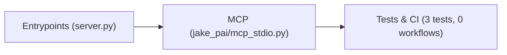

# Senior Architect Scan-Mode Note: `jake-pai-mcp`

## 1. Synthesis (Reader Priority — Rule 19)
- **Primary Recommendation:** Add minimal CI workflow running tests/linting.
- **MCP 2 (`2026-07-28`) Status:** `Strict MCP 2`
- **Critical / High Findings:** None identified.

## 2. Pass Level, Scope & Promotion Gate
- **Pass Level:** `Scan Mode` (Rule 0 default)
- **Scope:** Repository `jake-pai-mcp` at `/Users/rig128gb/Developer/jake-pai-mcp` (`lang=Python`, `private=True`)
- **Focus/Full Promotion Trigger:** None identified (Scan Mode sufficient for current bounded scope).
- **Architecture Areas Classified:** Backend/CLI, MCP Surface, Tests & Quality Gates

## 3. Evidence Checked & Skipped Areas
- **Evidence Files Checked (6):** `README.md`, `server.py`, `jake_pai/mcp_stdio.py`
- **Root Entries:** 12 items | **Tracked Files:** 20 | **Last Commit:** `73f2d5e 2026-10-01 19:50:09 -0600 fix(crew): prefer rig-tac only when run --help supports --model; omp fallback otherwise` | **Dirty Entries:** `10`
- **Workflows:** Not observed
- **MCP Files:** `jake_pai/mcp_stdio.py`, `server.py`
- **Skipped Areas (Scan-Mode Budget):** Deep line-by-line module bodies, runtime execution, and external service probes (not executed in read-only Scan Mode).

## 4. Confirmed Facts (`Direct`)
- Local checkout exists at `/Users/rig128gb/Developer/jake-pai-mcp` on branch `main` with 12 top-level entries.
- Build/package manifests observed: Not observed.
- Entrypoints observed: `server.py`.
- Test files/suites observed: 3 (`tests/smoke.py`, `tests/test_crew.py`, `tests/test_recall_args.py`).
- Existing architecture docs observed: Not observed.
- MCP 2 (`2026-07-28`) status: `Strict MCP 2`.

## 5. Inferences & Assumptions (`Inferred` / `Assumed`)
- `Inferred`: Repository functions primarily as a documentation, corpus, or script-driven workspace without a standard package manifest.

## 6. System Map (Mermaid)

## 7. Findings (Debt, Separation of Concerns, Convention Drift, Flow Conflicts)
- **[Medium | Direct] Architecture Debt — Missing CI Workflow**
  - *Evidence:* No .github/workflows/ CI files observed despite executable entrypoints/manifests (server.py).
  - *Impact & Proposed Smallest Safe Correction:* Changes lack automated CI verification on push/PR. Proposed: Add minimal CI workflow running tests/linting.

## 8. Open Questions, Risks & Safe Next Actions
- **Open Questions:** None identified.
- **Risks:** None identified beyond standard Scan-Mode inspection limits.
- **Safe Next Actions (Proposed, Read-Only Until Approved):**
  - Run the existing test suite locally to verify baseline health.

## 9. Step-8 Validation Gate
1. **Claim traceability:** Yes — every file path, manifest, workflow, test directory, and MCP 2 status (`Strict MCP 2`) traces directly to inspected local files at `/Users/rig128gb/Developer/jake-pai-mcp`; inferences are explicitly labeled `Inferred`.
2. **Scope alignment:** Yes — bounded strictly to Scan Mode (Rule 0) read-only inspection of this single repository; no files inside the target repository were modified.
3. **Handoff readiness:** Yes — open questions, risks, and proposed smallest safe next actions are explicitly listed (or marked `None identified`).
