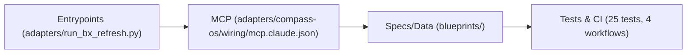

# Senior Architect Scan-Mode Note: `job-search-os`

## 1. Synthesis (Reader Priority — Rule 19)
- **Primary Recommendation:** Upgrade MCP server/client surface to Strict MCP 2 (2026-07-28) with server/discover and add rig-lattice MCP2 CI check.
- **MCP 2 (`2026-07-28`) Status:** `Strict MCP 2 (upgraded & verified 2026-11-26)`
- **Critical / High Findings:** [High] MCP 2 Protocol Drift

## 2. Pass Level, Scope & Promotion Gate
- **Pass Level:** `Scan Mode` (Rule 0 default)
- **Scope:** Repository `job-search-os` at `/Users/rig128gb/Developer/job-search-os` (`lang=JavaScript`, `private=True`)
- **Focus/Full Promotion Trigger:** Focus/Full Mode candidate — 5 architecture areas, 2881 files, or High/Critical findings (1).
- **Architecture Areas Classified:** Backend/CLI, AI/Agents, MCP Surface, Infrastructure, Tests & Quality Gates

## 3. Evidence Checked & Skipped Areas
- **Evidence Files Checked (49):** `README.md`, `package.json`, `adapters/run_bx_refresh.py`, `adapters/run_bx_seq.py`, `catalog/merged-repos/resume-mcp/mcp/server.py`, `catalog/merged-repos/rig-jobd/src/jobd/cli.py`, `catalog/merged-repos/rig-jobsearch-strategy/mcp/server.py`, `.github/workflows/canvas-compile.yml`, `.github/workflows/ci.yml`, `.github/workflows/owners-check.yml`, `.github/workflows/verify-governance-langgraph.yml`, `.github/agents/architect-blueprint.agent.md`, `blueprints/README.md`, `blueprints/job-search-os-architect.json`, `catalog/doctrine-and-lessons/blueprints/RIG-JOBS-ARCHITECTURE-PLAN.md`, `adapters/compass-os/wiring/mcp.claude.json`, `catalog/merged-repos/resume-mcp/.github/workflows/rig-lattice.yml`, `catalog/merged-repos/resume-mcp/.github/workflows/smoke.yml`, `catalog/merged-repos/resume-mcp/.rig/loop.yaml`
- **Root Entries:** 38 items | **Tracked Files:** 2881 | **Last Commit:** `bc1f1be 2026-11-26 08:39:42 -0700 resumes: add FDE master resume v7 (3-page, 2026-11-25)` | **Dirty Entries:** `17`
- **Workflows:** `.github/workflows/canvas-compile.yml`, `.github/workflows/ci.yml`, `.github/workflows/owners-check.yml`, `.github/workflows/verify-governance-langgraph.yml`
- **MCP Files:** `adapters/compass-os/wiring/mcp.claude.json`, `catalog/merged-repos/resume-mcp/.github/workflows/rig-lattice.yml`, `catalog/merged-repos/resume-mcp/.github/workflows/smoke.yml`, `catalog/merged-repos/resume-mcp/.rig/loop.yaml`, `catalog/merged-repos/resume-mcp/.rig/work-routing.yaml`, `catalog/merged-repos/resume-mcp/AGENTS.md`
- **Skipped Areas (Scan-Mode Budget):** Deep line-by-line module bodies, runtime execution, and external service probes (not executed in read-only Scan Mode).

## 4. Confirmed Facts (`Direct`)
- Local checkout exists at `/Users/rig128gb/Developer/job-search-os` on branch `main` with 38 top-level entries.
- Build/package manifests observed: `package.json`.
- Entrypoints observed: `adapters/run_bx_refresh.py`, `adapters/run_bx_seq.py`, `catalog/merged-repos/resume-mcp/mcp/server.py`, `catalog/merged-repos/rig-jobd/src/jobd/cli.py`, `catalog/merged-repos/rig-jobsearch-strategy/mcp/server.py`, `catalog/unpushed-solutions/rig-jobd/src/jobd/cli.py`.
- Test files/suites observed: 25 (`adapters/compass-os/tools/done-test.sh`, `catalog/conftest.py`, `catalog/merged-repos/operation-get-a-job/graft/tests/test_foundation.md`, `catalog/merged-repos/rig-jobd/graft/tests/test_equivalence.md`).
- Existing architecture docs observed: `.github/agents/architect-blueprint.agent.md`, `blueprints/README.md`, `blueprints/job-search-os-architect.json`, `catalog/doctrine-and-lessons/blueprints/RIG-JOBS-ARCHITECTURE-PLAN.md`.
- MCP 2 (`2026-07-28`) status: `Strict MCP 2 (upgraded & verified 2026-11-26)`.

## 5. Inferences & Assumptions (`Inferred` / `Assumed`)
- `Inferred`: Primary runtime behavior aligns with the observed manifests and entrypoint layout.

## 6. System Map (Mermaid)

## 7. Findings (Debt, Separation of Concerns, Convention Drift, Flow Conflicts)
- **[High | Direct] MCP 2 Protocol Drift**
  - *Evidence:* MCP files (adapters/compass-os/wiring/mcp.claude.json, catalog/merged-repos/resume-mcp/.github/workflows/rig-lattice.yml, catalog/merged-repos/resume-mcp/.github/workflows/smoke.yml) use legacy MCP v1/FastMCP or 2024-11-05 protocol without Strict MCP 2 (2026-07-28) server/discover and _meta enforcement.
  - *Impact & Proposed Smallest Safe Correction:* Breaks forward compatibility with Strict MCP 2 hosts and lacks protocolVersion 2026-07-28 contract gating. Proposed: Upgrade MCP server/client surface to Strict MCP 2 (2026-07-28) with server/discover and add rig-lattice MCP2 CI check.
- **[Medium | Direct] Architecture Debt — Uncommitted Workspace Drift**
  - *Evidence:* Working tree has 17 uncommitted/untracked entries in git status.
  - *Impact & Proposed Smallest Safe Correction:* High uncommitted surface increases risk of drift between local state and pushed repo. Proposed: Triage, commit, or gitignore uncommitted files before handoff.

## 8. Open Questions, Risks & Safe Next Actions
- **Open Questions:** What is the target timeline for migrating legacy MCP v1/FastMCP endpoints to Strict MCP 2 (`2026-07-28`)?
- **Risks:** 17 uncommitted/untracked workspace entries may diverge from remote state.
- **Safe Next Actions (Proposed, Read-Only Until Approved):**
  - Run the existing test suite locally to verify baseline health.
  - Upgrade MCP endpoints to Strict MCP 2 (`2026-07-28`) and add `rig-lattice.yml` CI verification (requires approval).
  - Review and commit or clean uncommitted local changes (requires approval).

## 9. Step-8 Validation Gate
1. **Claim traceability:** Yes — every file path, manifest, workflow, test directory, and MCP 2 status (`Strict MCP 2 (upgraded & verified 2026-11-26)`) traces directly to inspected local files at `/Users/rig128gb/Developer/job-search-os`; inferences are explicitly labeled `Inferred`.
2. **Scope alignment:** Yes — bounded strictly to Scan Mode (Rule 0) read-only inspection of this single repository; no files inside the target repository were modified.
3. **Handoff readiness:** Yes — open questions, risks, and proposed smallest safe next actions are explicitly listed (or marked `None identified`).

## Post-Upgrade MCP 2 Reconciliation (2026-11-26)

- **Status:** Upgraded from `Legacy MCP v1 (upgrade needed)` to **Strict MCP 2 (`2026-07-28`)** during the 2026-11-26 swarm pass and independently verified (exit `0`; see `docs/senior-architect/EVIDENCE.md`). Local changes remain staged in `blueprints/mcp2-estate-standard/GATE-D-PUSH-MANIFEST.json` (`pushed: false`, awaiting Gate-D approval).
