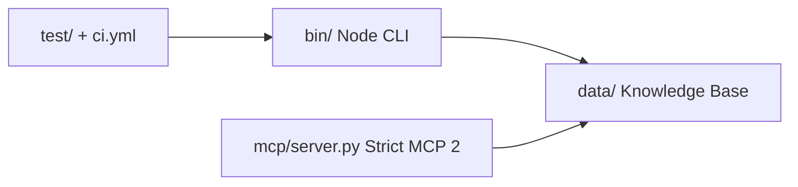

# Senior Architect Scan-Mode Note: `mrodgersjs-web-teammate`

## 1. Synthesis (Reader Priority — Rule 19)
- **Primary Recommendation:** Review and seal the 3 uncommitted MCP 2 / lattice retrofit files (`mcp/server.py`, `rig-lattice.yml`, `rig.repos.json`) after running the `test/` suite.
- **MCP 2 (`2026-07-28`) Status:** `Strict MCP 2`
- **Critical / High Findings:** None identified.

## 2. Pass Level, Scope & Promotion Gate
- **Pass Level:** `Scan Mode` (Rule 0 default)
- **Scope:** Repository `mrodgersjs-web-teammate` at `/Users/rig128gb/Developer/mrodgersjs-web-teammate` (`lang=JavaScript`, `private=False`, `inManifest38=True`)
- **Focus/Full Promotion Trigger:** None (bounded zero-dependency CLI + Strict MCP 2 server; Scan Mode sufficient)
- **Architecture Areas Classified:** CLI / Backend (bin/ zero-dependency Node CLI); Data / Knowledge Base (data/); AI / MCP Surface (mcp/server.py Strict MCP 2); Tests & Quality Gates (test/, ci.yml, rig-lattice.yml); Documentation (docs/architecture.md, AGENTS.md); Frontend / Database (Not observed)

## 3. Evidence Checked & Skipped Areas
- **Evidence Files Checked (7):** `.github/workflows/ci.yml`, `.github/workflows/rig-lattice.yml`, `AGENTS.md`, `README.md`, `docs/architecture.md`, `mcp/server.py`, `package.json`
- **Root Entries:** 20 items (`.github/, .gitignore, .rig/, AGENTS.md, CHANGELOG.md, CITATION.cff, CODE_OF_CONDUCT.md, LICENSE, README.md, assets/, bin/, data/...`)
- **Last Commit:** `b4c5d2e 2026-10-19 23:59:54 -0600 chore: repository hygiene checks, CI timeouts, and doc truth fixes`
- **Git Working Tree:** `3` dirty/untracked entries (`M .github/workflows/rig-lattice.yml`, `M mcp/server.py`, `M rig.repos.json`)
- **Workflows:** `.github/workflows/ci.yml`, `.github/workflows/rig-lattice.yml`
- **MCP Files:** `mcp/server.py`
- **Existing Architecture Docs:** `AGENTS.md`, `docs/architecture.md`
- **Skipped Areas (Scan-Mode Budget):** Deep line-by-line function bodies, runtime execution, and external network/service probes (not executed in read-only Scan Mode).

## 4. Confirmed Facts (`Direct`)
- Local checkout exists at `/Users/rig128gb/Developer/mrodgersjs-web-teammate` (branch `ghup/2026-10-19`) with 20 top-level entries and 34 sampled files (depth <= 3).
- Build/package manifests observed: `package.json`.
- Top-level source/tool directories observed: `bin/`, `mcp/`.
- Entrypoints observed: `mcp/server.py`.
- Tests observed: 5 sampled test file(s) (`test/cli.test.js`, `test/help.test.js`, `test/lockfile.test.js`, `test/repo-hygiene.test.js`).
- MCP 2 (`2026-07-28`) status: `Strict MCP 2`.
- Committed/untracked secret-file candidates observed: None identified.

## 5. Inferences & Assumptions (`Inferred` / `Assumed`)
- Inferred: `bin/` CLI reads bundled knowledge assets from `data/` while `mcp/server.py` exposes the same repo surface over Strict MCP 2 (`2026-07-28`) stdio.
- Assumed: The 3 dirty files (`mcp/server.py`, `.github/workflows/rig-lattice.yml`, `rig.repos.json`) are part of an in-flight MCP 2 / lattice retrofit.

## 6. System Map (Mermaid)

## 7. Findings (Debt, Separation of Concerns, Convention Drift, Flow Conflicts, MCP 2)
- **[Medium | Direct] Convention Drift — Uncommitted MCP 2 & Lattice Retrofit**
  - *Evidence:* 3 dirty files in git status: `M .github/workflows/rig-lattice.yml`, `M mcp/server.py`, `M rig.repos.json`.
  - *Impact:* Local Strict MCP 2 server and CI workflow changes are unsealed and can diverge from remote `origin`.
  - *Proposed Smallest Safe Correction (Requires Approval):* Review `git diff` on the 3 files, run `test/` suite, and commit/push on approval.
- **[Low | Direct] Architecture Debt — Polyglot Runtime Split (Node CLI + Python MCP)**
  - *Evidence:* `package.json` + `bin/` + `test/*.test.js` (JavaScript) alongside `mcp/server.py` (Python) with no `pyproject.toml`.
  - *Impact:* Contributors must maintain both Node and Python runtimes for a single small utility repo.
  - *Proposed Smallest Safe Correction (Requires Approval):* Document the Python stdlib-only requirement for `mcp/server.py` in `docs/architecture.md` or add a lightweight smoke check in `ci.yml`.

## 8. Open Questions, Risks & Safe Next Actions
- **Open Questions:** Should `mcp/server.py` remain Python stdlib or be consolidated into Node alongside `bin/`?
- **Risks:** Uncommitted changes to `mcp/server.py` and `rig-lattice.yml` risk being overwritten during fleet syncs.
- **Safe Next Actions (Proposed, Read-Only Until Approved):**
  - Review and commit the 3 pending MCP 2 / lattice retrofit files after running `test/`.

## 9. Step-8 Validation Gate
1. **Claim traceability:** Yes — every file path, manifest, workflow, test file, git status count, and MCP 2 status (`Strict MCP 2`) traces directly to inspected local files at `/Users/rig128gb/Developer/mrodgersjs-web-teammate`; inferences and assumptions are explicitly labeled.
2. **Scope alignment:** Yes — bounded strictly to Scan Mode (Rule 0) read-only inspection of `mrodgersjs-web-teammate`; no files inside the target repository were modified.
3. **Handoff readiness:** Yes — open questions, risks, promotion gate status, and proposed smallest safe next actions are explicitly listed (or marked `None identified`).
