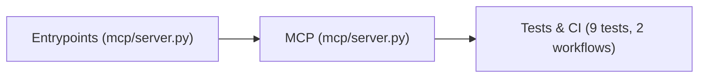

# Senior Architect Scan-Mode Note: `mrodgersjs-web`

## 1. Synthesis (Reader Priority — Rule 19)
- **Primary Recommendation:** Upgrade MCP server/client surface to Strict MCP 2 (2026-07-28) with server/discover and add rig-lattice MCP2 CI check.
- **MCP 2 (`2026-07-28`) Status:** `Legacy MCP v1 (upgrade needed)`
- **Critical / High Findings:** [High] MCP 2 Protocol Drift

## 2. Pass Level, Scope & Promotion Gate
- **Pass Level:** `Scan Mode` (Rule 0 default)
- **Scope:** Repository `mrodgersjs-web` at `/Users/rig128gb/Developer/mrodgersjs-web-profile` (`lang=HTML`, `private=False`)
- **Focus/Full Promotion Trigger:** Focus/Full Mode candidate — 5 architecture areas, 2513 files, or High/Critical findings (1).
- **Architecture Areas Classified:** Frontend, Backend/CLI, MCP Surface, Infrastructure, Tests & Quality Gates

## 3. Evidence Checked & Skipped Areas
- **Evidence Files Checked (13):** `README.md`, `mcp/server.py`, `.github/workflows/rig-lattice.yml`, `.github/workflows/steward.yml`, `assets/architecture.svg`, `systems-thinking/studio/architecture.md`, `systems-thinking/workspace/docs/systems-thinking-2026-08-29/harness-playbook.architecture.json`, `steward/catalog_mcp.py`, `steward/test_catalog_mcp.py`
- **Root Entries:** 15 items | **Tracked Files:** 2513 | **Last Commit:** `9559e51 2026-11-23 22:45:36 -0700 docs: name cloud and workflow tools at their evidence tier` | **Dirty Entries:** `0`
- **Workflows:** `.github/workflows/rig-lattice.yml`, `.github/workflows/steward.yml`
- **MCP Files:** `mcp/server.py`, `steward/catalog_mcp.py`, `steward/test_catalog_mcp.py`
- **Skipped Areas (Scan-Mode Budget):** Deep line-by-line module bodies, runtime execution, and external service probes (not executed in read-only Scan Mode).

## 4. Confirmed Facts (`Direct`)
- Local checkout exists at `/Users/rig128gb/Developer/mrodgersjs-web-profile` on branch `main` with 15 top-level entries.
- Build/package manifests observed: Not observed.
- Entrypoints observed: `mcp/server.py`.
- Test files/suites observed: 9 (`steward/scoreboard/latest.json`, `steward/test_build_readme.py`, `steward/test_catalog_mcp.py`, `steward/test_repo_scorecard.py`).
- Existing architecture docs observed: `assets/architecture.svg`, `systems-thinking/studio/architecture.md`, `systems-thinking/workspace/docs/systems-thinking-2026-08-29/harness-playbook.architecture.json`.
- MCP 2 (`2026-07-28`) status: `Legacy MCP v1 (upgrade needed)`.

## 5. Inferences & Assumptions (`Inferred` / `Assumed`)
- `Inferred`: Repository functions primarily as a documentation, corpus, or script-driven workspace without a standard package manifest.

## 6. System Map (Mermaid)

## 7. Findings (Debt, Separation of Concerns, Convention Drift, Flow Conflicts)
- **[High | Direct] MCP 2 Protocol Drift**
  - *Evidence:* MCP files (mcp/server.py, steward/catalog_mcp.py, steward/test_catalog_mcp.py) use legacy MCP v1/FastMCP or 2024-11-05 protocol without Strict MCP 2 (2026-07-28) server/discover and _meta enforcement.
  - *Impact & Proposed Smallest Safe Correction:* Breaks forward compatibility with Strict MCP 2 hosts and lacks protocolVersion 2026-07-28 contract gating. Proposed: Upgrade MCP server/client surface to Strict MCP 2 (2026-07-28) with server/discover and add rig-lattice MCP2 CI check.

## 8. Open Questions, Risks & Safe Next Actions
- **Open Questions:** What is the target timeline for migrating legacy MCP v1/FastMCP endpoints to Strict MCP 2 (`2026-07-28`)?
- **Risks:** Legacy MCP v1 surface may fail Strict MCP 2 host validation.
- **Safe Next Actions (Proposed, Read-Only Until Approved):**
  - Run the existing test suite locally to verify baseline health.
  - Upgrade MCP endpoints to Strict MCP 2 (`2026-07-28`) and add `rig-lattice.yml` CI verification (requires approval).

## 9. Step-8 Validation Gate
1. **Claim traceability:** Yes — every file path, manifest, workflow, test directory, and MCP 2 status (`Legacy MCP v1 (upgrade needed)`) traces directly to inspected local files at `/Users/rig128gb/Developer/mrodgersjs-web-profile`; inferences are explicitly labeled `Inferred`.
2. **Scope alignment:** Yes — bounded strictly to Scan Mode (Rule 0) read-only inspection of this single repository; no files inside the target repository were modified.
3. **Handoff readiness:** Yes — open questions, risks, and proposed smallest safe next actions are explicitly listed (or marked `None identified`).
