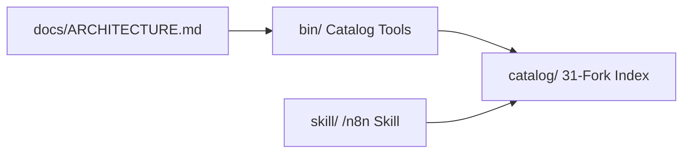

# Senior Architect Scan-Mode Note: `n8n`

## 1. Synthesis (Reader Priority — Rule 19)
- **Primary Recommendation:** Add a lightweight catalog-integrity smoke test and GitHub Actions workflow to prevent index or skill drift across the 31 merged forks.
- **MCP 2 (`2026-07-28`) Status:** `No MCP surface observed`
- **Critical / High Findings:** None identified.

## 2. Pass Level, Scope & Promotion Gate
- **Pass Level:** `Scan Mode` (Rule 0 default)
- **Scope:** Repository `n8n` at `/Users/rig128gb/Developer/n8n` (`lang=None`, `private=False`, `inManifest38=False`)
- **Focus/Full Promotion Trigger:** None (clean catalog and skill distribution repo with existing `docs/ARCHITECTURE.md`)
- **Architecture Areas Classified:** Catalog & Data (catalog/ merged 31-fork index); CLI / Tooling (bin/); Skills & Docs (skill/, docs/ARCHITECTURE.md); Backend / Frontend / Database / Tests / CI (Not observed)

## 3. Evidence Checked & Skipped Areas
- **Evidence Files Checked (2):** `README.md`, `docs/ARCHITECTURE.md`
- **Root Entries:** 5 items (`README.md, bin/, catalog/, docs/, skill/`)
- **Last Commit:** `59bc7d0 2026-11-25 10:02:26 -0700 Add /n8n skill, arch scan note, URL fix, drop metadata JSON`
- **Git Working Tree:** `0` dirty/untracked entries (clean)
- **Workflows:** Not observed
- **MCP Files:** Not observed
- **Existing Architecture Docs:** `docs/ARCHITECTURE.md`
- **Skipped Areas (Scan-Mode Budget):** Deep line-by-line function bodies, runtime execution, and external network/service probes (not executed in read-only Scan Mode).

## 4. Confirmed Facts (`Direct`)
- Local checkout exists at `/Users/rig128gb/Developer/n8n` (branch `main`) with 5 top-level entries and 7 sampled files (depth <= 3).
- Build/package manifests observed: Not observed.
- Top-level source/tool directories observed: `bin/`.
- Entrypoints observed: Not observed.
- Tests observed: Not observed.
- MCP 2 (`2026-07-28`) status: `No MCP surface observed`.
- Committed/untracked secret-file candidates observed: None identified.

## 5. Inferences & Assumptions (`Inferred` / `Assumed`)
- Inferred: `bin/` scripts query or refresh `catalog/` entries indexing the 31 `mrodgersjs-web/n8n-os-*` forks, while `skill/` packages the `/n8n` Aside skill.

## 6. System Map (Mermaid)

## 7. Findings (Debt, Separation of Concerns, Convention Drift, Flow Conflicts, MCP 2)
- **[Medium | Direct] Architecture Debt — Missing Automated Validation & CI**
  - *Evidence:* No test files (`tests: 0`) and no `.github/workflows/` observed at repo root.
  - *Impact:* Broken catalog indexes or malformed skill frontmatter can be committed without automated checks.
  - *Proposed Smallest Safe Correction (Requires Approval):* Add a lightweight smoke test and CI workflow validating `catalog/` integrity and `bin/` execution.

## 8. Open Questions, Risks & Safe Next Actions
- **Open Questions:** Is `catalog/` regenerated on a schedule or manually when upstream `n8n-os-*` forks update?
- **Risks:** Catalog drift against the 31 upstream forks without automated validation.
- **Safe Next Actions (Proposed, Read-Only Until Approved):**
  - Add a minimal catalog/schema smoke test and CI workflow.

## 9. Step-8 Validation Gate
1. **Claim traceability:** Yes — every file path, manifest, workflow, test file, git status count, and MCP 2 status (`No MCP surface observed`) traces directly to inspected local files at `/Users/rig128gb/Developer/n8n`; inferences and assumptions are explicitly labeled.
2. **Scope alignment:** Yes — bounded strictly to Scan Mode (Rule 0) read-only inspection of `n8n`; no files inside the target repository were modified.
3. **Handoff readiness:** Yes — open questions, risks, promotion gate status, and proposed smallest safe next actions are explicitly listed (or marked `None identified`).
