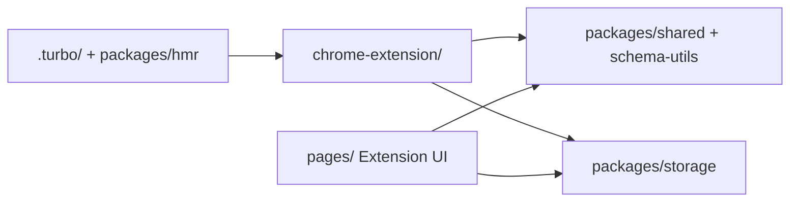

# Senior Architect Scan-Mode Note: `nanobrowser`

## 1. Synthesis (Reader Priority — Rule 19)
- **Primary Recommendation:** Promote to Focus Mode before code changes; add a build/typecheck CI workflow, consolidate duplicate env templates (`.env.example` vs `.example.env`), and commit the 2 dirty governance files.
- **MCP 2 (`2026-07-28`) Status:** `No MCP surface observed`
- **Critical / High Findings:** None identified.

## 2. Pass Level, Scope & Promotion Gate
- **Pass Level:** `Scan Mode` (Rule 0 default)
- **Scope:** Repository `nanobrowser` at `/Users/rig128gb/Developer/nanobrowser` (`lang=TypeScript`, `private=True`, `inManifest38=True`)
- **Focus/Full Promotion Trigger:** Focus Mode recommended before feature work — Trigger: multi-package browser extension monorepo (`chrome-extension/`, `pages/`, 6+ `packages/*`) with no observed test suite and 2 dirty governance files. Risk of staying in Scan Mode: silent regressions across extension background/storage/UI boundaries.
- **Architecture Areas Classified:** Frontend / Browser Extension (`chrome-extension/`, `pages/`); Shared Modules (`packages/dev-utils`, `hmr`, `i18n`, `schema-utils`, `shared`, `storage`); Build / Infrastructure (`package.json`, `.turbo/`, `.husky/`, `.github/workflows/rig-lattice.yml`); Backend / Database / Tests / MCP (Not observed)

## 3. Evidence Checked & Skipped Areas
- **Evidence Files Checked (5):** `.github/workflows/rig-lattice.yml`, `AGENTS.md`, `CLAUDE.md`, `README.md`, `package.json`
- **Root Entries:** 36 items (`.env.example, .eslintignore, .eslintrc, .example.env, .gitattributes, .github/, .gitignore, .husky/, .npmrc, .nvmrc, .prettierignore, .prettierrc...`)
- **Last Commit:** `370dac5 2026-10-10 17:35:45 -0600 Merge pull request #1 from mrodgersjs-web/fix/rig-lattice-skip-until-published`
- **Git Working Tree:** `2` dirty/untracked entries (`M .github/workflows/rig-lattice.yml`, `M rig.repos.json`)
- **Workflows:** `.github/workflows/rig-lattice.yml`
- **MCP Files:** Not observed
- **Existing Architecture Docs:** `AGENTS.md`, `CLAUDE.md`
- **Skipped Areas (Scan-Mode Budget):** Deep line-by-line function bodies, runtime execution, and external network/service probes (not executed in read-only Scan Mode).

## 4. Confirmed Facts (`Direct`)
- Local checkout exists at `/Users/rig128gb/Developer/nanobrowser` (branch `master`) with 36 top-level entries and 166 sampled files (depth <= 3).
- Build/package manifests observed: `package.json`.
- Top-level source/tool directories observed: `chrome-extension/`, `packages/`, `pages/`.
- Entrypoints observed: `packages/dev-utils/index.ts`, `packages/hmr/index.ts`, `packages/i18n/index.ts`, `packages/schema-utils/index.ts`, `packages/shared/index.ts`, `packages/storage/index.ts`.
- Tests observed: Not observed.
- MCP 2 (`2026-07-28`) status: `No MCP surface observed`.
- Committed/untracked secret-file candidates observed: None identified.

## 5. Inferences & Assumptions (`Inferred` / `Assumed`)
- Inferred: Turborepo TypeScript monorepo building a Chrome extension (`chrome-extension/`) and UI surfaces (`pages/`) backed by shared internal packages (`packages/storage`, `packages/shared`, `packages/schema-utils`).

## 6. System Map (Mermaid)

## 7. Findings (Debt, Separation of Concerns, Convention Drift, Flow Conflicts, MCP 2)
- **[Medium | Direct] Architecture Debt — No Automated Test Suite Observed**
  - *Evidence:* 0 test files observed across `chrome-extension/`, `pages/`, and `packages/`; only `.github/workflows/rig-lattice.yml` present.
  - *Impact:* Changes to `packages/storage` or `chrome-extension/` lack automated regression coverage.
  - *Proposed Smallest Safe Correction (Requires Approval):* Add unit tests for `packages/schema-utils` and `packages/storage` plus a build/typecheck CI workflow.
- **[Low | Direct] Project Convention Drift — Duplicate Environment Templates**
  - *Evidence:* Both `.env.example` and `.example.env` exist at repo root.
  - *Impact:* Creates ambiguity over which env template is authoritative for contributors.
  - *Proposed Smallest Safe Correction (Requires Approval):* Consolidate into a single `.env.example` and remove the duplicate template.
- **[Low | Direct] Convention Drift — Uncommitted Governance Files**
  - *Evidence:* 2 dirty files: `M .github/workflows/rig-lattice.yml`, `M rig.repos.json`.
  - *Impact:* Local lattice metadata is out of sync with git history.
  - *Proposed Smallest Safe Correction (Requires Approval):* Review and commit the 2 modified governance files.

## 8. Open Questions, Risks & Safe Next Actions
- **Open Questions:** Should `nanobrowser` expose a Strict MCP 2 server, or remain a pure Chrome extension without an MCP surface?
- **Risks:** Unverified extension build/runtime regressions due to missing CI build/test workflow.
- **Safe Next Actions (Proposed, Read-Only Until Approved):**
  - Review and commit the 2 dirty governance files.
  - Consolidate `.env.example` / `.example.env` and add a build/typecheck CI workflow.

## 9. Step-8 Validation Gate
1. **Claim traceability:** Yes — every file path, manifest, workflow, test file, git status count, and MCP 2 status (`No MCP surface observed`) traces directly to inspected local files at `/Users/rig128gb/Developer/nanobrowser`; inferences and assumptions are explicitly labeled.
2. **Scope alignment:** Yes — bounded strictly to Scan Mode (Rule 0) read-only inspection of `nanobrowser`; no files inside the target repository were modified.
3. **Handoff readiness:** Yes — open questions, risks, promotion gate status, and proposed smallest safe next actions are explicitly listed (or marked `None identified`).
