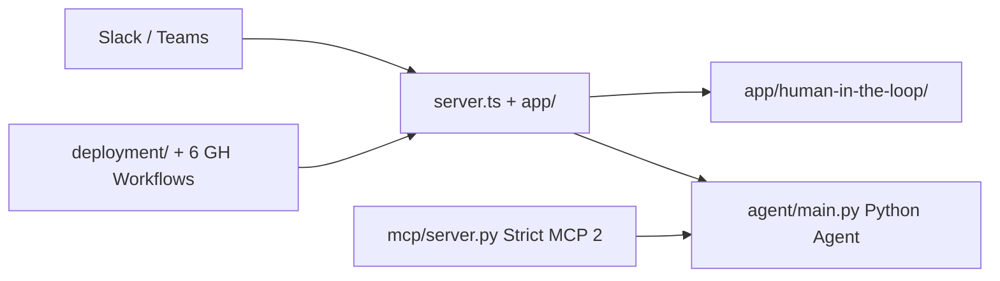

# Senior Architect Scan-Mode Note: `openbot-channel`

## 1. Synthesis (Reader Priority — Rule 19)
- **Primary Recommendation:** Seal the 3 uncommitted MCP 2 / lattice files after verifying `vitest` and `agent/tests/`, and promote to Focus Mode before changing Slack/Teams or Kite deployment flows.
- **MCP 2 (`2026-07-28`) Status:** `Strict MCP 2`
- **Critical / High Findings:** None identified.

## 2. Pass Level, Scope & Promotion Gate
- **Pass Level:** `Scan Mode` (Rule 0 default)
- **Scope:** Repository `openbot-channel` at `/Users/rig128gb/Developer/openbot-channel` (`lang=TypeScript`, `private=True`, `inManifest38=True`)
- **Focus/Full Promotion Trigger:** Focus Mode recommended before modifying channel/agent boundaries — Trigger: polyglot TypeScript (`server.ts`/`app/`) + Python (`agent/main.py`) knowledge-work agent with human-in-the-loop flows and 6 deployment/GitOps workflows. Risk of staying in Scan Mode: breaking Slack/Teams event handling or Kite GitOps release automation.
- **Architecture Areas Classified:** Backend / Channel Server (`server.ts`, `app/`, `app/commands/`, `app/human-in-the-loop/`); AI Agent Runtime (`agent/main.py`, `agent/tests/`); MCP Surface (`mcp/server.py` Strict MCP 2); Infrastructure & Deployment (`deployment/`, `.railway/`, `.copilotkit/`, 6 GitHub workflows); Tests & Quality Gates (`vitest.config.ts`, `e2e/`, `agent/tests/`, `ci.yml`); Database (Not directly observed at root)

## 3. Evidence Checked & Skipped Areas
- **Evidence Files Checked (14):** `.github/workflows/_deploy-kite-environment.yml`, `.github/workflows/ci.yml`, `.github/workflows/deploy-release.yml`, `.github/workflows/publish-release.yml`, `.github/workflows/release.yml`, `.github/workflows/rig-lattice.yml`, `AGENTS.md`, `README.md`, `docs/aws-deployment-research.md`, `docs/kite-gitops.md`, `docs/migration-kite.md`, `mcp/server.py`
- **Root Entries:** 26 items (`.copilotkit/, .dockerignore, .env.example, .github/, .gitignore, .npmrc, .railway/, .rig/, AGENTS.md, CHANGELOG.md, LICENSE, README.md...`)
- **Last Commit:** `972ab9a 2026-10-10 17:38:25 -0600 Merge pull request #1 from mrodgersjs-web/fix/rig-lattice-skip-until-published`
- **Git Working Tree:** `3` dirty/untracked entries (`M .github/workflows/rig-lattice.yml`, `M mcp/server.py`, `M rig.repos.json`)
- **Workflows:** `.github/workflows/_deploy-kite-environment.yml`, `.github/workflows/ci.yml`, `.github/workflows/deploy-release.yml`, `.github/workflows/publish-release.yml`, `.github/workflows/release.yml`, `.github/workflows/rig-lattice.yml`
- **MCP Files:** `mcp/server.py`
- **Existing Architecture Docs:** `AGENTS.md`, `docs/aws-deployment-research.md`, `docs/kite-gitops.md`, `docs/migration-kite.md`
- **Skipped Areas (Scan-Mode Budget):** Deep line-by-line function bodies, runtime execution, and external network/service probes (not executed in read-only Scan Mode).

## 4. Confirmed Facts (`Direct`)
- Local checkout exists at `/Users/rig128gb/Developer/openbot-channel` (branch `main`) with 26 top-level entries and 144 sampled files (depth <= 3).
- Build/package manifests observed: `package.json`, `tsconfig.json`.
- Top-level source/tool directories observed: `app/`, `mcp/`.
- Entrypoints observed: `server.ts`, `agent/main.py`, `app/index.ts`, `app/commands/index.ts`, `app/components/index.ts`, `app/human-in-the-loop/index.ts`.
- Tests observed: 12 sampled test file(s) (`vitest.config.ts`, `agent/tests/test_agent_configuration.py`, `agent/tests/test_agui_recursion.py`, `agent/tests/test_coder_approval_resume.py`).
- MCP 2 (`2026-07-28`) status: `Strict MCP 2`.
- Committed/untracked secret-file candidates observed: None identified.

## 5. Inferences & Assumptions (`Inferred` / `Assumed`)
- Inferred: `server.ts` and `app/` handle Slack/Teams channel events, commands, and generative UI (`.copilotkit/`), delegating agent reasoning to `agent/main.py`.

## 6. System Map (Mermaid)

## 7. Findings (Debt, Separation of Concerns, Convention Drift, Flow Conflicts, MCP 2)
- **[Medium | Direct] Convention Drift — Uncommitted MCP 2 & Lattice Retrofit**
  - *Evidence:* 3 dirty files: `M .github/workflows/rig-lattice.yml`, `M mcp/server.py`, `M rig.repos.json`.
  - *Impact:* Local Strict MCP 2 changes are uncommitted and could conflict with GitOps release workflows.
  - *Proposed Smallest Safe Correction (Requires Approval):* Review `git diff`, run `vitest` and `agent/tests/`, and commit the 3 files.

## 8. Open Questions, Risks & Safe Next Actions
- **Open Questions:** Does `mcp/server.py` bridge into `agent/main.py` at runtime, or serve strictly as a repository-level MCP 2 control surface?
- **Risks:** Polyglot TS/Python contract drift across `app/` and `agent/` if schemas are not versioned together.
- **Safe Next Actions (Proposed, Read-Only Until Approved):**
  - Review and commit the 3 dirty MCP 2 / lattice files.
  - Keep `vitest` and `agent/tests/` green across any boundary changes.

## 9. Step-8 Validation Gate
1. **Claim traceability:** Yes — every file path, manifest, workflow, test file, git status count, and MCP 2 status (`Strict MCP 2`) traces directly to inspected local files at `/Users/rig128gb/Developer/openbot-channel`; inferences and assumptions are explicitly labeled.
2. **Scope alignment:** Yes — bounded strictly to Scan Mode (Rule 0) read-only inspection of `openbot-channel`; no files inside the target repository were modified.
3. **Handoff readiness:** Yes — open questions, risks, promotion gate status, and proposed smallest safe next actions are explicitly listed (or marked `None identified`).
