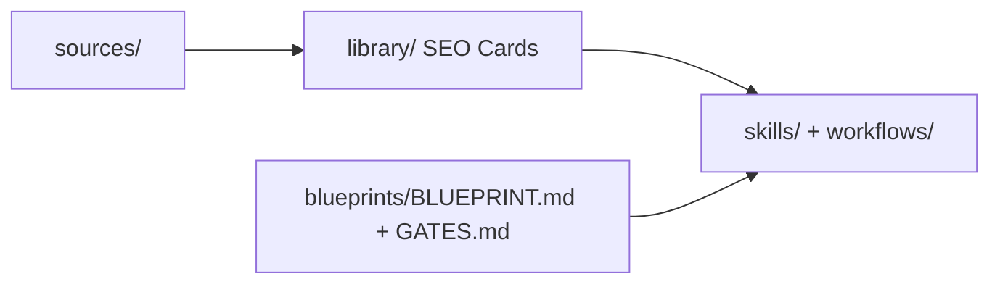

# Senior Architect Scan-Mode Note: `openseo-library`

## 1. Synthesis (Reader Priority — Rule 19)
- **Primary Recommendation:** Clarify canonical ownership boundary between `openseo-library` and `openseo-os` to avoid catalog duplication, and add a lightweight frontmatter/link lint CI check.
- **MCP 2 (`2026-07-28`) Status:** `No MCP surface observed`
- **Critical / High Findings:** None identified.

## 2. Pass Level, Scope & Promotion Gate
- **Pass Level:** `Scan Mode` (Rule 0 default)
- **Scope:** Repository `openseo-library` at `/Users/rig128gb/Developer/openseo-library` (`lang=JavaScript`, `private=True`, `inManifest38=False`)
- **Focus/Full Promotion Trigger:** None (clean, well-documented content/operating library; Scan Mode sufficient)
- **Architecture Areas Classified:** Documentation & Architecture (`ARCHITECTURE.md`, `blueprints/BLUEPRINT.md`, `CATALOG.md`, `GATES.md`, `ATTRIBUTION.md`); Knowledge Library (`library/`); Skills & Workflows (`skills/`, `workflows/`, `sources/`); Backend / Frontend / Database / Tests / CI / MCP (Not observed)

## 3. Evidence Checked & Skipped Areas
- **Evidence Files Checked (14):** `ARCHITECTURE.md`, `README.md`, `blueprints/BLUEPRINT.md`, `library/ai-agent-seo/ai-search-optimization.md`, `library/keyword-research/README.md`, `library/keyword-research/content-gap-analysis.md`, `library/keyword-research/customer-language-keywords.md`, `library/keyword-research/keyword-clustering.md`, `library/keyword-research/keyword-difficulty.md`, `library/keyword-research/keyword-prioritization.md`, `library/keyword-research/long-tail-keywords.md`, `library/keyword-research/search-intent-mapping.md`
- **Root Entries:** 11 items (`ARCHITECTURE.md, ATTRIBUTION.md, CATALOG.md, GATES.md, LICENSE, README.md, blueprints/, library/, skills/, sources/, workflows/`)
- **Last Commit:** `44c6f3e 2026-11-23 20:53:51 -0700 Add the OpenSEO operating library.`
- **Git Working Tree:** `0` dirty/untracked entries (clean)
- **Workflows:** Not observed
- **MCP Files:** Not observed
- **Existing Architecture Docs:** `ARCHITECTURE.md`, `blueprints/BLUEPRINT.md`, `library/ai-agent-seo/ai-search-optimization.md`, `library/keyword-research/README.md`, `library/keyword-research/content-gap-analysis.md`
- **Skipped Areas (Scan-Mode Budget):** Deep line-by-line function bodies, runtime execution, and external network/service probes (not executed in read-only Scan Mode).

## 4. Confirmed Facts (`Direct`)
- Local checkout exists at `/Users/rig128gb/Developer/openseo-library` (branch `main`) with 11 top-level entries and 52 sampled files (depth <= 3).
- Build/package manifests observed: Not observed.
- Top-level source/tool directories observed: `skills/`, `workflows/`.
- Entrypoints observed: Not observed.
- Tests observed: Not observed.
- MCP 2 (`2026-07-28`) status: `No MCP surface observed`.
- Committed/untracked secret-file candidates observed: None identified.

## 5. Inferences & Assumptions (`Inferred` / `Assumed`)
- Inferred: Static operating library and blueprint reference complementary to `openseo-os` and the upstream `open-seo` app fork.

## 6. System Map (Mermaid)

## 7. Findings (Debt, Separation of Concerns, Convention Drift, Flow Conflicts, MCP 2)
- **[Low | Direct] Architecture Debt — No Automated Link/Schema Validation**
  - *Evidence:* 0 test files and 0 CI workflows observed despite structured `CATALOG.md`, `GATES.md`, and `skills/`.
  - *Impact:* Broken internal references or malformed skill frontmatter can slip into `library/` or `skills/` undetected.
  - *Proposed Smallest Safe Correction (Requires Approval):* Add a lightweight markdown/frontmatter lint check in CI.

## 8. Open Questions, Risks & Safe Next Actions
- **Open Questions:** How is content deduplicated or synced between `openseo-library` and `openseo-os`?
- **Risks:** Potential drift between `openseo-library` and `openseo-os` (both contain `CATALOG.md`, `library/`, `skills/`, `workflows/`).
- **Safe Next Actions (Proposed, Read-Only Until Approved):**
  - Clarify canonical ownership vs `openseo-os` and add a lightweight frontmatter/link lint workflow.

## 9. Step-8 Validation Gate
1. **Claim traceability:** Yes — every file path, manifest, workflow, test file, git status count, and MCP 2 status (`No MCP surface observed`) traces directly to inspected local files at `/Users/rig128gb/Developer/openseo-library`; inferences and assumptions are explicitly labeled.
2. **Scope alignment:** Yes — bounded strictly to Scan Mode (Rule 0) read-only inspection of `openseo-library`; no files inside the target repository were modified.
3. **Handoff readiness:** Yes — open questions, risks, promotion gate status, and proposed smallest safe next actions are explicitly listed (or marked `None identified`).
