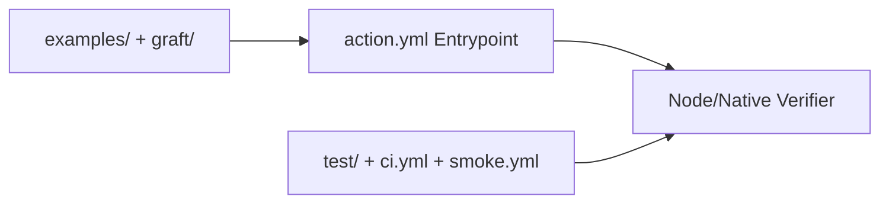

# Senior Architect Scan-Mode Note: `proof-gate-action`

## 1. Synthesis (Reader Priority — Rule 19)
- **Primary Recommendation:** No architecture defects identified; maintain current hygiene, native verification tests, and CI workflows.
- **MCP 2 (`2026-07-28`) Status:** `No MCP surface observed`
- **Critical / High Findings:** None identified.

## 2. Pass Level, Scope & Promotion Gate
- **Pass Level:** `Scan Mode` (Rule 0 default)
- **Scope:** Repository `proof-gate-action` at `/Users/rig128gb/Developer/proof-gate-action` (`lang=HTML`, `private=False`, `inManifest38=False`)
- **Focus/Full Promotion Trigger:** None (clean, tested GitHub Action repo with existing `docs/architecture.md` and 2 CI workflows)
- **Architecture Areas Classified:** GitHub Action Surface (`action.yml`, `package.json`, `examples/`, `graft/`); Tests & Quality Gates (`test/repo-hygiene.test.js`, `test/verify-native.test.js`, `test/verify.test.js`, `ci.yml`, `smoke.yml`); Documentation (`docs/architecture.md`, `AGENTS.md`, `SECURITY.md`); Frontend / Database / MCP (Not observed)

## 3. Evidence Checked & Skipped Areas
- **Evidence Files Checked (7):** `.github/workflows/ci.yml`, `.github/workflows/smoke.yml`, `AGENTS.md`, `README.md`, `action.yml`, `docs/architecture.md`, `package.json`
- **Root Entries:** 19 items (`.github/, .gitignore, .ignore, AGENTS.md, CHANGELOG.md, CODE_OF_CONDUCT.md, CONTRIBUTING.md, LICENSE, README.md, SECURITY.md, action.yml, assets/...`)
- **Last Commit:** `05d8124 2026-10-19 23:43:55 -0600 chore: repository hygiene checks, CI timeouts, and doc truth fixes`
- **Git Working Tree:** `0` dirty/untracked entries (clean)
- **Workflows:** `.github/workflows/ci.yml`, `.github/workflows/smoke.yml`
- **MCP Files:** Not observed
- **Existing Architecture Docs:** `AGENTS.md`, `docs/architecture.md`
- **Skipped Areas (Scan-Mode Budget):** Deep line-by-line function bodies, runtime execution, and external network/service probes (not executed in read-only Scan Mode).

## 4. Confirmed Facts (`Direct`)
- Local checkout exists at `/Users/rig128gb/Developer/proof-gate-action` (branch `ghup/2026-10-19`) with 19 top-level entries and 39 sampled files (depth <= 3).
- Build/package manifests observed: `package.json`, `action.yml`.
- Top-level source/tool directories observed: Not observed.
- Entrypoints observed: Not observed.
- Tests observed: 3 sampled test file(s) (`test/repo-hygiene.test.js`, `test/verify-native.test.js`, `test/verify.test.js`).
- MCP 2 (`2026-07-28`) status: `No MCP surface observed`.
- Committed/untracked secret-file candidates observed: None identified.

## 5. Inferences & Assumptions (`Inferred` / `Assumed`)
- Inferred: Reusable GitHub Action (`action.yml`) verifying proof packets/gates in CI pipelines with native and JS verification test suites.

## 6. System Map (Mermaid)

## 7. Findings (Debt, Separation of Concerns, Convention Drift, Flow Conflicts, MCP 2)
None identified.

## 8. Open Questions, Risks & Safe Next Actions
- **Open Questions:** None identified
- **Risks:** Supply-chain / action-pinning drift for downstream consumers if release tags are not immutable.
- **Safe Next Actions (Proposed, Read-Only Until Approved):**
  - Keep `ci.yml` and `smoke.yml` passing on any updates to `action.yml`.

## 9. Step-8 Validation Gate
1. **Claim traceability:** Yes — every file path, manifest, workflow, test file, git status count, and MCP 2 status (`No MCP surface observed`) traces directly to inspected local files at `/Users/rig128gb/Developer/proof-gate-action`; inferences and assumptions are explicitly labeled.
2. **Scope alignment:** Yes — bounded strictly to Scan Mode (Rule 0) read-only inspection of `proof-gate-action`; no files inside the target repository were modified.
3. **Handoff readiness:** Yes — open questions, risks, promotion gate status, and proposed smallest safe next actions are explicitly listed (or marked `None identified`).
