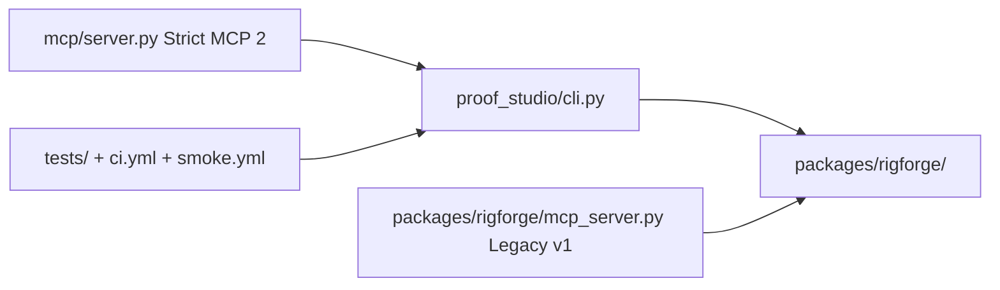

# Senior Architect Scan-Mode Note: `proof-studio`

## 1. Synthesis (Reader Priority — Rule 19)
- **Primary Recommendation:** Resolve the dual-MCP protocol mismatch by upgrading or retiring `packages/rigforge/rigforge/mcp_server.py` to match Strict MCP 2 (`2026-07-28`), and commit the 3 dirty retrofit files.
- **MCP 2 (`2026-07-28`) Status:** `Strict MCP 2`
- **Critical / High Findings:** [High] Flow Conflict / Convention Drift — Dual MCP Servers With Protocol Mismatch (`Root `mcp/server.py` enforces Strict MCP 2 (`PROTOCOL_VERSION = "2026-07-28"`), while `pac`)

## 2. Pass Level, Scope & Promotion Gate
- **Pass Level:** `Scan Mode` (Rule 0 default)
- **Scope:** Repository `proof-studio` at `/Users/rig128gb/Developer/proof-studio` (`lang=Python`, `private=False`, `inManifest38=True`)
- **Focus/Full Promotion Trigger:** Focus Mode recommended for MCP surface consolidation — Trigger: dual MCP server implementations with conflicting protocol versions (`mcp/server.py` Strict MCP 2 `2026-07-28` vs `packages/rigforge/rigforge/mcp_server.py` using legacy `mcp>=1.0`). Risk of staying in Scan Mode: clients connecting to `rigforge` MCP surface bypass MCP 2 compliance.
- **Architecture Areas Classified:** CLI & Core Package (`proof_studio/cli.py`, `pyproject.toml`); Embedded Package (`packages/rigforge/rigforge/mcp_server.py`); MCP Surface (`mcp/server.py` Strict MCP 2 + legacy `packages/rigforge/rigforge/mcp_server.py`); Tests & Quality Gates (`tests/`, `ci.yml`, `smoke.yml`, `rig-lattice.yml`); Documentation (`docs/architecture.md`, `docs/evaluation-strategy.md`, `docs/public-boundary.md`); Frontend / Database (Not observed)

## 3. Evidence Checked & Skipped Areas
- **Evidence Files Checked (13):** `.github/workflows/ci.yml`, `.github/workflows/rig-lattice.yml`, `.github/workflows/smoke.yml`, `AGENTS.md`, `README.md`, `docs/architecture.md`, `docs/evaluation-strategy.md`, `docs/public-boundary.md`, `docs/video-script.md`, `mcp/server.py`, `packages/rigforge/docs/ARCHITECTURE.md`, `packages/rigforge/rigforge/mcp_server.py`
- **Root Entries:** 25 items (`.coverage, .github/, .gitignore, .ignore, .pytest_cache/, .rig/, .ruff_cache/, AGENTS.md, CHANGELOG.md, CITATION.cff, CODE_OF_CONDUCT.md, CONTRIBUTING.md...`)
- **Last Commit:** `c6e09bc 2026-10-20 02:22:34 -0600 ci: make the rig-lattice workflow manual-only until its scorer is installable`
- **Git Working Tree:** `3` dirty/untracked entries (`M .github/workflows/rig-lattice.yml`, `M mcp/server.py`, `M rig.repos.json`)
- **Workflows:** `.github/workflows/ci.yml`, `.github/workflows/rig-lattice.yml`, `.github/workflows/smoke.yml`
- **MCP Files:** `mcp/server.py`, `packages/rigforge/rigforge/mcp_server.py`
- **Existing Architecture Docs:** `AGENTS.md`, `docs/architecture.md`, `docs/evaluation-strategy.md`, `docs/public-boundary.md`, `docs/video-script.md`
- **Skipped Areas (Scan-Mode Budget):** Deep line-by-line function bodies, runtime execution, and external network/service probes (not executed in read-only Scan Mode).

## 4. Confirmed Facts (`Direct`)
- Local checkout exists at `/Users/rig128gb/Developer/proof-studio` (branch `ghup/2026-10-19`) with 25 top-level entries and 113 sampled files (depth <= 3).
- Build/package manifests observed: `pyproject.toml`.
- Top-level source/tool directories observed: `mcp/`, `packages/`, `scripts/`.
- Entrypoints observed: `mcp/server.py`, `proof_studio/cli.py`.
- Tests observed: 7 sampled test file(s) (`tests/test_ci_config.py`, `tests/test_cli.py`, `tests/test_packaging.py`, `tests/test_readme_truth.py`).
- MCP 2 (`2026-07-28`) status: `Strict MCP 2` — Root mcp/server.py is Strict MCP 2 (2026-07-28); secondary packages/rigforge/rigforge/mcp_server.py uses mcp>=1.0 (legacy v1 surface - drift)..
- Committed/untracked secret-file candidates observed: None identified.

## 5. Inferences & Assumptions (`Inferred` / `Assumed`)
- Inferred: Tamper-scenario and benchmark studio wrapping `rigforge` to test forged-proof attacks against the verifier.

## 6. System Map (Mermaid)

## 7. Findings (Debt, Separation of Concerns, Convention Drift, Flow Conflicts, MCP 2)
- **[High | Direct] Flow Conflict / Convention Drift — Dual MCP Servers With Protocol Mismatch**
  - *Evidence:* Root `mcp/server.py` enforces Strict MCP 2 (`PROTOCOL_VERSION = "2026-07-28"`), while `packages/rigforge/rigforge/mcp_server.py` uses legacy `mcp>=1.0` without `2026-07-28` enforcement.
  - *Impact:* Two MCP entrypoints in the same repo present inconsistent protocol guarantees and tool surfaces.
  - *Proposed Smallest Safe Correction (Requires Approval):* Upgrade `packages/rigforge/rigforge/mcp_server.py` to Strict MCP 2 (`2026-07-28`) or deprecate/delegate it through root `mcp/server.py`.
- **[Medium | Direct] Convention Drift — Uncommitted MCP 2 & Lattice Retrofit**
  - *Evidence:* 3 dirty files: `M .github/workflows/rig-lattice.yml`, `M mcp/server.py`, `M rig.repos.json`.
  - *Impact:* Local MCP 2 retrofit changes are unsealed.
  - *Proposed Smallest Safe Correction (Requires Approval):* Review `git diff`, run `tests/`, and commit the 3 modified files.

## 8. Open Questions, Risks & Safe Next Actions
- **Open Questions:** Should `packages/rigforge/rigforge/mcp_server.py` be upgraded in-place to MCP 2 or retired in favor of root `mcp/server.py`?
- **Risks:** Downstream agents invoking `rigforge.mcp_server` will fail strict MCP 2 (`2026-07-28`) handshake checks.
- **Safe Next Actions (Proposed, Read-Only Until Approved):**
  - Consolidate or upgrade `packages/rigforge/rigforge/mcp_server.py` to Strict MCP 2.
  - Commit the 3 pending lattice/MCP files after running `tests/`.

## 9. Step-8 Validation Gate
1. **Claim traceability:** Yes — every file path, manifest, workflow, test file, git status count, and MCP 2 status (`Strict MCP 2`) traces directly to inspected local files at `/Users/rig128gb/Developer/proof-studio`; inferences and assumptions are explicitly labeled.
2. **Scope alignment:** Yes — bounded strictly to Scan Mode (Rule 0) read-only inspection of `proof-studio`; no files inside the target repository were modified.
3. **Handoff readiness:** Yes — open questions, risks, promotion gate status, and proposed smallest safe next actions are explicitly listed (or marked `None identified`).

## Post-Upgrade MCP 2 Reconciliation (2026-11-26)

- **Status:** Upgraded from `Strict MCP 2` to **Strict MCP 2 (`2026-07-28`)** during the 2026-11-26 swarm pass and independently verified (exit `0`; see `docs/senior-architect/EVIDENCE.md`). Local changes remain staged in `blueprints/mcp2-estate-standard/GATE-D-PUSH-MANIFEST.json` (`pushed: false`, awaiting Gate-D approval).
