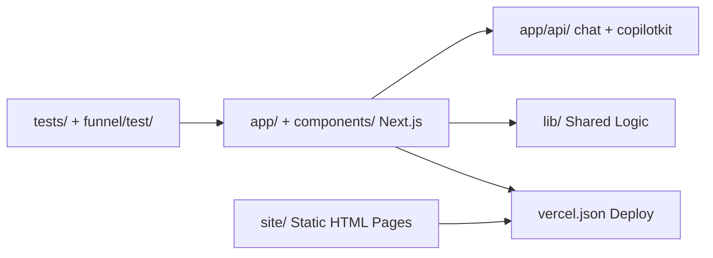

# Senior Architect Scan-Mode Note: `recruiting-calendar`

## 1. Synthesis (Reader Priority — Rule 19)
- **Primary Recommendation:** Triage and commit the 152 uncommitted files in bounded slices, clarify `app/` vs `site/` routing ownership, and add a CI build/test workflow.
- **MCP 2 (`2026-07-28`) Status:** `No MCP surface observed`
- **Critical / High Findings:** [High] Architecture Debt — Large Uncommitted Working Tree (152 Dirty Files) Without CI (`152 modified/untracked files including `app/[...slug]/page.tsx`, `app/api/chat/route.ts`, `)

## 2. Pass Level, Scope & Promotion Gate
- **Pass Level:** `Scan Mode` (Rule 0 default)
- **Scope:** Repository `recruiting-calendar` at `/Users/rig128gb/Developer/recruiting-calendar` (`lang=HTML`, `private=True`, `inManifest38=False`)
- **Focus/Full Promotion Trigger:** Focus Mode recommended — Trigger: 152 uncommitted/modified files across active Next.js routes (`app/[...slug]/page.tsx`, `app/api/chat/route.ts`, `app/api/copilotkit/route.ts`), coexisting `app/` and `site/` surfaces, and no CI workflows. Risk of staying in Scan Mode: deploying broken chat/billing routes or losing uncommitted work.
- **Architecture Areas Classified:** Frontend / Next.js App (`app/`, `components/`, `lib/`, `vercel.json`, `tsconfig.json`); Static Site Surface (`site/index.html`, `site/about/`, `site/billing/`, `site/account/`); API Routes (`app/api/chat/route.ts`, `app/api/copilotkit/route.ts`); Tests (`tests/chatbot.spec.ts`, `tests/redesign.spec.ts`, `funnel/test/funnel.test.js`, `.e2e/`); CI / MCP / Database (CI & MCP not observed; persistence not directly observed at root)

## 3. Evidence Checked & Skipped Areas
- **Evidence Files Checked (12):** `docs/BRIEF.md`, `docs/designs/comprehension_report.md`, `docs/designs/consolidated_review_report.md`, `docs/designs/critic_report.md`, `docs/designs/family-solutions.md`, `docs/designs/implementation_readiness_report.md`, `docs/designs/intermediate_zoom_out_report.md`, `docs/designs/zoom_out_report.md`, `package.json`, `tsconfig.json`, `v3/AGENTS.md`, `vercel.json`
- **Root Entries:** 37 items (`.claude/, .e2e/, .eslintrc.json, .gitignore, .next/, .vercel/, .vercelignore, BRIEF.md, COMMIT-BOOK-HANDOFF.md, PROOFPACKET.json, app/, components/...`)
- **Last Commit:** `edc20a7 2026-11-26 11:23:52 -0700 feat(aeo): llms.txt, aeo.json, entity.json, brand.json, JSON-LD, AI bot allowlist`
- **Git Working Tree:** `152` dirty/untracked entries (`M app/[...slug]/page.tsx`, `M app/api/chat/route.ts`, `M app/api/copilotkit/route.ts`, `M app/auditor/page.tsx`)
- **Workflows:** Not observed
- **MCP Files:** Not observed
- **Existing Architecture Docs:** `docs/BRIEF.md`, `docs/designs/comprehension_report.md`, `docs/designs/consolidated_review_report.md`, `docs/designs/critic_report.md`, `docs/designs/family-solutions.md`
- **Skipped Areas (Scan-Mode Budget):** Deep line-by-line function bodies, runtime execution, and external network/service probes (not executed in read-only Scan Mode).

## 4. Confirmed Facts (`Direct`)
- Local checkout exists at `/Users/rig128gb/Developer/recruiting-calendar` (branch `feat/commitbook-chatbot-kokonut`) with 37 top-level entries and 595 sampled files (depth <= 3).
- Build/package manifests observed: `package.json`, `vercel.json`, `tsconfig.json`.
- Top-level source/tool directories observed: `app/`, `lib/`, `scripts/`.
- Entrypoints observed: `site/index.html`, `site/about/index.html`, `site/access/index.html`, `site/account/index.html`, `site/answers/index.html`, `site/billing/index.html`.
- Tests observed: 4 sampled test file(s) (`funnel/test/funnel.test.js`, `tests/chatbot.spec.ts`, `tests/redesign.spec.ts`, `tests/solutions.spec.ts`).
- MCP 2 (`2026-07-28`) status: `No MCP surface observed`.
- Committed/untracked secret-file candidates observed: None identified.

## 5. Inferences & Assumptions (`Inferred` / `Assumed`)
- Inferred: Next.js + Vercel web application (`app/`, `components/`, `lib/`) with CopilotKit chat API routes and a parallel static `site/` directory.

## 6. System Map (Mermaid)

## 7. Findings (Debt, Separation of Concerns, Convention Drift, Flow Conflicts, MCP 2)
- **[High | Direct] Architecture Debt — Large Uncommitted Working Tree (152 Dirty Files) Without CI**
  - *Evidence:* 152 modified/untracked files including `app/[...slug]/page.tsx`, `app/api/chat/route.ts`, `app/api/copilotkit/route.ts`; 0 `.github/workflows/` observed.
  - *Impact:* High risk of accidental regression, unreviewed deploys to Vercel, or data loss across active API and UI routes.
  - *Proposed Smallest Safe Correction (Requires Approval):* Triage and commit/stash the 152 dirty files in logical slices, and add a CI workflow running typecheck + `tests/`.
- **[Medium | Inferred] Separation of Concerns — Parallel `app/` and `site/` Web Surfaces**
  - *Evidence:* Both Next.js `app/` (`app/[...slug]/page.tsx`) and static `site/*.html` (`site/index.html`, `site/billing/index.html`, `site/account/index.html`) coexist at root (`Verify first: Yes`).
  - *Impact:* Unclear routing precedence between static `site/` pages and dynamic Next.js `app/` routes.
  - *Proposed Smallest Safe Correction (Requires Approval):* Verify `vercel.json` routing rules and archive or remove unused legacy static pages.

## 8. Open Questions, Risks & Safe Next Actions
- **Open Questions:** Are `site/*.html` pages still served in production alongside `app/`, or are they a superseded static build?
- **Risks:** Uncommitted changes to `app/api/chat/route.ts` and `app/api/copilotkit/route.ts` lack automated CI gating.
- **Safe Next Actions (Proposed, Read-Only Until Approved):**
  - Audit and commit the 152 dirty files in bounded commits.
  - Add a CI workflow for Next.js build, typecheck, and Playwright tests.

## 9. Step-8 Validation Gate
1. **Claim traceability:** Yes — every file path, manifest, workflow, test file, git status count, and MCP 2 status (`No MCP surface observed`) traces directly to inspected local files at `/Users/rig128gb/Developer/recruiting-calendar`; inferences and assumptions are explicitly labeled.
2. **Scope alignment:** Yes — bounded strictly to Scan Mode (Rule 0) read-only inspection of `recruiting-calendar`; no files inside the target repository were modified.
3. **Handoff readiness:** Yes — open questions, risks, promotion gate status, and proposed smallest safe next actions are explicitly listed (or marked `None identified`).
