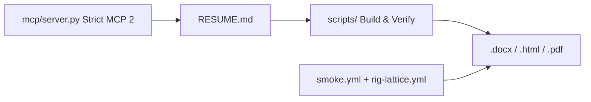

# Senior Architect Scan-Mode Note: `resume`

## 1. Synthesis (Reader Priority — Rule 19)
- **Primary Recommendation:** Verify parity between `RESUME.md` and the modified `.docx`/`.pdf` artifacts, then seek approval to commit and push the 6 pending files.
- **MCP 2 (`2026-07-28`) Status:** `Strict MCP 2`
- **Critical / High Findings:** None identified.

## 2. Pass Level, Scope & Promotion Gate
- **Pass Level:** `Scan Mode` (Rule 0 default)
- **Scope:** Repository `resume` at `/Users/rig128gb/Developer/resume` (`lang=HTML`, `private=False`, `inManifest38=True`)
- **Focus/Full Promotion Trigger:** None (bounded document + Strict MCP 2 repo with smoke CI; Scan Mode sufficient)
- **Architecture Areas Classified:** Document Artifacts (`RESUME.md`, `Mike-Rodgers-Forward-Deployed-Engineer.{docx,html,pdf}`); Scripts & Automation (`scripts/`); MCP Surface (`mcp/server.py` Strict MCP 2); CI & Quality Gates (`.github/workflows/smoke.yml`, `.github/workflows/rig-lattice.yml`); Documentation (`docs/architecture.md`, `docs/public-boundary.md`, `AGENTS.md`); Backend / Frontend / Database (Not observed)

## 3. Evidence Checked & Skipped Areas
- **Evidence Files Checked (9):** `.github/workflows/rig-lattice.yml`, `.github/workflows/smoke.yml`, `AGENTS.md`, `README.md`, `docs/architecture.md`, `docs/evaluation-strategy.md`, `docs/public-boundary.md`, `docs/video-script.md`, `mcp/server.py`
- **Root Entries:** 16 items (`.github/, .rig/, AGENTS.md, CONTRIBUTING.md, LICENSE, Mike-Rodgers-Forward-Deployed-Engineer.docx, Mike-Rodgers-Forward-Deployed-Engineer.html, Mike-Rodgers-Forward-Deployed-Engineer.pdf, README.md, RESUME.md, SECURITY.md, assets/...`)
- **Last Commit:** `4f6cbb1 2026-10-20 02:12:29 -0600 README: verify this repo with its own smoke test`
- **Git Working Tree:** `6` dirty/untracked entries (`M .github/workflows/rig-lattice.yml`, `M Mike-Rodgers-Forward-Deployed-Engineer.docx`, `M Mike-Rodgers-Forward-Deployed-Engineer.pdf`, `M RESUME.md`)
- **Workflows:** `.github/workflows/rig-lattice.yml`, `.github/workflows/smoke.yml`
- **MCP Files:** `mcp/server.py`
- **Existing Architecture Docs:** `AGENTS.md`, `docs/architecture.md`, `docs/evaluation-strategy.md`, `docs/public-boundary.md`, `docs/video-script.md`
- **Skipped Areas (Scan-Mode Budget):** Deep line-by-line function bodies, runtime execution, and external network/service probes (not executed in read-only Scan Mode).

## 4. Confirmed Facts (`Direct`)
- Local checkout exists at `/Users/rig128gb/Developer/resume` (branch `main`) with 16 top-level entries and 25 sampled files (depth <= 3).
- Build/package manifests observed: Not observed.
- Top-level source/tool directories observed: `mcp/`, `scripts/`.
- Entrypoints observed: `mcp/server.py`.
- Tests observed: Not observed.
- MCP 2 (`2026-07-28`) status: `Strict MCP 2`.
- Committed/untracked secret-file candidates observed: None identified.

## 5. Inferences & Assumptions (`Inferred` / `Assumed`)
- Inferred: Public resume distribution repo where `scripts/` builds or verifies `RESUME.md` alongside rendered `.docx`, `.html`, and `.pdf` artifacts.

## 6. System Map (Mermaid)

## 7. Findings (Debt, Separation of Concerns, Convention Drift, Flow Conflicts, MCP 2)
- **[Medium | Direct] Convention Drift — Uncommitted Resume Artifacts & MCP 2 Retrofit**
  - *Evidence:* 6 dirty files including `M Mike-Rodgers-Forward-Deployed-Engineer.docx`, `M Mike-Rodgers-Forward-Deployed-Engineer.pdf`, `M mcp/server.py`, `M .github/workflows/rig-lattice.yml`.
  - *Impact:* Rendered `.docx`/`.pdf` artifacts may be out of sync with `RESUME.md` or remote `origin`.
  - *Proposed Smallest Safe Correction (Requires Approval):* Verify `RESUME.md` matches the rendered `.docx`/`.pdf`/`.html` outputs, run `smoke.yml` checks locally, and commit on Mike's approval (public artifact).

## 8. Open Questions, Risks & Safe Next Actions
- **Open Questions:** Are the modified `.docx` and `.pdf` files ready to publish to this public repository?
- **Risks:** Public resume artifacts require Mike's explicit approval before pushing.
- **Safe Next Actions (Proposed, Read-Only Until Approved):**
  - Review diff on `RESUME.md`, `.docx`, `.pdf`, and `mcp/server.py` and request approval before pushing.

## 9. Step-8 Validation Gate
1. **Claim traceability:** Yes — every file path, manifest, workflow, test file, git status count, and MCP 2 status (`Strict MCP 2`) traces directly to inspected local files at `/Users/rig128gb/Developer/resume`; inferences and assumptions are explicitly labeled.
2. **Scope alignment:** Yes — bounded strictly to Scan Mode (Rule 0) read-only inspection of `resume`; no files inside the target repository were modified.
3. **Handoff readiness:** Yes — open questions, risks, promotion gate status, and proposed smallest safe next actions are explicitly listed (or marked `None identified`).
