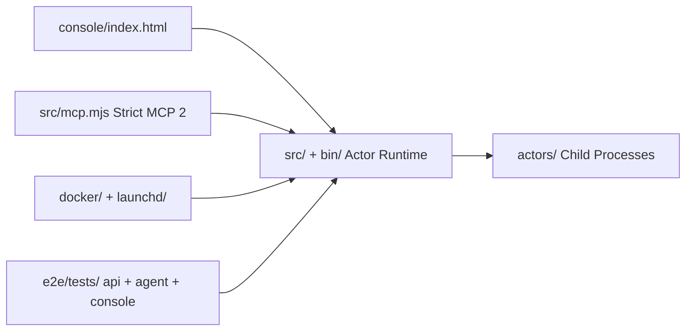

# Senior Architect Scan-Mode Note: `rig-actor`

## 1. Synthesis (Reader Priority — Rule 19)
- **Primary Recommendation:** Review and commit the pending `src/mcp.mjs` change after running `e2e/tests/`, and add a CI workflow to enforce the existing E2E suite.
- **MCP 2 (`2026-07-28`) Status:** `Strict MCP 2`
- **Critical / High Findings:** None identified.

## 2. Pass Level, Scope & Promotion Gate
- **Pass Level:** `Scan Mode` (Rule 0 default)
- **Scope:** Repository `rig-actor` at `/Users/rig128gb/Developer/rig-actor` (`lang=JavaScript`, `private=True`, `inManifest38=False`)
- **Focus/Full Promotion Trigger:** None (well-structured local actor platform with Strict MCP 2 and E2E tests; Scan Mode sufficient)
- **Architecture Areas Classified:** Backend / Actor Runtime (`src/`, `bin/`, `actors/`); Frontend / Console (`console/index.html`); MCP Surface (`src/mcp.mjs` Strict MCP 2 `2026-07-28`); Infrastructure (`docker/`, `launchd/`, `scripts/`); Tests (`e2e/tests/agent.e2e.ts`, `api.e2e.ts`, `console.e2e.ts`); Documentation (`docs/BRIEF.md`, `docs/DECISIONS.md`, `docs/FIXLOG.md`, `docs/STORIES.md`)

## 3. Evidence Checked & Skipped Areas
- **Evidence Files Checked (10):** `README.md`, `docs/BRIEF.md`, `docs/DECISIONS.md`, `docs/FIXLOG.md`, `docs/STORIES.md`, `docs/design_draft.md`, `docs/research/apify-capability-map.md`, `docs/review-notes.md`, `package.json`, `src/mcp.mjs`
- **Root Entries:** 17 items (`.dockerignore, .e2e-data/, .gitignore, DONE.txt, JOB.md, README.md, actors/, bin/, console/, docker/, docs/, e2e/...`)
- **Last Commit:** `d8a6099 2026-11-09 12:03:41 -0600 chore: checkpoint before github consolidation 2026-11-09`
- **Git Working Tree:** `1` dirty/untracked entries (`M src/mcp.mjs`)
- **Workflows:** Not observed
- **MCP Files:** `src/mcp.mjs`
- **Existing Architecture Docs:** `docs/BRIEF.md`, `docs/DECISIONS.md`, `docs/FIXLOG.md`, `docs/STORIES.md`, `docs/design_draft.md`
- **Skipped Areas (Scan-Mode Budget):** Deep line-by-line function bodies, runtime execution, and external network/service probes (not executed in read-only Scan Mode).

## 4. Confirmed Facts (`Direct`)
- Local checkout exists at `/Users/rig128gb/Developer/rig-actor` (branch `main`) with 17 top-level entries and 387 sampled files (depth <= 3).
- Build/package manifests observed: `package.json`.
- Top-level source/tool directories observed: `bin/`, `scripts/`, `src/`.
- Entrypoints observed: `console/index.html`.
- Tests observed: 3 sampled test file(s) (`e2e/tests/agent.e2e.ts`, `e2e/tests/api.e2e.ts`, `e2e/tests/console.e2e.ts`).
- MCP 2 (`2026-07-28`) status: `Strict MCP 2`.
- Committed/untracked secret-file candidates observed: None identified.

## 5. Inferences & Assumptions (`Inferred` / `Assumed`)
- Inferred: Local Node.js actor execution platform (Apify-like) running actors as child processes, serving a web console (`console/index.html`), and exposing 6 Strict MCP 2 tools via `src/mcp.mjs`.

## 6. System Map (Mermaid)

## 7. Findings (Debt, Separation of Concerns, Convention Drift, Flow Conflicts, MCP 2)
- **[Medium | Direct] Architecture Debt — No CI Workflow Enforcing Existing E2E Suite**
  - *Evidence:* 3 E2E test suites exist (`e2e/tests/{agent,api,console}.e2e.ts`), but 0 `.github/workflows/` files observed.
  - *Impact:* E2E tests only run manually and can silently regress.
  - *Proposed Smallest Safe Correction (Requires Approval):* Add a CI workflow (or local pre-push check) executing the E2E suite.
- **[Low | Direct] Convention Drift — Uncommitted MCP Server Edit**
  - *Evidence:* 1 dirty file: `M src/mcp.mjs`.
  - *Impact:* Local Strict MCP 2 edit is uncommitted.
  - *Proposed Smallest Safe Correction (Requires Approval):* Review `git diff src/mcp.mjs`, run `e2e/tests/`, and commit.

## 8. Open Questions, Risks & Safe Next Actions
- **Open Questions:** None identified
- **Risks:** Uncommitted edit to `src/mcp.mjs` could drift from deployed `launchd/` service.
- **Safe Next Actions (Proposed, Read-Only Until Approved):**
  - Review and commit `src/mcp.mjs` after running `e2e/tests/`.
  - Wire E2E tests into CI.

## 9. Step-8 Validation Gate
1. **Claim traceability:** Yes — every file path, manifest, workflow, test file, git status count, and MCP 2 status (`Strict MCP 2`) traces directly to inspected local files at `/Users/rig128gb/Developer/rig-actor`; inferences and assumptions are explicitly labeled.
2. **Scope alignment:** Yes — bounded strictly to Scan Mode (Rule 0) read-only inspection of `rig-actor`; no files inside the target repository were modified.
3. **Handoff readiness:** Yes — open questions, risks, promotion gate status, and proposed smallest safe next actions are explicitly listed (or marked `None identified`).

## Post-Upgrade MCP 2 Reconciliation (2026-11-26)

- **Status:** Upgraded from `Strict MCP 2` to **Strict MCP 2 (`2026-07-28`)** during the 2026-11-26 swarm pass and independently verified (exit `0`; see `docs/senior-architect/EVIDENCE.md`). Local changes remain staged in `blueprints/mcp2-estate-standard/GATE-D-PUSH-MANIFEST.json` (`pushed: false`, awaiting Gate-D approval).
