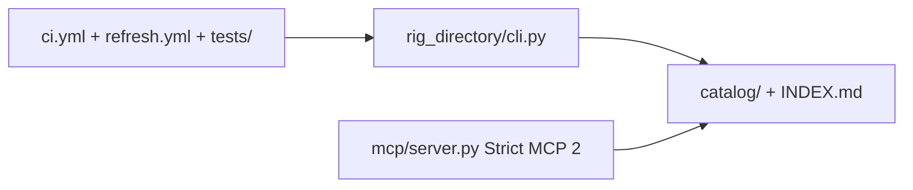

# Senior Architect Scan-Mode Note: `rig-agent-directory`

## 1. Synthesis (Reader Priority — Rule 19)
- **Primary Recommendation:** Review and commit the 3 pending MCP 2 / lattice retrofit files after running `tests/`.
- **MCP 2 (`2026-07-28`) Status:** `Strict MCP 2`
- **Critical / High Findings:** None identified.

## 2. Pass Level, Scope & Promotion Gate
- **Pass Level:** `Scan Mode` (Rule 0 default)
- **Scope:** Repository `rig-agent-directory` at `/Users/rig128gb/Developer/rig-agent-directory` (`lang=Python`, `private=False`, `inManifest38=True`)
- **Focus/Full Promotion Trigger:** None (clean, well-tested Python crawler/catalog repo with Strict MCP 2; Scan Mode sufficient)
- **Architecture Areas Classified:** Backend / Crawler & CLI (`rig_directory/cli.py`, `pyproject.toml`); Data / Generated Catalog (`catalog/`, `INDEX.md`); MCP Surface (`mcp/server.py` Strict MCP 2); Tests & CI (`tests/`, `ci.yml`, `refresh.yml`, `rig-lattice.yml`); Documentation (`docs/architecture.md`, `AGENTS.md`); Frontend / Database (Not observed)

## 3. Evidence Checked & Skipped Areas
- **Evidence Files Checked (8):** `.github/workflows/ci.yml`, `.github/workflows/refresh.yml`, `.github/workflows/rig-lattice.yml`, `AGENTS.md`, `README.md`, `docs/architecture.md`, `mcp/server.py`, `pyproject.toml`
- **Root Entries:** 24 items (`.coverage, .github/, .gitignore, .pytest_cache/, .rig/, .ruff_cache/, AGENTS.md, CHANGELOG.md, CODE_OF_CONDUCT.md, CONTRIBUTING.md, INDEX.md, LICENSE...`)
- **Last Commit:** `8302e2f 2026-10-20 00:17:10 -0600 test+docs+ci: repo-hygiene suite + copilot-instructions.md + CODEOWNERS + README polish`
- **Git Working Tree:** `3` dirty/untracked entries (`M .github/workflows/rig-lattice.yml`, `M mcp/server.py`, `M rig.repos.json`)
- **Workflows:** `.github/workflows/ci.yml`, `.github/workflows/refresh.yml`, `.github/workflows/rig-lattice.yml`
- **MCP Files:** `mcp/server.py`
- **Existing Architecture Docs:** `AGENTS.md`, `docs/architecture.md`
- **Skipped Areas (Scan-Mode Budget):** Deep line-by-line function bodies, runtime execution, and external network/service probes (not executed in read-only Scan Mode).

## 4. Confirmed Facts (`Direct`)
- Local checkout exists at `/Users/rig128gb/Developer/rig-agent-directory` (branch `ghup/2026-10-19`) with 24 top-level entries and 62 sampled files (depth <= 3).
- Build/package manifests observed: `pyproject.toml`.
- Top-level source/tool directories observed: `mcp/`.
- Entrypoints observed: `mcp/server.py`, `rig_directory/cli.py`.
- Tests observed: 5 sampled test file(s) (`tests/test_attribution.py`, `tests/test_cli.py`, `tests/test_counts.py`, `tests/test_directory.py`).
- MCP 2 (`2026-07-28`) status: `Strict MCP 2`.
- Committed/untracked secret-file candidates observed: None identified.

## 5. Inferences & Assumptions (`Inferred` / `Assumed`)
- Inferred: Crawls public `mrodgersjs-web` repos via `rig_directory/cli.py` (and scheduled `refresh.yml`) to regenerate `catalog/` and `INDEX.md`.

## 6. System Map (Mermaid)

## 7. Findings (Debt, Separation of Concerns, Convention Drift, Flow Conflicts, MCP 2)
- **[Medium | Direct] Convention Drift — Uncommitted MCP 2 & Lattice Retrofit**
  - *Evidence:* 3 dirty files: `M .github/workflows/rig-lattice.yml`, `M mcp/server.py`, `M rig.repos.json`.
  - *Impact:* Local Strict MCP 2 updates are unsealed.
  - *Proposed Smallest Safe Correction (Requires Approval):* Review `git diff`, run `pytest` (`tests/`), and commit the 3 files.

## 8. Open Questions, Risks & Safe Next Actions
- **Open Questions:** None identified
- **Risks:** Scheduled `refresh.yml` commits on remote may conflict with local uncommitted changes.
- **Safe Next Actions (Proposed, Read-Only Until Approved):**
  - Review and commit the 3 dirty MCP 2 / lattice files after running `tests/`.

## 9. Step-8 Validation Gate
1. **Claim traceability:** Yes — every file path, manifest, workflow, test file, git status count, and MCP 2 status (`Strict MCP 2`) traces directly to inspected local files at `/Users/rig128gb/Developer/rig-agent-directory`; inferences and assumptions are explicitly labeled.
2. **Scope alignment:** Yes — bounded strictly to Scan Mode (Rule 0) read-only inspection of `rig-agent-directory`; no files inside the target repository were modified.
3. **Handoff readiness:** Yes — open questions, risks, promotion gate status, and proposed smallest safe next actions are explicitly listed (or marked `None identified`).
