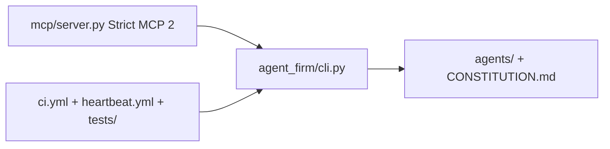

# Senior Architect Scan-Mode Note: `rig-agent-firm`

## 1. Synthesis (Reader Priority — Rule 19)
- **Primary Recommendation:** Commit the 3 pending MCP 2 / lattice retrofit files after running `tests/`, and add a brief `docs/architecture.md`.
- **MCP 2 (`2026-07-28`) Status:** `Strict MCP 2`
- **Critical / High Findings:** None identified.

## 2. Pass Level, Scope & Promotion Gate
- **Pass Level:** `Scan Mode` (Rule 0 default)
- **Scope:** Repository `rig-agent-firm` at `/Users/rig128gb/Developer/rig-agent-firm` (`lang=Python`, `private=False`, `inManifest38=True`)
- **Focus/Full Promotion Trigger:** None (bounded Python package + agent specs with Strict MCP 2 and CI; Scan Mode sufficient)
- **Architecture Areas Classified:** Backend / CLI (`agent_firm/cli.py`, `pyproject.toml`); Agent Specifications (`agents/`, `CONSTITUTION.md`); MCP Surface (`mcp/server.py` Strict MCP 2); Tests & CI (`tests/test_firm.py`, `tests/test_repo_hygiene.py`, `ci.yml`, `heartbeat.yml`, `rig-lattice.yml`); Frontend / Database (Not observed)

## 3. Evidence Checked & Skipped Areas
- **Evidence Files Checked (7):** `.github/workflows/ci.yml`, `.github/workflows/heartbeat.yml`, `.github/workflows/rig-lattice.yml`, `AGENTS.md`, `README.md`, `mcp/server.py`, `pyproject.toml`
- **Root Entries:** 23 items (`.coverage, .github/, .gitignore, .pytest_cache/, .rig/, .ruff_cache/, AGENTS.md, CHANGELOG.md, CODE_OF_CONDUCT.md, CONSTITUTION.md, CONTRIBUTING.md, LICENSE...`)
- **Last Commit:** `dd7c72f 2026-10-20 00:22:04 -0600 test+docs+ci: repo-hygiene suite + copilot-instructions.md + CODEOWNERS (heartbeat preserved)`
- **Git Working Tree:** `3` dirty/untracked entries (`M .github/workflows/rig-lattice.yml`, `M mcp/server.py`, `M rig.repos.json`)
- **Workflows:** `.github/workflows/ci.yml`, `.github/workflows/heartbeat.yml`, `.github/workflows/rig-lattice.yml`
- **MCP Files:** `mcp/server.py`
- **Existing Architecture Docs:** `AGENTS.md`
- **Skipped Areas (Scan-Mode Budget):** Deep line-by-line function bodies, runtime execution, and external network/service probes (not executed in read-only Scan Mode).

## 4. Confirmed Facts (`Direct`)
- Local checkout exists at `/Users/rig128gb/Developer/rig-agent-firm` (branch `ghup/2026-10-19`) with 23 top-level entries and 77 sampled files (depth <= 3).
- Build/package manifests observed: `pyproject.toml`.
- Top-level source/tool directories observed: `agents/`, `mcp/`, `scripts/`.
- Entrypoints observed: `agent_firm/cli.py`, `mcp/server.py`.
- Tests observed: 2 sampled test file(s) (`tests/test_firm.py`, `tests/test_repo_hygiene.py`).
- MCP 2 (`2026-07-28`) status: `Strict MCP 2`.
- Committed/untracked secret-file candidates observed: None identified.

## 5. Inferences & Assumptions (`Inferred` / `Assumed`)
- Inferred: Autonomous agent firm framework governed by `CONSTITUTION.md`, operated via `agent_firm/cli.py` and `heartbeat.yml`.

## 6. System Map (Mermaid)

## 7. Findings (Debt, Separation of Concerns, Convention Drift, Flow Conflicts, MCP 2)
- **[Medium | Direct] Convention Drift — Uncommitted MCP 2 & Lattice Retrofit**
  - *Evidence:* 3 dirty files: `M .github/workflows/rig-lattice.yml`, `M mcp/server.py`, `M rig.repos.json`.
  - *Impact:* Local MCP 2 retrofit changes are unsealed.
  - *Proposed Smallest Safe Correction (Requires Approval):* Review `git diff`, run `tests/`, and commit the 3 files.
- **[Low | Direct] Documentation Gap — No Dedicated `docs/architecture.md`**
  - *Evidence:* Only `AGENTS.md` and `CONSTITUTION.md` observed; no `docs/architecture.md` unlike sibling RIG repos.
  - *Impact:* New contributors lack a single concise architecture overview of `agent_firm/` vs `agents/`.
  - *Proposed Smallest Safe Correction (Requires Approval):* Add a brief `docs/architecture.md` linking `agent_firm/cli.py`, `agents/`, and `heartbeat.yml`.

## 8. Open Questions, Risks & Safe Next Actions
- **Open Questions:** None identified
- **Risks:** Scheduled `heartbeat.yml` runs on remote could diverge from local dirty state.
- **Safe Next Actions (Proposed, Read-Only Until Approved):**
  - Commit the 3 dirty MCP 2 / lattice files after running `tests/`.

## 9. Step-8 Validation Gate
1. **Claim traceability:** Yes — every file path, manifest, workflow, test file, git status count, and MCP 2 status (`Strict MCP 2`) traces directly to inspected local files at `/Users/rig128gb/Developer/rig-agent-firm`; inferences and assumptions are explicitly labeled.
2. **Scope alignment:** Yes — bounded strictly to Scan Mode (Rule 0) read-only inspection of `rig-agent-firm`; no files inside the target repository were modified.
3. **Handoff readiness:** Yes — open questions, risks, promotion gate status, and proposed smallest safe next actions are explicitly listed (or marked `None identified`).
