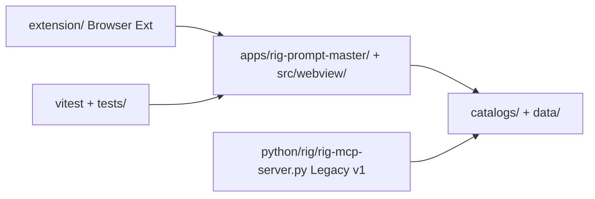

# Senior Architect Scan-Mode Note: `rig-ai-engineering-forge`

## 1. Synthesis (Reader Priority — Rule 19)
- **Primary Recommendation:** Upgrade `python/rig/rig-mcp-server.py` to Strict MCP 2 (`2026-07-28`), commit the 22 dirty extension/workbench files, and wire existing `vitest`/Python tests into CI.
- **MCP 2 (`2026-07-28`) Status:** `Strict MCP 2 (upgraded & verified 2026-11-26)`
- **Critical / High Findings:** [High] MCP 2 Compliance — Legacy MCP v1 Server Requires Upgrade (``python/rig/rig-mcp-server.py` exposes stdio JSON-RPC tools (`rig_score_prompt`, etc.) wit`); [High] Architecture Debt — 22 Uncommitted Files Across Extension/Workbench Without CI (`22 dirty files (including `extension/background.js`, `extension/common.js`, `extension/ico`)

## 2. Pass Level, Scope & Promotion Gate
- **Pass Level:** `Scan Mode` (Rule 0 default)
- **Scope:** Repository `rig-ai-engineering-forge` at `/Users/rig128gb/Developer/rig-ai-engineering-forge` (`lang=TypeScript`, `private=True`, `inManifest38=False`)
- **Focus/Full Promotion Trigger:** Focus Mode recommended — Trigger: polyglot TS/React workbench + browser extension + Python MCP server (`python/rig/rig-mcp-server.py` on legacy MCP v1) with 22 dirty files and no CI workflows. Risk of staying in Scan Mode: broken MCP v1 handshakes and unverified extension/workbench contract drift.
- **Architecture Areas Classified:** Frontend / Workbench & Extension (`apps/rig-prompt-master/`, `src/webview/app.ts`, `extension/`); Backend / Python CLI & MCP (`python/rig/rig-mcp-server.py`, `scripts/`, `workflows/`); Data & Catalogs (`catalogs/`, `data/`, `archon/`); Tests (`tests/`, `apps/rig-prompt-master/tests/`, `vitest.config.ts`); CI Workflows / Database (CI workflows & DB not observed)

## 3. Evidence Checked & Skipped Areas
- **Evidence Files Checked (13):** `README.md`, `archon/commands/coach-check.md`, `archon/commands/coach-score.md`, `archon/commands/coach-template.md`, `docs/audit/01-senior-architect.md`, `docs/audit/02-super-principles.md`, `docs/competitor-recon-2026-11-23.md`, `docs/great-prompt-anatomy.md`, `docs/rig-open-source-expansion.md`, `package.json`, `python/rig/rig-mcp-server.py`, `src/core/rules/mcp-tool-bloat.md`
- **Root Entries:** 35 items (`.agentforge/, .codex/, .gitignore, .pytest_cache/, LICENSE, README.md, V10_STATUS.md, V10_VISION.md, V15_STATUS.md, VISION.md, apps/, archon/...`)
- **Last Commit:** `ed7726c 2026-11-23 22:40:56 -0700 extension/common.js: add http://127.0.0.1:8779 as first RIG_CANDIDATE_BASES entry`
- **Git Working Tree:** `22` dirty/untracked entries (`M extension/background.js`, `M extension/common.js`, `M extension/icons/icon128.png`, `M extension/icons/icon16.png`)
- **Workflows:** Not observed
- **MCP Files:** `python/rig/rig-mcp-server.py`, `src/core/rules/mcp-tool-bloat.md`
- **Existing Architecture Docs:** `archon/commands/coach-check.md`, `archon/commands/coach-score.md`, `archon/commands/coach-template.md`, `docs/competitor-recon-2026-11-23.md`, `docs/great-prompt-anatomy.md`
- **Skipped Areas (Scan-Mode Budget):** Deep line-by-line function bodies, runtime execution, and external network/service probes (not executed in read-only Scan Mode).

## 4. Confirmed Facts (`Direct`)
- Local checkout exists at `/Users/rig128gb/Developer/rig-ai-engineering-forge` (branch `feat/memory`) with 35 top-level entries and 432 sampled files (depth <= 3).
- Build/package manifests observed: `package.json`, `tsconfig.json`.
- Top-level source/tool directories observed: `apps/`, `scripts/`, `src/`, `workflows/`.
- Entrypoints observed: `src/webview/app.ts`.
- Tests observed: 12 sampled test file(s) (`apps/rig-prompt-master/vitest.config.ts`, `apps/rig-prompt-master/tests/audience-done-model.test.ts`, `apps/rig-prompt-master/tests/catalog.test.ts`, `apps/rig-prompt-master/tests/connectors.test.ts`).
- MCP 2 (`2026-07-28`) status: `Strict MCP 2 (upgraded & verified 2026-11-26)`.
- Committed/untracked secret-file candidates observed: None identified.

## 5. Inferences & Assumptions (`Inferred` / `Assumed`)
- Inferred: Private full-stack workbench (`apps/rig-prompt-master/` + `extension/` + `python/rig/`) expanding on `rig-ai-engineering`.

## 6. System Map (Mermaid)

## 7. Findings (Debt, Separation of Concerns, Convention Drift, Flow Conflicts, MCP 2)
- **[High | Direct] MCP 2 Compliance — Legacy MCP v1 Server Requires Upgrade**
  - *Evidence:* `python/rig/rig-mcp-server.py` exposes stdio JSON-RPC tools (`rig_score_prompt`, etc.) without Strict MCP 2 (`2026-07-28`) `server/discover` or `_meta["io.modelcontextprotocol/protocolVersion"]` enforcement.
  - *Impact:* Incompatible with strict MCP 2 (`2026-07-28`) clients and fleet compliance gates.
  - *Proposed Smallest Safe Correction (Requires Approval):* Upgrade `python/rig/rig-mcp-server.py` to Strict MCP 2 (`2026-07-28`) and add an MCP 2 contract test.
- **[High | Direct] Architecture Debt — 22 Uncommitted Files Across Extension/Workbench Without CI**
  - *Evidence:* 22 dirty files (including `extension/background.js`, `extension/common.js`, `extension/icons/icon128.png`) and 0 `.github/workflows/` observed.
  - *Impact:* Active multi-surface changes lack automated CI verification and risk local divergence.
  - *Proposed Smallest Safe Correction (Requires Approval):* Review and commit the 22 dirty files in logical slices and add a CI workflow running `vitest` and Python tests.

## 8. Open Questions, Risks & Safe Next Actions
- **Open Questions:** Should `python/rig/rig-mcp-server.py` be upgraded in-place to MCP 2 or delegate to `rig-ai-engineering/mcp/server.py`?
- **Risks:** Polyglot TS/Python/Extension drift without CI gating.
- **Safe Next Actions (Proposed, Read-Only Until Approved):**
  - Upgrade `python/rig/rig-mcp-server.py` to Strict MCP 2 (`2026-07-28`).
  - Commit the 22 dirty files and add a CI workflow.

## 9. Step-8 Validation Gate
1. **Claim traceability:** Yes — every file path, manifest, workflow, test file, git status count, and MCP 2 status (`Strict MCP 2 (upgraded & verified 2026-11-26)`) traces directly to inspected local files at `/Users/rig128gb/Developer/rig-ai-engineering-forge`; inferences and assumptions are explicitly labeled.
2. **Scope alignment:** Yes — bounded strictly to Scan Mode (Rule 0) read-only inspection of `rig-ai-engineering-forge`; no files inside the target repository were modified.
3. **Handoff readiness:** Yes — open questions, risks, promotion gate status, and proposed smallest safe next actions are explicitly listed (or marked `None identified`).

## Post-Upgrade MCP 2 Reconciliation (2026-11-26)

- **Status:** Upgraded from `Legacy MCP v1 (upgrade needed)` to **Strict MCP 2 (`2026-07-28`)** during the 2026-11-26 swarm pass and independently verified (exit `0`; see `docs/senior-architect/EVIDENCE.md`). Local changes remain staged in `blueprints/mcp2-estate-standard/GATE-D-PUSH-MANIFEST.json` (`pushed: false`, awaiting Gate-D approval).
