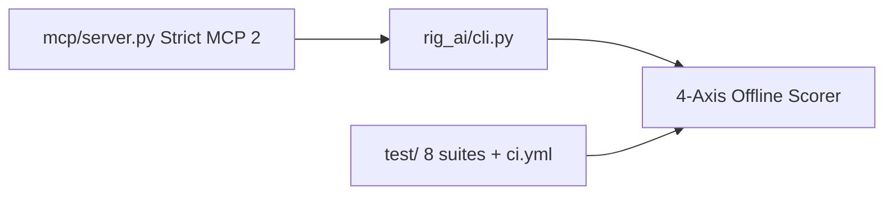

# Senior Architect Scan-Mode Note: `rig-ai-engineering`

## 1. Synthesis (Reader Priority — Rule 19)
- **Primary Recommendation:** Commit the 3 pending MCP 2 / lattice retrofit files after running `test/`, and clarify shared-core boundaries with `rig-ai-engineering-forge`.
- **MCP 2 (`2026-07-28`) Status:** `Strict MCP 2`
- **Critical / High Findings:** None identified.

## 2. Pass Level, Scope & Promotion Gate
- **Pass Level:** `Scan Mode` (Rule 0 default)
- **Scope:** Repository `rig-ai-engineering` at `/Users/rig128gb/Developer/rig-ai-engineering` (`lang=Python`, `private=False`, `inManifest38=True`)
- **Focus/Full Promotion Trigger:** None (clean, well-tested offline prompt scorer with Strict MCP 2; Scan Mode sufficient)
- **Architecture Areas Classified:** Backend / CLI (`rig_ai/cli.py`, `pyproject.toml`); MCP Surface (`mcp/server.py` Strict MCP 2); Tests & CI (`test/test_axes.py`, `test_calibration.py`, `test_cli.py`, `ci.yml`, `rig-lattice.yml`); Documentation (`docs/architecture.md`, `docs/axes.md`, `AGENTS.md`); Frontend / Database (Not observed)

## 3. Evidence Checked & Skipped Areas
- **Evidence Files Checked (8):** `.github/workflows/ci.yml`, `.github/workflows/rig-lattice.yml`, `AGENTS.md`, `README.md`, `docs/architecture.md`, `docs/axes.md`, `mcp/server.py`, `pyproject.toml`
- **Root Entries:** 23 items (`.coverage, .github/, .gitignore, .pytest_cache/, .rig/, .ruff_cache/, .venv/, .venv311/, AGENTS.md, CHANGELOG.md, CODE_OF_CONDUCT.md, CONTRIBUTING.md...`)
- **Last Commit:** `f40d6da 2026-10-19 23:57:13 -0600 chore: repository hygiene checks, CI timeouts, and doc truth fixes`
- **Git Working Tree:** `3` dirty/untracked entries (`M .github/workflows/rig-lattice.yml`, `M mcp/server.py`, `M rig.repos.json`)
- **Workflows:** `.github/workflows/ci.yml`, `.github/workflows/rig-lattice.yml`
- **MCP Files:** `mcp/server.py`
- **Existing Architecture Docs:** `AGENTS.md`, `docs/architecture.md`, `docs/axes.md`
- **Skipped Areas (Scan-Mode Budget):** Deep line-by-line function bodies, runtime execution, and external network/service probes (not executed in read-only Scan Mode).

## 4. Confirmed Facts (`Direct`)
- Local checkout exists at `/Users/rig128gb/Developer/rig-ai-engineering` (branch `ghup/2026-10-19`) with 23 top-level entries and 87 sampled files (depth <= 3).
- Build/package manifests observed: `pyproject.toml`.
- Top-level source/tool directories observed: `mcp/`.
- Entrypoints observed: `mcp/server.py`, `rig_ai/cli.py`.
- Tests observed: 8 sampled test file(s) (`test/test_axes.py`, `test/test_calibration.py`, `test/test_cli.py`, `test/test_docs.py`).
- MCP 2 (`2026-07-28`) status: `Strict MCP 2`.
- Committed/untracked secret-file candidates observed: None identified.

## 5. Inferences & Assumptions (`Inferred` / `Assumed`)
- Inferred: Deterministic offline 4-axis prompt scorer/rewriter (`rig_ai/cli.py`) exposed over Strict MCP 2 (`mcp/server.py`).

## 6. System Map (Mermaid)

## 7. Findings (Debt, Separation of Concerns, Convention Drift, Flow Conflicts, MCP 2)
- **[Medium | Direct] Convention Drift — Uncommitted MCP 2 & Lattice Retrofit**
  - *Evidence:* 3 dirty files: `M .github/workflows/rig-lattice.yml`, `M mcp/server.py`, `M rig.repos.json`.
  - *Impact:* Local MCP 2 updates are uncommitted.
  - *Proposed Smallest Safe Correction (Requires Approval):* Review `git diff`, run `test/`, and commit the 3 files.
- **[Low | Direct] Workspace Hygiene — Multiple Local Virtualenvs**
  - *Evidence:* Both `.venv/` and `.venv311/` exist in the repo root.
  - *Impact:* Can cause tooling/IDE confusion over which Python interpreter is active.
  - *Proposed Smallest Safe Correction (Requires Approval):* Keep one canonical `.venv/` and remove the unused `.venv311/` locally.

## 8. Open Questions, Risks & Safe Next Actions
- **Open Questions:** How is core scoring logic shared or kept in sync with `rig-ai-engineering-forge`?
- **Risks:** Potential divergence between this public CLI (`rig-ai-engineering`) and the private workbench (`rig-ai-engineering-forge`).
- **Safe Next Actions (Proposed, Read-Only Until Approved):**
  - Commit the 3 pending MCP 2 / lattice files after running `test/`.

## 9. Step-8 Validation Gate
1. **Claim traceability:** Yes — every file path, manifest, workflow, test file, git status count, and MCP 2 status (`Strict MCP 2`) traces directly to inspected local files at `/Users/rig128gb/Developer/rig-ai-engineering`; inferences and assumptions are explicitly labeled.
2. **Scope alignment:** Yes — bounded strictly to Scan Mode (Rule 0) read-only inspection of `rig-ai-engineering`; no files inside the target repository were modified.
3. **Handoff readiness:** Yes — open questions, risks, promotion gate status, and proposed smallest safe next actions are explicitly listed (or marked `None identified`).
