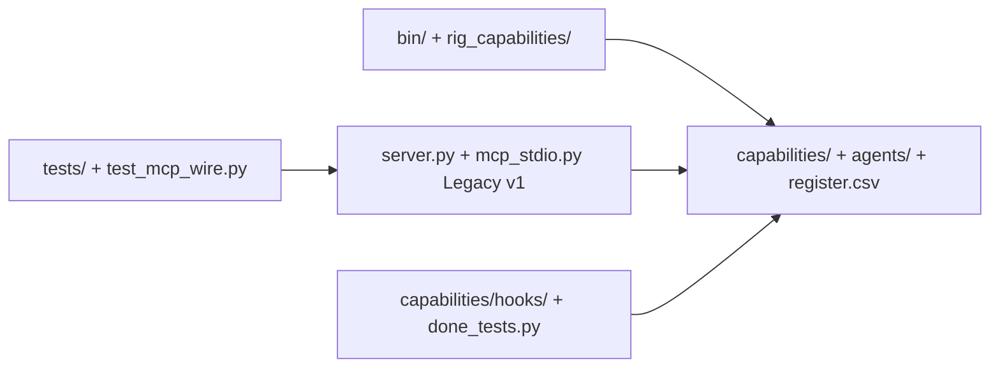

# Senior Architect Scan-Mode Note: `rig-capabilities`

## 1. Synthesis (Reader Priority — Rule 19)
- **Primary Recommendation:** Immediately relocate untracked `.signing.key` out of this public repo root, then upgrade `rig_capabilities/mcp_stdio.py` from legacy v1 (`2025-06-18`) to Strict MCP 2 (`2026-07-28`).
- **MCP 2 (`2026-07-28`) Status:** `Legacy MCP v1 (upgrade needed)`
- **Critical / High Findings:** [Critical] Security / Secret Hygiene — Untracked `.signing.key` Present in Repo Root (``.signing.key` exists as an untracked file at `/Users/rig128gb/Developer/rc-s11-wt/.signin`); [High] MCP 2 Compliance — Legacy MCP v1 Protocol Versions Hardcoded (``rig_capabilities/mcp_stdio.py` hardcodes `SUPPORTED_PROTOCOL_VERSIONS = ("2024-11-05", "2`)

## 2. Pass Level, Scope & Promotion Gate
- **Pass Level:** `Scan Mode` (Rule 0 default)
- **Scope:** Repository `rig-capabilities` at `/Users/rig128gb/Developer/rc-s11-wt` (`lang=Python`, `private=False`, `inManifest38=True`)
- **Focus/Full Promotion Trigger:** Full Mode recommended — Trigger: canonical estate capability store serving all harnesses with Legacy MCP v1 (`2024-11-05`/`2025-03-26`/`2025-06-18`), an untracked `.signing.key` at repo root, 13 dirty runtime files, and no CI workflows in this worktree (`rc-s11-wt`). Risk of staying in Scan Mode: fleet-wide MCP breakage or accidental key exposure.
- **Architecture Areas Classified:** Backend / Capability Store & CLI (`bin/`, `rig_capabilities/`, `pyproject.toml`, `capability_register.csv`); MCP Surface (`rig_capabilities/mcp_stdio.py`, `mcp_wire.py`, `server.py`, `tests/test_mcp_wire.py` — Legacy MCP v1); Capabilities Assets (`capabilities/`, `agents/`, `acl_policy.json`); Tests (`tests/`, `capabilities/hooks/rig-loop-hooks.test.ts`, `rig_capabilities/done_tests.py`); CI Workflows / Frontend / Database (CI workflows not observed in worktree)

## 3. Evidence Checked & Skipped Areas
- **Evidence Files Checked (27):** `AGENTS.md`, `CLAUDE.md`, `README.md`, `capabilities/loops/research-harness.md`, `databricks-rig-lattice/SPEC.md`, `docs/ADOPTION-PLAN.md`, `docs/ASSUMPTIONS.md`, `docs/CONFLICT-RESOLUTIONS.md`, `docs/CONTEXT-FABRIC.md`, `examples/great/design-ux/hC-03-ux-research.md`, `examples/great/research-intel/excellence-ingestion.md`, `examples/great/research-intel/hD-09-market-research.md`
- **Root Entries:** 36 items (`.concepts.llm.json, .gitignore, .install.json, .pytest_cache/, .serena/, .signing.key, .tessl/, AGENTS.md, CLAUDE.md, LICENSE, README.md, acl_policy.json...`)
- **Last Commit:** `d7d57435 2026-09-12 14:10:09 -0500 rig-loop status: accept --format json; allow inspecting closed runs by id`
- **Git Working Tree:** `13` dirty/untracked entries (`M capabilities/skills/rig-lattice-system/rig_lattice/deviator/baselines/_last_recal.txt`, `M capabilities/skills/rig-lattice-system/runs/audit_hash_chain.jsonl`, `M capabilities/skills/rig-lattice-system/runs/brier_history.jsonl`, `M capabilities/skills/rig-lattice-system/runs/cost_ledger.jsonl`)
- **Workflows:** Not observed
- **MCP Files:** `rig_capabilities/mcp_stdio.py`, `rig_capabilities/mcp_wire.py`, `rig_capabilities/server.py`, `server.py`, `tests/test_mcp_wire.py`
- **Existing Architecture Docs:** `AGENTS.md`, `CLAUDE.md`, `capabilities/loops/research-harness.md`, `databricks-rig-lattice/SPEC.md`, `docs/ADOPTION-PLAN.md`
- **Skipped Areas (Scan-Mode Budget):** Deep line-by-line function bodies, runtime execution, and external network/service probes (not executed in read-only Scan Mode).

## 4. Confirmed Facts (`Direct`)
- Local checkout exists at `/Users/rig128gb/Developer/rc-s11-wt` (branch `s11-candidate`) with 36 top-level entries and 800 sampled files (depth <= 3).
- Build/package manifests observed: `pyproject.toml`.
- Top-level source/tool directories observed: `agents/`, `bin/`, `scripts/`.
- Entrypoints observed: `server.py`, `rig_capabilities/server.py`.
- Tests observed: 12 sampled test file(s) (`capabilities/hooks/rig-loop-hooks.test.ts`, `rig_capabilities/done_tests.py`, `tests/fable2031_afproof.py`, `tests/fable2031_brief.py`).
- MCP 2 (`2026-07-28`) status: `Legacy MCP v1 (upgrade needed)`.
- Committed/untracked secret-file candidates observed: 1 untracked file(s) (redacted; see Findings).

## 5. Inferences & Assumptions (`Inferred` / `Assumed`)
- Inferred: Local checkout at `/Users/rig128gb/Developer/rc-s11-wt` is a git worktree for `rig-capabilities`, serving skills, agents, hooks, loops, and harnesses via `rig_capabilities/server.py` and `mcp_stdio.py`.

## 6. System Map (Mermaid)

## 7. Findings (Debt, Separation of Concerns, Convention Drift, Flow Conflicts, MCP 2)
- **[Critical | Direct] Security / Secret Hygiene — Untracked `.signing.key` Present in Repo Root**
  - *Evidence:* `.signing.key` exists as an untracked file at `/Users/rig128gb/Developer/rc-s11-wt/.signing.key` (contents not read/printed).
  - *Impact:* A broad `git add .` could commit a private signing key to a public repository (`isPrivate=False`).
  - *Proposed Smallest Safe Correction (Requires Approval):* Verify `.signing.key` is in `.gitignore`, move it outside the repo tree (e.g. `~/.rig/keys/` or Keychain), and rotate if ever exposed.
- **[High | Direct] MCP 2 Compliance — Legacy MCP v1 Protocol Versions Hardcoded**
  - *Evidence:* `rig_capabilities/mcp_stdio.py` hardcodes `SUPPORTED_PROTOCOL_VERSIONS = ("2024-11-05", "2025-03-26", "2025-06-18")` and `LATEST_PROTOCOL_VERSION = "2025-06-18"`.
  - *Impact:* Canonical capability store fails Strict MCP 2 (`2026-07-28`) negotiation.
  - *Proposed Smallest Safe Correction (Requires Approval):* Upgrade `rig_capabilities/mcp_stdio.py` and `tests/test_mcp_wire.py` to Strict MCP 2 (`2026-07-28`).
- **[Medium | Direct] Architecture Debt — Runtime Audit Logs Dirtying Worktree + No CI Observed**
  - *Evidence:* 13 dirty files including `audit_hash_chain.jsonl`, `brier_history.jsonl`, `_last_recal.txt`; 0 `.github/workflows/` observed in worktree.
  - *Impact:* Runtime state mutates tracked files in the git worktree, polluting diffs.
  - *Proposed Smallest Safe Correction (Requires Approval):* Relocate runtime run logs out of tracked paths (or `.gitignore` them) and verify CI workflows on `main`.

## 8. Open Questions, Risks & Safe Next Actions
- **Open Questions:** Is `.signing.key` referenced by an absolute path or relative to the worktree root?
- **Risks:** Public repo (`isPrivate=False`) with an untracked `.signing.key` at root carries high accidental-commit risk.
- **Safe Next Actions (Proposed, Read-Only Until Approved):**
  - Move `.signing.key` out of the repo root and confirm `.gitignore` coverage.
  - Upgrade `rig_capabilities/mcp_stdio.py` to Strict MCP 2 (`2026-07-28`).
  - Separate runtime `.jsonl` logs from git-tracked files.

## 9. Step-8 Validation Gate
1. **Claim traceability:** Yes — every file path, manifest, workflow, test file, git status count, and MCP 2 status (`Legacy MCP v1 (upgrade needed)`) traces directly to inspected local files at `/Users/rig128gb/Developer/rc-s11-wt`; inferences and assumptions are explicitly labeled.
2. **Scope alignment:** Yes — bounded strictly to Scan Mode (Rule 0) read-only inspection of `rig-capabilities`; no files inside the target repository were modified.
3. **Handoff readiness:** Yes — open questions, risks, promotion gate status, and proposed smallest safe next actions are explicitly listed (or marked `None identified`).
