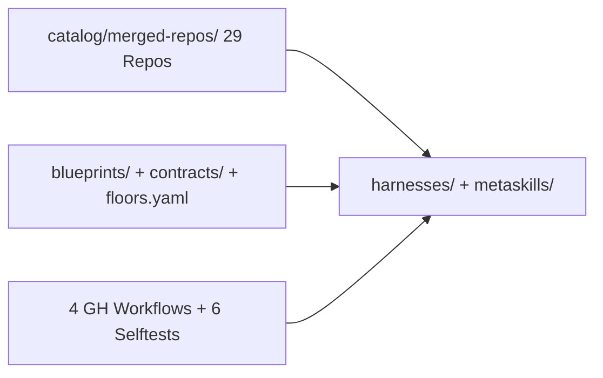

# Senior Architect Scan-Mode Note: `rig-company-os`

## 1. Synthesis (Reader Priority — Rule 19)
- **Primary Recommendation:** No architecture defects identified; maintain the 4 existing governance/canvas/ownership CI workflows.
- **MCP 2 (`2026-07-28`) Status:** `No MCP surface observed`
- **Critical / High Findings:** None identified.

## 2. Pass Level, Scope & Promotion Gate
- **Pass Level:** `Scan Mode` (Rule 0 default)
- **Scope:** Repository `rig-company-os` at `/Users/rig128gb/Developer/rig-company-os` (`lang=HTML`, `private=True`, `inManifest38=False`)
- **Focus/Full Promotion Trigger:** None (clean, well-governed consolidation hub with 4 CI workflows and 6 selftests; Scan Mode sufficient)
- **Architecture Areas Classified:** Governance & Contracts (`AGENTS.md`, `HARNESS.md`, `OWNERS.yaml`, `floors.yaml`, `contracts/`, `proof.json`); Harnesses & Blueprints (`blueprints/`, `canvas/`, `harnesses/`, `metaharness/`, `metaskills/`, `golden/`); Catalog (`catalog/merged-repos/` 29 sourced agency-OS repos); Tests & CI (`scripts/selftests/test-01..03*.sh`, 4 GitHub workflows: `canvas-verify.yml`, `governance.yml`, `offline-safety.yml`, `ownership.yml`); MCP / Database (Not observed)

## 3. Evidence Checked & Skipped Areas
- **Evidence Files Checked (23):** `.github/workflows/canvas-verify.yml`, `.github/workflows/governance.yml`, `.github/workflows/offline-safety.yml`, `.github/workflows/ownership.yml`, `AGENTS.md`, `README.md`, `catalog/merged-repos/InvoiceShelf_InvoiceShelf/AGENTS.md`, `catalog/merged-repos/Mohrimz_sayso/AGENTS.md`, `catalog/merged-repos/Vibra-Labs_Atrium/CLAUDE.md`, `catalog/merged-repos/Worklenz_worklenz/AGENTS.md`, `catalog/merged-repos/Worklenz_worklenz/DESIGN.md`, `catalog/merged-repos/frappe_crm/AGENTS.md`
- **Root Entries:** 20 items (`.github/, AGENTS.md, HARNESS.md, OWNERS.yaml, README.md, blueprints/, canvas/, catalog/, contracts/, docs/, floors.yaml, golden/...`)
- **Last Commit:** `eedb0b7 2026-11-22 14:49:25 -0700 ci: make owned dirs exist in clean checkouts; scan authored paths only`
- **Git Working Tree:** `0` dirty/untracked entries (clean)
- **Workflows:** `.github/workflows/canvas-verify.yml`, `.github/workflows/governance.yml`, `.github/workflows/offline-safety.yml`, `.github/workflows/ownership.yml`
- **MCP Files:** Not observed
- **Existing Architecture Docs:** `AGENTS.md`, `catalog/merged-repos/InvoiceShelf_InvoiceShelf/AGENTS.md`, `catalog/merged-repos/Mohrimz_sayso/AGENTS.md`, `catalog/merged-repos/Vibra-Labs_Atrium/CLAUDE.md`, `catalog/merged-repos/Worklenz_worklenz/AGENTS.md`
- **Skipped Areas (Scan-Mode Budget):** Deep line-by-line function bodies, runtime execution, and external network/service probes (not executed in read-only Scan Mode).

## 4. Confirmed Facts (`Direct`)
- Local checkout exists at `/Users/rig128gb/Developer/rig-company-os` (branch `main`) with 20 top-level entries and 313 sampled files (depth <= 3).
- Build/package manifests observed: Not observed.
- Top-level source/tool directories observed: `harnesses/`, `scripts/`, `workflows/`.
- Entrypoints observed: Not observed.
- Tests observed: 6 sampled test file(s) (`scripts/selftests/test-01-onboarding.sh`, `scripts/selftests/test-02-catalog-quoting.sh`, `scripts/selftests/test-03-billing.sh`, `scripts/selftests/test-04-kanban-sla.sh`).
- MCP 2 (`2026-07-28`) status: `No MCP surface observed`.
- Committed/untracked secret-file candidates observed: None identified.

## 5. Inferences & Assumptions (`Inferred` / `Assumed`)
- Inferred: Governed consolidation hub for the Company OS Factory with enforced ownership (`OWNERS.yaml`), offline safety, and canvas verification in CI.

## 6. System Map (Mermaid)

## 7. Findings (Debt, Separation of Concerns, Convention Drift, Flow Conflicts, MCP 2)
None identified.

## 8. Open Questions, Risks & Safe Next Actions
- **Open Questions:** None identified
- **Risks:** Upstream drift across the 29 merged repos inside `catalog/merged-repos/` if not periodically refreshed.
- **Safe Next Actions (Proposed, Read-Only Until Approved):**
  - Maintain the 4 governance/verification CI workflows on any new blueprint additions.

## 9. Step-8 Validation Gate
1. **Claim traceability:** Yes — every file path, manifest, workflow, test file, git status count, and MCP 2 status (`No MCP surface observed`) traces directly to inspected local files at `/Users/rig128gb/Developer/rig-company-os`; inferences and assumptions are explicitly labeled.
2. **Scope alignment:** Yes — bounded strictly to Scan Mode (Rule 0) read-only inspection of `rig-company-os`; no files inside the target repository were modified.
3. **Handoff readiness:** Yes — open questions, risks, promotion gate status, and proposed smallest safe next actions are explicitly listed (or marked `None identified`).
