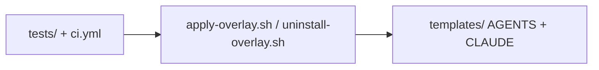

# Senior Architect Scan-Mode Note: `rig-doctrine-overlay`

## 1. Synthesis (Reader Priority — Rule 19)
- **Primary Recommendation:** No architecture defects identified; maintain current pytest coverage and CI workflow.
- **MCP 2 (`2026-07-28`) Status:** `No MCP surface observed`
- **Critical / High Findings:** None identified.

## 2. Pass Level, Scope & Promotion Gate
- **Pass Level:** `Scan Mode` (Rule 0 default)
- **Scope:** Repository `rig-doctrine-overlay` at `/Users/rig128gb/Developer/rig-doctrine-overlay` (`lang=Shell`, `private=False`, `inManifest38=False`)
- **Focus/Full Promotion Trigger:** None (clean, tested shell/template overlay repo; Scan Mode sufficient)
- **Architecture Areas Classified:** Overlay Scripts (`apply-overlay.sh`, `uninstall-overlay.sh`, `scripts/`); Templates & Specs (`templates/AGENTS.md`, `templates/CLAUDE.md`, `spec/`); Tests & CI (`tests/test_overlay.py`, `tests/test_rig_checks.py`, `pyproject.toml`, `ci.yml`); Frontend / Database / MCP (Not observed)

## 3. Evidence Checked & Skipped Areas
- **Evidence Files Checked (7):** `.github/workflows/ci.yml`, `AGENTS.md`, `CLAUDE.md`, `README.md`, `pyproject.toml`, `templates/AGENTS.md`, `templates/CLAUDE.md`
- **Root Entries:** 16 items (`.github/, .gitignore, .rig/, AGENTS.md, CLAUDE.md, LICENSE, README.md, TOP-10-CANDIDATES.md, apply-overlay.sh, assets/, pyproject.toml, scripts/...`)
- **Last Commit:** `3363018 2026-10-10 19:40:06 -0600 Merge pull request #1 from mrodgersjs-web/loop/2026-10-10-build-core`
- **Git Working Tree:** `0` dirty/untracked entries (clean)
- **Workflows:** `.github/workflows/ci.yml`
- **MCP Files:** Not observed
- **Existing Architecture Docs:** `AGENTS.md`, `CLAUDE.md`, `templates/AGENTS.md`, `templates/CLAUDE.md`
- **Skipped Areas (Scan-Mode Budget):** Deep line-by-line function bodies, runtime execution, and external network/service probes (not executed in read-only Scan Mode).

## 4. Confirmed Facts (`Direct`)
- Local checkout exists at `/Users/rig128gb/Developer/rig-doctrine-overlay` (branch `main`) with 16 top-level entries and 31 sampled files (depth <= 3).
- Build/package manifests observed: `pyproject.toml`.
- Top-level source/tool directories observed: `scripts/`.
- Entrypoints observed: Not observed.
- Tests observed: 3 sampled test file(s) (`tests/conftest.py`, `tests/test_overlay.py`, `tests/test_rig_checks.py`).
- MCP 2 (`2026-07-28`) status: `No MCP surface observed`.
- Committed/untracked secret-file candidates observed: None identified.

## 5. Inferences & Assumptions (`Inferred` / `Assumed`)
- Inferred: Applies and removes standardized RIG doctrine templates (`templates/`) onto target repositories via `apply-overlay.sh`/`uninstall-overlay.sh`, verified by pytest.

## 6. System Map (Mermaid)

## 7. Findings (Debt, Separation of Concerns, Convention Drift, Flow Conflicts, MCP 2)
None identified.

## 8. Open Questions, Risks & Safe Next Actions
- **Open Questions:** None identified
- **Risks:** Template drift if `templates/AGENTS.md` lags behind estate doctrine updates.
- **Safe Next Actions (Proposed, Read-Only Until Approved):**
  - Keep `tests/test_overlay.py` green when updating `templates/`.

## 9. Step-8 Validation Gate
1. **Claim traceability:** Yes — every file path, manifest, workflow, test file, git status count, and MCP 2 status (`No MCP surface observed`) traces directly to inspected local files at `/Users/rig128gb/Developer/rig-doctrine-overlay`; inferences and assumptions are explicitly labeled.
2. **Scope alignment:** Yes — bounded strictly to Scan Mode (Rule 0) read-only inspection of `rig-doctrine-overlay`; no files inside the target repository were modified.
3. **Handoff readiness:** Yes — open questions, risks, promotion gate status, and proposed smallest safe next actions are explicitly listed (or marked `None identified`).
