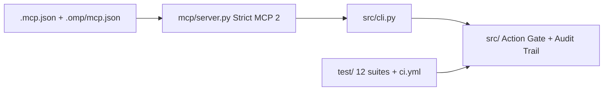

# Senior Architect Scan-Mode Note: `rig-enhanced-agent-ops`

## 1. Synthesis (Reader Priority — Rule 19)
- **Primary Recommendation:** Review and commit the 4 pending MCP 2 / lattice retrofit files after running `pytest test/`.
- **MCP 2 (`2026-07-28`) Status:** `Strict MCP 2`
- **Critical / High Findings:** None identified.

## 2. Pass Level, Scope & Promotion Gate
- **Pass Level:** `Scan Mode` (Rule 0 default)
- **Scope:** Repository `rig-enhanced-agent-ops` at `/Users/rig128gb/Developer/rig-enhanced-agent-ops` (`lang=Python`, `private=False`, `inManifest38=True`)
- **Focus/Full Promotion Trigger:** None (well-tested Python package with Strict MCP 2 and CI; Scan Mode sufficient)
- **Architecture Areas Classified:** Backend / Action Gate & Audit Trail (`src/cli.py`, `src/`, `scripts/`, `pyproject.toml`); MCP Surface (`mcp/server.py` Strict MCP 2; client configs `.mcp.json`, `.omp/mcp.json`); Tests & CI (`test/` 12+ suites incl. `test_action_gate.py`, `test_audit_trail.py`, `ci.yml`, `rig-lattice.yml`); Documentation (`docs/architecture.md`, `AGENTS.md`, `spec/`); Frontend / Database (Not observed)

## 3. Evidence Checked & Skipped Areas
- **Evidence Files Checked (9):** `.github/workflows/ci.yml`, `.github/workflows/rig-lattice.yml`, `.mcp.json`, `.omp/mcp.json`, `AGENTS.md`, `README.md`, `docs/architecture.md`, `mcp/server.py`, `pyproject.toml`
- **Root Entries:** 28 items (`.agentsroom/, .claude/, .coverage, .github/, .gitignore, .mcp.json, .omp/, .pytest_cache/, .rig/, .ruff_cache/, AGENTS.md, CHANGELOG.md...`)
- **Last Commit:** `888c642 2026-11-17 09:13:22 -0700 chore(robonuggets-ops): finalize bridges CLI path and ignore local agentsroom state`
- **Git Working Tree:** `4` dirty/untracked entries (`M .github/workflows/rig-lattice.yml`, `M mcp/server.py`, `M rig.repos.json`, `?? .agentsroom/`)
- **Workflows:** `.github/workflows/ci.yml`, `.github/workflows/rig-lattice.yml`
- **MCP Files:** `.mcp.json`, `.omp/mcp.json`, `mcp/server.py`
- **Existing Architecture Docs:** `AGENTS.md`, `docs/architecture.md`
- **Skipped Areas (Scan-Mode Budget):** Deep line-by-line function bodies, runtime execution, and external network/service probes (not executed in read-only Scan Mode).

## 4. Confirmed Facts (`Direct`)
- Local checkout exists at `/Users/rig128gb/Developer/rig-enhanced-agent-ops` (branch `feat/robonuggets-6tool-ops`) with 28 top-level entries and 117 sampled files (depth <= 3).
- Build/package manifests observed: `pyproject.toml`.
- Top-level source/tool directories observed: `mcp/`, `scripts/`, `src/`.
- Entrypoints observed: `mcp/server.py`, `src/cli.py`.
- Tests observed: 12 sampled test file(s) (`test/test_action_gate.py`, `test/test_audit_trail.py`, `test/test_cli.py`, `test/test_move1_arms_audit.py`).
- MCP 2 (`2026-07-28`) status: `Strict MCP 2`.
- Committed/untracked secret-file candidates observed: None identified.

## 5. Inferences & Assumptions (`Inferred` / `Assumed`)
- Inferred: Confidence-gated agent action runner sealing decisions into a tamper-evident audit trail, exposed via `src/cli.py` and Strict MCP 2 `mcp/server.py`.

## 6. System Map (Mermaid)

## 7. Findings (Debt, Separation of Concerns, Convention Drift, Flow Conflicts, MCP 2)
- **[Medium | Direct] Convention Drift — Uncommitted MCP 2 & Lattice Retrofit**
  - *Evidence:* 4 dirty files including `M .github/workflows/rig-lattice.yml`, `M mcp/server.py`, `M rig.repos.json`.
  - *Impact:* Local MCP 2 updates are uncommitted.
  - *Proposed Smallest Safe Correction (Requires Approval):* Review `git diff`, run `pytest test/`, and commit the 4 files.
- **[Low | Direct] Project Convention Drift — Multiple Harness MCP Client Configs**
  - *Evidence:* Both `.mcp.json` and `.omp/mcp.json` exist at repo root without explicit `2026-07-28` version pinning.
  - *Impact:* Harness configs can drift from `mcp/server.py` launch arguments.
  - *Proposed Smallest Safe Correction (Requires Approval):* Verify `.mcp.json` and `.omp/mcp.json` point to the exact `mcp/server.py` Strict MCP 2 entrypoint.

## 8. Open Questions, Risks & Safe Next Actions
- **Open Questions:** None identified
- **Risks:** Uncommitted changes to `mcp/server.py` and `rig-lattice.yml`.
- **Safe Next Actions (Proposed, Read-Only Until Approved):**
  - Review and commit the 4 dirty files after running `test/`.

## 9. Step-8 Validation Gate
1. **Claim traceability:** Yes — every file path, manifest, workflow, test file, git status count, and MCP 2 status (`Strict MCP 2`) traces directly to inspected local files at `/Users/rig128gb/Developer/rig-enhanced-agent-ops`; inferences and assumptions are explicitly labeled.
2. **Scope alignment:** Yes — bounded strictly to Scan Mode (Rule 0) read-only inspection of `rig-enhanced-agent-ops`; no files inside the target repository were modified.
3. **Handoff readiness:** Yes — open questions, risks, promotion gate status, and proposed smallest safe next actions are explicitly listed (or marked `None identified`).
