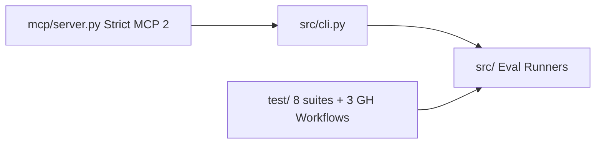

# Senior Architect Scan-Mode Note: `rig-enhanced-evals`

## 1. Synthesis (Reader Priority — Rule 19)
- **Primary Recommendation:** Review and commit the 7 pending MCP 2 / `.gitignore` retrofit files after running `pytest test/`.
- **MCP 2 (`2026-07-28`) Status:** `Strict MCP 2`
- **Critical / High Findings:** None identified.

## 2. Pass Level, Scope & Promotion Gate
- **Pass Level:** `Scan Mode` (Rule 0 default)
- **Scope:** Repository `rig-enhanced-evals` at `/Users/rig128gb/Developer/rig-enhanced-evals` (`lang=Python`, `private=False`, `inManifest38=True`)
- **Focus/Full Promotion Trigger:** None (well-tested Python eval package with Strict MCP 2 and 3 CI workflows; Scan Mode sufficient)
- **Architecture Areas Classified:** Backend / Eval Engine & CLI (`src/cli.py`, `src/`, `pyproject.toml`); MCP Surface (`mcp/server.py` Strict MCP 2); Tests & CI (`test/` 8 suites, `ci.yml`, `smoke.yml`, `rig-lattice.yml`); Documentation (`docs/architecture.md`, `AGENTS.md`, `spec/`); Frontend / Database (Not observed)

## 3. Evidence Checked & Skipped Areas
- **Evidence Files Checked (8):** `.github/workflows/ci.yml`, `.github/workflows/rig-lattice.yml`, `.github/workflows/smoke.yml`, `AGENTS.md`, `README.md`, `docs/architecture.md`, `mcp/server.py`, `pyproject.toml`
- **Root Entries:** 29 items (`.coverage, .github/, .gitignore, .ignore, .pytest_cache/, .rig/, .ruff_cache/, .tmp/, AGENTS.md, CHANGELOG.md, CITATION.cff, CODE_OF_CONDUCT.md...`)
- **Last Commit:** `22e3f41 2026-10-20 00:54:16 -0600 fix(ci): valid workflow YAML, coverage run plus report, and a parse test for every workflow`
- **Git Working Tree:** `7` dirty/untracked entries (`M .github/workflows/rig-lattice.yml`, `M .gitignore`, `M mcp/server.py`, `M rig.repos.json`)
- **Workflows:** `.github/workflows/ci.yml`, `.github/workflows/rig-lattice.yml`, `.github/workflows/smoke.yml`
- **MCP Files:** `mcp/server.py`
- **Existing Architecture Docs:** `AGENTS.md`, `docs/architecture.md`
- **Skipped Areas (Scan-Mode Budget):** Deep line-by-line function bodies, runtime execution, and external network/service probes (not executed in read-only Scan Mode).

## 4. Confirmed Facts (`Direct`)
- Local checkout exists at `/Users/rig128gb/Developer/rig-enhanced-evals` (branch `ghup/2026-10-19`) with 29 top-level entries and 100 sampled files (depth <= 3).
- Build/package manifests observed: `pyproject.toml`.
- Top-level source/tool directories observed: `mcp/`, `src/`.
- Entrypoints observed: `mcp/server.py`, `src/cli.py`.
- Tests observed: 8 sampled test file(s) (`conftest.py`, `test/__init__.py`, `test/test_cli.py`, `test/test_evaluator.py`).
- MCP 2 (`2026-07-28`) status: `Strict MCP 2`.
- Committed/untracked secret-file candidates observed: None identified.

## 5. Inferences & Assumptions (`Inferred` / `Assumed`)
- Inferred: Agent evaluation framework (`src/cli.py`) exposed over Strict MCP 2 (`mcp/server.py`) with coverage-enforced CI.

## 6. System Map (Mermaid)

## 7. Findings (Debt, Separation of Concerns, Convention Drift, Flow Conflicts, MCP 2)
- **[Medium | Direct] Convention Drift — Uncommitted MCP 2 & Lattice Retrofit**
  - *Evidence:* 7 dirty files including `M .github/workflows/rig-lattice.yml`, `M .gitignore`, `M mcp/server.py`.
  - *Impact:* Local MCP 2 and `.gitignore` updates are uncommitted.
  - *Proposed Smallest Safe Correction (Requires Approval):* Review `git diff`, run `pytest test/`, and commit the 7 modified files.

## 8. Open Questions, Risks & Safe Next Actions
- **Open Questions:** None identified
- **Risks:** Temporary artifacts (`.tmp/`) present at root; verify `.gitignore` excludes `.tmp/`.
- **Safe Next Actions (Proposed, Read-Only Until Approved):**
  - Verify `.tmp/` is gitignored and commit the 7 dirty files after running `test/`.

## 9. Step-8 Validation Gate
1. **Claim traceability:** Yes — every file path, manifest, workflow, test file, git status count, and MCP 2 status (`Strict MCP 2`) traces directly to inspected local files at `/Users/rig128gb/Developer/rig-enhanced-evals`; inferences and assumptions are explicitly labeled.
2. **Scope alignment:** Yes — bounded strictly to Scan Mode (Rule 0) read-only inspection of `rig-enhanced-evals`; no files inside the target repository were modified.
3. **Handoff readiness:** Yes — open questions, risks, promotion gate status, and proposed smallest safe next actions are explicitly listed (or marked `None identified`).
