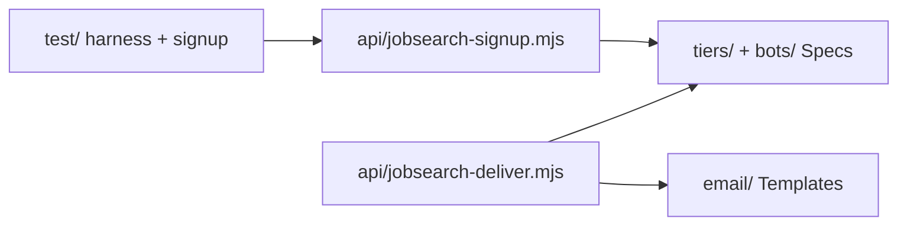

# Senior Architect Scan-Mode Note: `rig-grokbots-delivery`

## 1. Synthesis (Reader Priority — Rule 19)
- **Primary Recommendation:** Run `test/signup.test.mjs` and commit the 6 pending API edits, remove the two stale `tiers.bak-*` backup folders, and add a `package.json` + CI test workflow.
- **MCP 2 (`2026-07-28`) Status:** `No MCP surface observed`
- **Critical / High Findings:** None identified.

## 2. Pass Level, Scope & Promotion Gate
- **Pass Level:** `Scan Mode` (Rule 0 default)
- **Scope:** Repository `rig-grokbots-delivery` at `/Users/rig128gb/rig-builds/rig-grokbots-delivery` (`lang=JavaScript`, `private=True`, `inManifest38=False`)
- **Focus/Full Promotion Trigger:** Focus Mode recommended before production delivery edits — Trigger: live signup/delivery API endpoints (`api/jobsearch-signup.mjs`, `api/jobsearch-deliver.mjs`) with 6 dirty files, stale backup directories (`tiers.bak-*`), no `package.json`, and no CI workflow. Risk of staying in Scan Mode: unverified changes breaking user signup/email delivery.
- **Architecture Areas Classified:** Backend / Delivery API (`api/jobsearch-signup.mjs`, `api/jobsearch-deliver.mjs`, `email/`, `scripts/`); Bot Specs & Tiers (`bots/01..04*/SPEC.md`, `tiers/`); Build Output (`dist/`); Tests (`test/harness.mjs`, `test/signup.test.mjs`); CI / Package Manifest / Database / MCP (Not observed)

## 3. Evidence Checked & Skipped Areas
- **Evidence Files Checked (20):** `bots/01-hiring-signal-digest/SPEC.md`, `bots/02-recruiter-radar/SPEC.md`, `bots/03-company-pre-brief/SPEC.md`, `bots/04-hiring-manager-warm-engager/SPEC.md`, `bots/05-warm-intro-path-finder/SPEC.md`, `bots/06-network-re-activation/SPEC.md`, `bots/07-follow-up-tracker/SPEC.md`, `bots/08-role-fit-scorecard/SPEC.md`, `bots/09-tailored-resume/SPEC.md`, `bots/10-application-ledger-audit/SPEC.md`, `bots/11-tough-panel-role-play/SPEC.md`, `bots/12-interview-company-brief/SPEC.md`
- **Root Entries:** 12 items (`.gitignore, ENVIRONMENT.md, WALKTHROUGH.md, api/, bots/, dist/, email/, scripts/, test/, tiers/, tiers.bak-20261105T182813/, tiers.bak-bots-support-1793933630/`)
- **Last Commit:** `72978ae 2026-11-09 12:41:22 -0600 chore: checkpoint before github consolidation 2026-11-09`
- **Git Working Tree:** `6` dirty/untracked entries (`M api/jobsearch-deliver.mjs`, `M api/jobsearch-signup.mjs`, `M test/signup.test.mjs`, `?? api/jobsearch-email.mjs`)
- **Workflows:** Not observed
- **MCP Files:** Not observed
- **Existing Architecture Docs:** `bots/01-hiring-signal-digest/SPEC.md`, `bots/02-recruiter-radar/SPEC.md`, `bots/03-company-pre-brief/SPEC.md`, `bots/04-hiring-manager-warm-engager/SPEC.md`, `bots/05-warm-intro-path-finder/SPEC.md`
- **Skipped Areas (Scan-Mode Budget):** Deep line-by-line function bodies, runtime execution, and external network/service probes (not executed in read-only Scan Mode).

## 4. Confirmed Facts (`Direct`)
- Local checkout exists at `/Users/rig128gb/rig-builds/rig-grokbots-delivery` (branch `main`) with 12 top-level entries and 56 sampled files (depth <= 3).
- Build/package manifests observed: Not observed.
- Top-level source/tool directories observed: `api/`, `scripts/`.
- Entrypoints observed: Not observed.
- Tests observed: 2 sampled test file(s) (`test/harness.mjs`, `test/signup.test.mjs`).
- MCP 2 (`2026-07-28`) status: `No MCP surface observed`.
- Committed/untracked secret-file candidates observed: None identified.

## 5. Inferences & Assumptions (`Inferred` / `Assumed`)
- Inferred: Node ESM serverless/API delivery pipeline (`api/`, `email/`, `tiers/`) packaging and emailing job-search GrokBot tiers to subscribers.

## 6. System Map (Mermaid)

## 7. Findings (Debt, Separation of Concerns, Convention Drift, Flow Conflicts, MCP 2)
- **[Medium | Direct] Architecture Debt — Stale Backup Directories Coexisting With Active `tiers/`**
  - *Evidence:* Two backup folders (`tiers.bak-20261105T182813/`, `tiers.bak-bots-support-1793933630/`) sit at repo root alongside `tiers/`.
  - *Impact:* Creates ambiguity over active tier payloads and bloats the repo.
  - *Proposed Smallest Safe Correction (Requires Approval):* Remove or archive the two `tiers.bak-*` directories once confirmed unneeded.
- **[Medium | Direct] Architecture Debt — Missing `package.json` & CI Workflow for Active API**
  - *Evidence:* 0 manifests (`package.json`) and 0 `.github/workflows/` observed; 6 dirty files (`M api/jobsearch-deliver.mjs`, `M api/jobsearch-signup.mjs`, `M test/signup.test.mjs`).
  - *Impact:* API signup/delivery logic lacks automated CI gating and pinned dependency declarations.
  - *Proposed Smallest Safe Correction (Requires Approval):* Run `test/signup.test.mjs`, commit the 6 dirty files, and add `package.json` + a CI test workflow.

## 8. Open Questions, Risks & Safe Next Actions
- **Open Questions:** Where are `api/jobsearch-signup.mjs` and `api/jobsearch-deliver.mjs` hosted in production (Vercel/Cloudflare/Node)?
- **Risks:** Uncommitted edits to `api/jobsearch-signup.mjs` and `api/jobsearch-deliver.mjs` could break subscriber onboarding.
- **Safe Next Actions (Proposed, Read-Only Until Approved):**
  - Run `test/signup.test.mjs` and commit the 6 dirty files.
  - Clean up `tiers.bak-*` folders and add CI.

## 9. Step-8 Validation Gate
1. **Claim traceability:** Yes — every file path, manifest, workflow, test file, git status count, and MCP 2 status (`No MCP surface observed`) traces directly to inspected local files at `/Users/rig128gb/rig-builds/rig-grokbots-delivery`; inferences and assumptions are explicitly labeled.
2. **Scope alignment:** Yes — bounded strictly to Scan Mode (Rule 0) read-only inspection of `rig-grokbots-delivery`; no files inside the target repository were modified.
3. **Handoff readiness:** Yes — open questions, risks, promotion gate status, and proposed smallest safe next actions are explicitly listed (or marked `None identified`).
