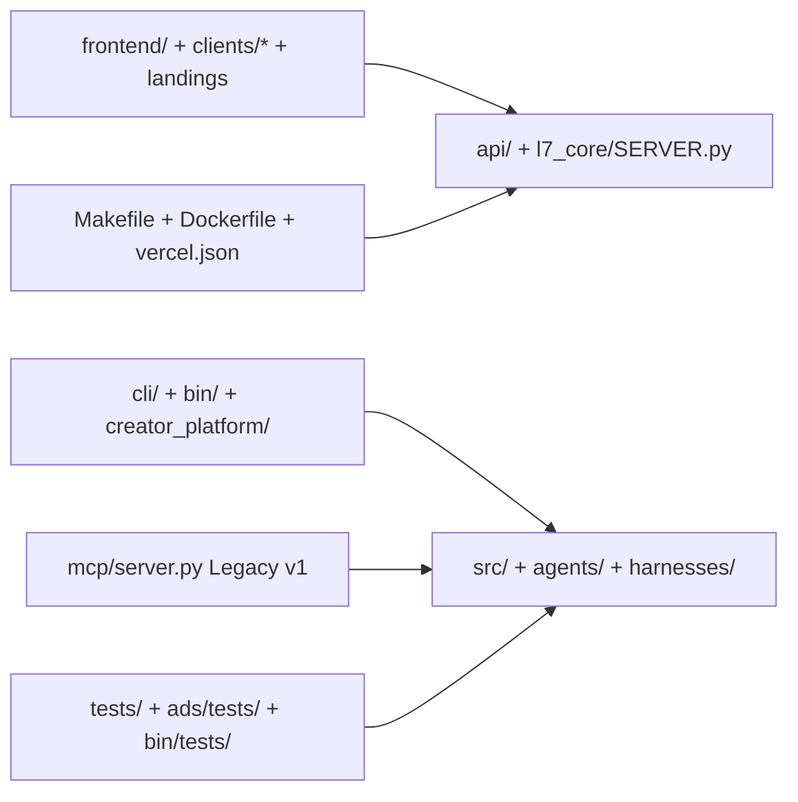

# Senior Architect Scan-Mode Note: `rig-gtm-studio-v2`

## 1. Synthesis (Reader Priority — Rule 19)
- **Primary Recommendation:** Upgrade `mcp/server.py` to Strict MCP 2 (`2026-07-28`), wire existing pytest suites into CI, and promote to Full Mode before refactoring the 141-entry root layout.
- **MCP 2 (`2026-07-28`) Status:** `Legacy MCP v1 (upgrade needed)`
- **Critical / High Findings:** [High] MCP 2 Compliance — Legacy MCP v1 Server Requires Upgrade (``mcp/server.py` implements the canonical RIG Studio read-only MCP without Strict MCP 2 (`2`); [High] Architecture Debt — Severe Root Sprawl (141 Entries) Without CI Gating (`141 top-level entries mixing runtime code, PNG artifacts (`.hero-check.png`, `.teaser-prev`)

## 2. Pass Level, Scope & Promotion Gate
- **Pass Level:** `Scan Mode` (Rule 0 default)
- **Scope:** Repository `rig-gtm-studio-v2` at `/Users/rig128gb/Developer/professional-ai-increment-3` (`lang=HTML`, `private=True`, `inManifest38=False`)
- **Focus/Full Promotion Trigger:** Full Mode recommended — Trigger: sprawling 141-root-entry monorepo spanning 12+ active code/agent directories, multiple client sites, Legacy MCP v1 (`mcp/server.py`), and 0 GitHub Actions CI workflows. Risk of staying in Scan Mode: unmapped cross-module coupling and MCP v1 compliance failures.
- **Architecture Areas Classified:** Backend / CLI & API (`api/`, `bin/`, `cli/`, `creator_platform/cli.py`, `src/`, `l7_core/SERVER.py`); Frontend / Client Sites (`frontend/`, `clients/*`, `gtm-cpa-ads/landing/`, `docs/index.html`); AI / Agents & Harnesses (`agents/`, `harnesses/`, `skills/`, `workflows/`, `tools/`); MCP Surface (`mcp/server.py` Legacy MCP v1; client design-extract `*-mcp.json` files); Infrastructure (`Makefile`, `Dockerfile`, `vercel.json`, `requirements.txt`, `CRON_SETUP.md`); Tests (`tests/`, `ads/tests/`, `bin/tests/`); CI Workflows (Not observed)

## 3. Evidence Checked & Skipped Areas
- **Evidence Files Checked (40):** `AGENTS.md`, `CLAUDE.md`, `Dockerfile`, `Makefile`, `README.md`, `clients/ahadco-cpa/brand-extract/ahadandco-com-mcp.json`, `clients/creativ-charleston/design-extract/crtv-mcp.json`, `clients/harris-law-firm/design-extract-real/harrislawcares-com-mcp.json`, `clients/ramos-law/design-extract/ramoslaw-com-mcp.json`, `clients/the-refinery-medical-aesthetics/design-extract/therefinerymed-com-mcp.json`, `corpus/recall/agent-patterns/omniscout-deep-research-reach-extension-module-full-build-sp-b8bf77e2.md`, `corpus/recall/cro/full-buildout-blueprint-pi-coding-gtm-architecture-and-ai-bu-a49c1ef8.md`
- **Root Entries:** 141 items (`.agentforge/, .codex/, .dockerignore, .env.example, .factory/, .gitignore, .hero-check.png, .omp/, .omx/, .teaser-preview-hero.png, AGENTS.md, CLASSIFICATION_MATRIX.md...`)
- **Last Commit:** `4ee6df3f 2026-09-10 20:37:29 -0600 fix(owner-brief): exemption needs the Deadline: prefix; article 'a' stays legal`
- **Git Working Tree:** `0` dirty/untracked entries (clean)
- **Workflows:** Not observed
- **MCP Files:** `clients/ahadco-cpa/brand-extract/ahadandco-com-mcp.json`, `clients/creativ-charleston/design-extract/crtv-mcp.json`, `clients/harris-law-firm/design-extract-real/harrislawcares-com-mcp.json`, `clients/ramos-law/design-extract/ramoslaw-com-mcp.json`, `clients/the-refinery-medical-aesthetics/design-extract/therefinerymed-com-mcp.json`, `l7_core/SERVER.py`
- **Existing Architecture Docs:** `AGENTS.md`, `CLAUDE.md`, `corpus/recall/agent-patterns/omniscout-deep-research-reach-extension-module-full-build-sp-b8bf77e2.md`, `corpus/recall/cro/full-buildout-blueprint-pi-coding-gtm-architecture-and-ai-bu-a49c1ef8.md`, `corpus/recall/gtm/rig-os-go-to-market-doctrine-v2-research-backed-autonomous-g-65084a40.md`
- **Skipped Areas (Scan-Mode Budget):** Deep line-by-line function bodies, runtime execution, and external network/service probes (not executed in read-only Scan Mode).

## 4. Confirmed Facts (`Direct`)
- Local checkout exists at `/Users/rig128gb/Developer/professional-ai-increment-3` (branch `mrodgersjs-web/professional-ai-packages-increment-3`) with 141 top-level entries and 5648 sampled files (depth <= 3).
- Build/package manifests observed: `requirements.txt`, `Makefile`, `Dockerfile`, `vercel.json`.
- Top-level source/tool directories observed: `agents/`, `api/`, `bin/`, `cli/`, `frontend/`, `harnesses/`, `mcp/`, `scripts/`, `skills/`, `src/`, `tools/`, `workflows/`.
- Entrypoints observed: `clients/burnham-law-rebuilt/index.html`, `clients/ramos-law/index.html`, `creator_platform/cli.py`, `docs/index.html`, `frontend/index.html`, `gtm-cpa-ads/landing/index.html`.
- Tests observed: 12 sampled test file(s) (`ads/tests/__init__.py`, `ads/tests/test_eligibility_gate.py`, `bin/tests/test_firm_research.py`, `bin/tests/test_gtm_dashboard.py`).
- MCP 2 (`2026-07-28`) status: `Legacy MCP v1 (upgrade needed)`.
- Committed/untracked secret-file candidates observed: None identified.

## 5. Inferences & Assumptions (`Inferred` / `Assumed`)
- Inferred: Local path `/Users/rig128gb/Developer/professional-ai-increment-3` backs `rig-gtm-studio-v2`, combining RIG's GTM studio, client site builds, LinkedIn/creator platforms, and read-only MCP server.

## 6. System Map (Mermaid)

## 7. Findings (Debt, Separation of Concerns, Convention Drift, Flow Conflicts, MCP 2)
- **[High | Direct] MCP 2 Compliance — Legacy MCP v1 Server Requires Upgrade**
  - *Evidence:* `mcp/server.py` implements the canonical RIG Studio read-only MCP without Strict MCP 2 (`2026-07-28`) `server/discover` or `_meta["io.modelcontextprotocol/protocolVersion"]` enforcement.
  - *Impact:* Fails Strict MCP 2 (`2026-07-28`) compliance across the fleet.
  - *Proposed Smallest Safe Correction (Requires Approval):* Upgrade `mcp/server.py` to Strict MCP 2 (`2026-07-28`) and add an MCP 2 handshake test.
- **[High | Direct] Architecture Debt — Severe Root Sprawl (141 Entries) Without CI Gating**
  - *Evidence:* 141 top-level entries mixing runtime code, PNG artifacts (`.hero-check.png`, `.teaser-preview-hero.png`), audit docs, client extracts, and 12 source dirs; 0 `.github/workflows/` observed.
  - *Impact:* High cognitive load for agents/humans and no automated CI gate enforcing `tests/`, `ads/tests/`, and `bin/tests/`.
  - *Proposed Smallest Safe Correction (Requires Approval):* Add a CI workflow running pytest suites and consolidate root PNG/doc scratch files into `docs/` or `artifacts/`.
- **[Low | Direct] Project Convention Drift — Local Folder Name Mismatch**
  - *Evidence:* Repo `rig-gtm-studio-v2` is checked out at `/Users/rig128gb/Developer/professional-ai-increment-3`.
  - *Impact:* Easy to confuse with other checkouts or scripts expecting `~/Developer/rig-gtm-studio-v2`.
  - *Proposed Smallest Safe Correction (Requires Approval):* Document the path mapping or align directory naming/symlink.

## 8. Open Questions, Risks & Safe Next Actions
- **Open Questions:** Which of the 12 top-level code directories are actively deployed vs archived increments?
- **Risks:** Lack of CI means breaking changes across `ads/`, `bin/`, and `mcp/server.py` go undetected.
- **Safe Next Actions (Proposed, Read-Only Until Approved):**
  - Upgrade `mcp/server.py` to Strict MCP 2 (`2026-07-28`).
  - Add CI running existing pytest suites.
  - Promote to Full Mode before structural refactors.

## 9. Step-8 Validation Gate
1. **Claim traceability:** Yes — every file path, manifest, workflow, test file, git status count, and MCP 2 status (`Legacy MCP v1 (upgrade needed)`) traces directly to inspected local files at `/Users/rig128gb/Developer/professional-ai-increment-3`; inferences and assumptions are explicitly labeled.
2. **Scope alignment:** Yes — bounded strictly to Scan Mode (Rule 0) read-only inspection of `rig-gtm-studio-v2`; no files inside the target repository were modified.
3. **Handoff readiness:** Yes — open questions, risks, promotion gate status, and proposed smallest safe next actions are explicitly listed (or marked `None identified`).
