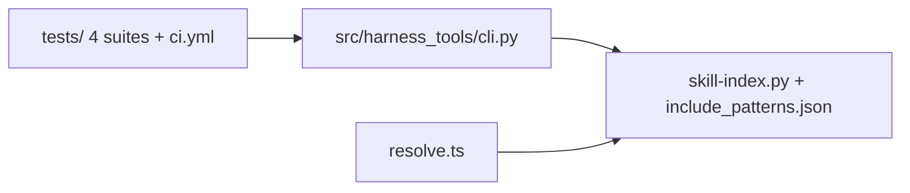

# Senior Architect Scan-Mode Note: `rig-harness-tools`

## 1. Synthesis (Reader Priority — Rule 19)
- **Primary Recommendation:** Confirm whether root `resolve.ts` is still active (and add a runtime/test check if so); otherwise keep the clean Python CLI and CI as-is.
- **MCP 2 (`2026-07-28`) Status:** `No MCP surface observed`
- **Critical / High Findings:** None identified.

## 2. Pass Level, Scope & Promotion Gate
- **Pass Level:** `Scan Mode` (Rule 0 default)
- **Scope:** Repository `rig-harness-tools` at `/Users/rig128gb/Developer/rig-harness-tools` (`lang=Python`, `private=True`, `inManifest38=False`)
- **Focus/Full Promotion Trigger:** None (clean, tested context-budget utility repo with CI; Scan Mode sufficient)
- **Architecture Areas Classified:** Backend / CLI (`src/harness_tools/cli.py`, `pyproject.toml`, `skill-index.py`, `resolve.ts`); Skills & Recall (`harness-recall/`, `skill-index-skill/`, `include_patterns.json`); Tests & CI (`tests/test_budget.py`, `test_cli.py`, `test_index.py`, `ci.yml`); Frontend / Database / MCP (Not observed)

## 3. Evidence Checked & Skipped Areas
- **Evidence Files Checked (3):** `.github/workflows/ci.yml`, `README.md`, `pyproject.toml`
- **Root Entries:** 12 items (`.github/, .gitignore, README.md, examples/, harness-recall/, include_patterns.json, pyproject.toml, resolve.ts, skill-index-skill/, skill-index.py, src/, tests/`)
- **Last Commit:** `a84eb0f 2026-10-10 19:39:36 -0600 Merge pull request #1 from mrodgersjs-web/loop/2026-10-10-build-core`
- **Git Working Tree:** `0` dirty/untracked entries (clean)
- **Workflows:** `.github/workflows/ci.yml`
- **MCP Files:** Not observed
- **Existing Architecture Docs:** Not observed
- **Skipped Areas (Scan-Mode Budget):** Deep line-by-line function bodies, runtime execution, and external network/service probes (not executed in read-only Scan Mode).

## 4. Confirmed Facts (`Direct`)
- Local checkout exists at `/Users/rig128gb/Developer/rig-harness-tools` (branch `main`) with 12 top-level entries and 28 sampled files (depth <= 3).
- Build/package manifests observed: `pyproject.toml`.
- Top-level source/tool directories observed: `src/`.
- Entrypoints observed: `src/harness_tools/cli.py`.
- Tests observed: 4 sampled test file(s) (`tests/test_budget.py`, `tests/test_cli.py`, `tests/test_index.py`, `tests/test_legacy_tools.py`).
- MCP 2 (`2026-07-28`) status: `No MCP surface observed`.
- Committed/untracked secret-file candidates observed: None identified.

## 5. Inferences & Assumptions (`Inferred` / `Assumed`)
- Inferred: Multi-harness context-budgeting and skill-indexing CLI (`src/harness_tools/cli.py`) plus a standalone TypeScript resolver (`resolve.ts`).

## 6. System Map (Mermaid)

## 7. Findings (Debt, Separation of Concerns, Convention Drift, Flow Conflicts, MCP 2)
- **[Low | Direct] Project Convention Drift — Root-Level Scripts Outside `src/`**
  - *Evidence:* `skill-index.py` and `resolve.ts` sit at repo root alongside packaged `src/harness_tools/` (`pyproject.toml`, no `package.json`).
  - *Impact:* `resolve.ts` has no declared TypeScript/Node manifest or CI check.
  - *Proposed Smallest Safe Correction (Requires Approval):* Move `skill-index.py` into `src/harness_tools/` (or document why it is standalone) and declare runtime requirements for `resolve.ts`.

## 8. Open Questions, Risks & Safe Next Actions
- **Open Questions:** Is `resolve.ts` actively consumed by an external harness or superseded by `src/harness_tools/cli.py`?
- **Risks:** `resolve.ts` is untested in `ci.yml`.
- **Safe Next Actions (Proposed, Read-Only Until Approved):**
  - Confirm whether `resolve.ts` is still active and add a check or archive it.

## 9. Step-8 Validation Gate
1. **Claim traceability:** Yes — every file path, manifest, workflow, test file, git status count, and MCP 2 status (`No MCP surface observed`) traces directly to inspected local files at `/Users/rig128gb/Developer/rig-harness-tools`; inferences and assumptions are explicitly labeled.
2. **Scope alignment:** Yes — bounded strictly to Scan Mode (Rule 0) read-only inspection of `rig-harness-tools`; no files inside the target repository were modified.
3. **Handoff readiness:** Yes — open questions, risks, promotion gate status, and proposed smallest safe next actions are explicitly listed (or marked `None identified`).
