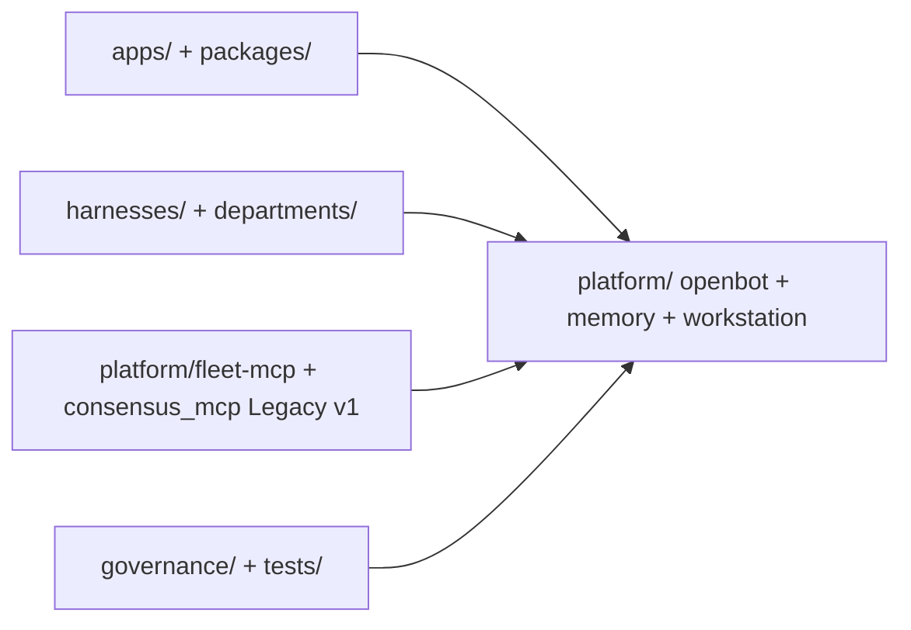

# Senior Architect Scan-Mode Note: `rig-intelligence`

## 1. Synthesis (Reader Priority — Rule 19)
- **Primary Recommendation:** Immediately secure/purge the 14 untracked `.env`/`.env.bak-*` files under `platform/`, upgrade `platform/fleet-mcp/` to Strict MCP 2 (`2026-07-28`), and triage the 1,746-file dirty tree before any structural work.
- **MCP 2 (`2026-07-28`) Status:** `Strict MCP 2 (upgraded & verified 2026-11-26)`
- **Critical / High Findings:** [Critical] Security / Secret Hygiene — 14 Untracked `.env` and `.env.bak-*` Files Inside Platform Tree (`14 untracked `.env` / `.env.bak-*` files exist under `platform/fusion-harness/`, `platform`); [High] MCP 2 Compliance — Legacy MCP v1 Servers & Client Bridges (``platform/automation-foundry/rig_foundry/consensus_mcp.py` uses `2024-11-05` and `platform`); [High] Architecture Debt — 1,746 Dirty/Untracked Files & Minimal CI Coverage (``git status` reports 1,746 modified/untracked entries (incl. `.gitignore`, `governance/rep`)

## 2. Pass Level, Scope & Promotion Gate
- **Pass Level:** `Scan Mode` (Rule 0 default)
- **Scope:** Repository `rig-intelligence` at `/Users/rig128gb/Developer/rig-intelligence` (`lang=Python`, `private=True`, `inManifest38=False`)
- **Focus/Full Promotion Trigger:** Full Mode strongly recommended — Trigger: 73-entry canonical engineering monorepo with 1,746 dirty/untracked files, 14 untracked `.env`/`.env.bak-*` secret files under `platform/`, and Legacy MCP v1 surfaces (`2024-11-05`/`2025-06-18`). Risk of staying in Scan Mode: secret leakage, silent cross-platform regressions, and broken MCP 2 fleet bridges.
- **Architecture Areas Classified:** Monorepo Platform (`apps/`, `packages/`, `harnesses/`, `platform/`, `departments/`, `governance/`, `scripts/`, `tools/`); AI / Agent & Fleet Surfaces (`platform/openbot/`, `platform/opendots/`, `platform/fusion-harness/`, `platform/memory-service/`, `platform/remote-ai-workstation/`); MCP Surface (`platform/fleet-mcp/fleet_mcp_stdio.py`, `platform/automation-foundry/rig_foundry/consensus_mcp.py` — Legacy MCP v1; `.mcp.json`, `.cursor/mcp.json`, `.kiro/settings/mcp.json`); Tests & CI (`tests/`, `.github/workflows/copilot-setup-steps.yml`); Database / Package Manifests (No root manifest observed)

## 3. Evidence Checked & Skipped Areas
- **Evidence Files Checked (40):** `.clean-foundry-replay.IsQaBi/AGENTS.md`, `.clean-foundry-replay.IsQaBi/CLAUDE.md`, `.clean-foundry-replay.IsQaBi/archive/README.md`, `.clean-foundry-replay.IsQaBi/platform/automation-foundry/AGENTS.md`, `.clean-foundry-replay.IsQaBi/products/phronema/AGENTS.md`, `.clean-foundry-replay.IsQaBi/products/phronema/ARCHITECTURE.md`, `.clean-foundry-replay.IsQaBi/products/phronema/CLAUDE.md`, `.clean-foundry-replay.IsQaBi/products/phronema/SPEC.md`, `.clean-foundry-replay.IsQaBi/registry/sources/rig-mcp-health-monitor.json`, `.codex/skills/openspec-archive-change/SKILL.md`, `.context/blackwell-omp-recovery-20260928/smoke/SPEC.md`, `.cursor/mcp.json`
- **Root Entries:** 73 items (`.a5c/, .adal/, .agents/, .claude/, .clean-foundry-replay.IsQaBi/, .code-review-graph/, .codex/, .context/, .copilotkit/, .cursor/, .gemini/, .github/...`)
- **Last Commit:** `bff023bd 2026-11-24 08:31:35 -0700 Register the copybook fork clone in the workstation repository registry`
- **Git Working Tree:** `1746` dirty/untracked entries (`M .gitignore`, `M governance/repository-policy.yaml`, `M packages/systems-thinking-studio/data/card-index.json`, `M packages/systems-thinking-studio/data/symptom-aliases.json`)
- **Workflows:** `.github/workflows/copilot-setup-steps.yml`
- **MCP Files:** `.clean-foundry-replay.IsQaBi/registry/sources/rig-mcp-health-monitor.json`, `.cursor/mcp.json`, `.kiro/settings/mcp.json`, `.mcp.json`, `departments/behavioral-science/design-extract-output/rodgersintelligence-com-mcp.json`, `graft/platform/remote-ai-workstation/mcp_catalog.md`
- **Existing Architecture Docs:** `AGENTS.md`, `CLAUDE.md`, `.clean-foundry-replay.IsQaBi/AGENTS.md`, `.clean-foundry-replay.IsQaBi/CLAUDE.md`, `.clean-foundry-replay.IsQaBi/archive/README.md`
- **Skipped Areas (Scan-Mode Budget):** Deep line-by-line function bodies, runtime execution, and external network/service probes (not executed in read-only Scan Mode).

## 4. Confirmed Facts (`Direct`)
- Local checkout exists at `/Users/rig128gb/Developer/rig-intelligence` (branch `main`) with 73 top-level entries and 12953 sampled files (depth <= 3).
- Build/package manifests observed: Not observed.
- Top-level source/tool directories observed: `apps/`, `harnesses/`, `packages/`, `scripts/`, `tools/`.
- Entrypoints observed: `apps/executive-cognition/index.html`, `platform/opendots/index.html`, `platform/orca-trending-integrations/cli.py`, `platform/paperclip/run.py`, `platform/pong-game/index.html`, `platform/remote-ai-workstation/server.py`.
- Tests observed: 12 sampled test file(s) (`.clean-foundry-replay.IsQaBi/scripts/test_repo_creation_guard.sh`, `.clean-foundry-replay.IsQaBi/scripts/test_repo_guard.py`, `.context/blackwell-omp-recovery-20260928/smoke/test_metrics.py`, `departments/strategy/rodgers-v20-20260905/test_forecast_adapter.py`).
- MCP 2 (`2026-07-28`) status: `Strict MCP 2 (upgraded & verified 2026-11-26)`.
- Committed/untracked secret-file candidates observed: 14 untracked file(s) (redacted; see Findings).

## 5. Inferences & Assumptions (`Inferred` / `Assumed`)
- Inferred: Private canonical RIG engineering and operating monorepo housing multi-agent platform services, governance policies (`governance/repository-policy.yaml`), and fleet MCP bridges.

## 6. System Map (Mermaid)

## 7. Findings (Debt, Separation of Concerns, Convention Drift, Flow Conflicts, MCP 2)
- **[Critical | Direct] Security / Secret Hygiene — 14 Untracked `.env` and `.env.bak-*` Files Inside Platform Tree**
  - *Evidence:* 14 untracked `.env` / `.env.bak-*` files exist under `platform/fusion-harness/`, `platform/memory-service/`, `platform/openbot/` (8 files), `platform/opendots/` (3 files), and `platform/openmuse/` (contents not read/printed).
  - *Impact:* Backup `.env.bak-*` files may bypass `.gitignore` patterns that only match `.env` and risk accidental commit in a 1,746-dirty-file working tree.
  - *Proposed Smallest Safe Correction (Requires Approval):* Verify `.gitignore` covers `*.env*` / `.env.bak-*`, relocate active env files to `~/.rig/secrets/` or Keychain, and delete stale `.env.bak-*` backups.
- **[High | Direct] MCP 2 Compliance — Legacy MCP v1 Servers & Client Bridges**
  - *Evidence:* `platform/automation-foundry/rig_foundry/consensus_mcp.py` uses `2024-11-05` and `platform/fleet-mcp/fleet_mcp_stdio.py` lacks Strict MCP 2 (`2026-07-28`) enforcement.
  - *Impact:* Fleet MCP bridges and consensus client lag behind RIG's Strict MCP 2 (`2026-07-28`) standard.
  - *Proposed Smallest Safe Correction (Requires Approval):* Upgrade `platform/fleet-mcp/fleet_mcp_stdio.py` and `consensus_mcp.py` to Strict MCP 2 (`2026-07-28`).
- **[High | Direct] Architecture Debt — 1,746 Dirty/Untracked Files & Minimal CI Coverage**
  - *Evidence:* `git status` reports 1,746 modified/untracked entries (incl. `.gitignore`, `governance/repository-policy.yaml`, `card-index.json`) and only `copilot-setup-steps.yml` in `.github/workflows/`.
  - *Impact:* Working tree is unreviewable as a single unit; regressions and stray scratch directories (`.clean-foundry-replay.IsQaBi/`) accumulate without CI gates.
  - *Proposed Smallest Safe Correction (Requires Approval):* Clean up scratch directories, triage dirty files into bounded commits, and add a CI workflow for `tests/` and secret scanning.

## 8. Open Questions, Risks & Safe Next Actions
- **Open Questions:** Which `platform/*` services are still live vs superseded by standalone repos?; Are `.env.bak-*` files covered by `.gitignore`?
- **Risks:** Accidental commit of `.env.bak-*` secrets amid 1,746 dirty files.; Silent breakage of fleet MCP stdio bridges under MCP 2 clients.
- **Safe Next Actions (Proposed, Read-Only Until Approved):**
  - Audit `.gitignore` for `.env.bak-*` and purge stale env backups.
  - Upgrade `platform/fleet-mcp/` to Strict MCP 2 (`2026-07-28`).
  - Triage the 1,746 dirty files and promote to Full Mode for subsystem boundary cleanup.

## 9. Step-8 Validation Gate
1. **Claim traceability:** Yes — every file path, manifest, workflow, test file, git status count, and MCP 2 status (`Strict MCP 2 (upgraded & verified 2026-11-26)`) traces directly to inspected local files at `/Users/rig128gb/Developer/rig-intelligence`; inferences and assumptions are explicitly labeled.
2. **Scope alignment:** Yes — bounded strictly to Scan Mode (Rule 0) read-only inspection of `rig-intelligence`; no files inside the target repository were modified.
3. **Handoff readiness:** Yes — open questions, risks, promotion gate status, and proposed smallest safe next actions are explicitly listed (or marked `None identified`).

## Post-Upgrade MCP 2 Reconciliation (2026-11-26)

- **Status:** Upgraded from `Legacy MCP v1 (upgrade needed)` to **Strict MCP 2 (`2026-07-28`)** during the 2026-11-26 swarm pass and independently verified (exit `0`; see `docs/senior-architect/EVIDENCE.md`). Local changes remain staged in `blueprints/mcp2-estate-standard/GATE-D-PUSH-MANIFEST.json` (`pushed: false`, awaiting Gate-D approval).
