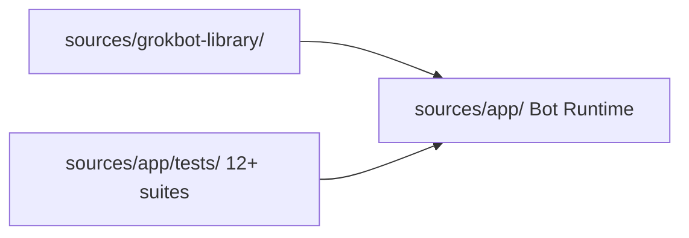

# Senior Architect Scan-Mode Note: `rig-jobsearch-grokbots`

## 1. Synthesis (Reader Priority — Rule 19)
- **Primary Recommendation:** Add a GitHub Actions CI workflow to automatically run the 12+ existing Node and Python tests under `sources/app/tests/`.
- **MCP 2 (`2026-07-28`) Status:** `No MCP surface observed`
- **Critical / High Findings:** None identified.

## 2. Pass Level, Scope & Promotion Gate
- **Pass Level:** `Scan Mode` (Rule 0 default)
- **Scope:** Repository `rig-jobsearch-grokbots` at `/Users/rig128gb/Developer/rig-jobsearch-grokbots` (`lang=JavaScript`, `private=True`, `inManifest38=False`)
- **Focus/Full Promotion Trigger:** None (clean canonical source repo with tests under `sources/app/tests/`; Scan Mode sufficient)
- **Architecture Areas Classified:** Sources / Bot Suite (`sources/app/`, `sources/grokbot-library/`); Tests (`sources/app/tests/caps.test.mjs`, `clientsai_daily_check_test.py`, `discovery.test.mjs`, 12+ test files); Documentation (`README.md`); CI / Root Manifests / MCP / Database (Not observed at root)

## 3. Evidence Checked & Skipped Areas
- **Evidence Files Checked (1):** `README.md`
- **Root Entries:** 3 items (`.gitignore, README.md, sources/`)
- **Last Commit:** `b28faab 2026-11-05 21:38:18 -0700 import sync_botdirectory.py (sources/grokbot-library/scripts/sync_botdirectory.py): byte-identical copy, file unmodified`
- **Git Working Tree:** `0` dirty/untracked entries (clean)
- **Workflows:** Not observed
- **MCP Files:** Not observed
- **Existing Architecture Docs:** Not observed
- **Skipped Areas (Scan-Mode Budget):** Deep line-by-line function bodies, runtime execution, and external network/service probes (not executed in read-only Scan Mode).

## 4. Confirmed Facts (`Direct`)
- Local checkout exists at `/Users/rig128gb/Developer/rig-jobsearch-grokbots` (branch `main`) with 3 top-level entries and 104 sampled files (depth <= 3).
- Build/package manifests observed: Not observed.
- Top-level source/tool directories observed: Not observed.
- Entrypoints observed: Not observed.
- Tests observed: 12 sampled test file(s) (`sources/app/tests/caps.test.mjs`, `sources/app/tests/clientsai_daily_check_test.py`, `sources/app/tests/discovery.test.mjs`, `sources/app/tests/event-clock.test.mjs`).
- MCP 2 (`2026-07-28`) status: `No MCP surface observed`.
- Committed/untracked secret-file candidates observed: None identified.

## 5. Inferences & Assumptions (`Inferred` / `Assumed`)
- Inferred: Canonical source-of-truth repo for job-search GrokBots (`sources/app/` + `sources/grokbot-library/`) consumed by machines and lanes.

## 6. System Map (Mermaid)

## 7. Findings (Debt, Separation of Concerns, Convention Drift, Flow Conflicts, MCP 2)
- **[Medium | Direct] Architecture Debt — 12+ Tests Exist Without CI Workflow**
  - *Evidence:* 12+ test files exist under `sources/app/tests/` (Node `.mjs` and Python `.py`), but 0 `.github/workflows/` files observed.
  - *Impact:* Regressions in cap enforcement (`caps.test.mjs`) or discovery logic are not gated automatically on push.
  - *Proposed Smallest Safe Correction (Requires Approval):* Add a GitHub Actions workflow running both Node and Python tests under `sources/app/tests/`.

## 8. Open Questions, Risks & Safe Next Actions
- **Open Questions:** How are updates synced from `rig-jobsearch-grokbots` to downstream machines/lanes?
- **Risks:** Cap-enforcement regressions if `caps.test.mjs` is not run in CI.
- **Safe Next Actions (Proposed, Read-Only Until Approved):**
  - Add a CI workflow executing `sources/app/tests/`.

## 9. Step-8 Validation Gate
1. **Claim traceability:** Yes — every file path, manifest, workflow, test file, git status count, and MCP 2 status (`No MCP surface observed`) traces directly to inspected local files at `/Users/rig128gb/Developer/rig-jobsearch-grokbots`; inferences and assumptions are explicitly labeled.
2. **Scope alignment:** Yes — bounded strictly to Scan Mode (Rule 0) read-only inspection of `rig-jobsearch-grokbots`; no files inside the target repository were modified.
3. **Handoff readiness:** Yes — open questions, risks, promotion gate status, and proposed smallest safe next actions are explicitly listed (or marked `None identified`).
