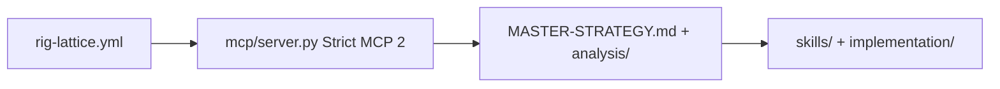

# Senior Architect Scan-Mode Note: `rig-jobsearch-strategy`

## 1. Synthesis (Reader Priority — Rule 19)
- **Primary Recommendation:** Review and commit the 3 pending MCP 2 / lattice retrofit files (`mcp/server.py`, `rig-lattice.yml`, `rig.repos.json`).
- **MCP 2 (`2026-07-28`) Status:** `Strict MCP 2`
- **Critical / High Findings:** None identified.

## 2. Pass Level, Scope & Promotion Gate
- **Pass Level:** `Scan Mode` (Rule 0 default)
- **Scope:** Repository `rig-jobsearch-strategy` at `/Users/rig128gb/Developer/rig-jobsearch-strategy` (`lang=Python`, `private=True`, `inManifest38=True`)
- **Focus/Full Promotion Trigger:** None (strategy, skills, and Strict MCP 2 repo; Scan Mode sufficient)
- **Architecture Areas Classified:** Strategy & Operating Docs (`MASTER-STRATEGY.md`, `MASTER-INDEX.md`, `DO-THIS-FIRST.md`, `EXECUTIVE-ACTION-BOARD.md`, `JULIE-WEEKLY-CADENCE.md`, `SHARED-CONTEXT.md`); Analysis & Implementation (`analysis/`, `implementation/`, `jen/`, `jen-visual/`); Skills & MCP Surface (`skills/`, `mcp/server.py` Strict MCP 2); CI (`.github/workflows/rig-lattice.yml`); Backend / Database / Tests (Tests not observed)

## 3. Evidence Checked & Skipped Areas
- **Evidence Files Checked (6):** `.github/workflows/rig-lattice.yml`, `AGENTS.md`, `README.md`, `analysis/external-market-research.md`, `implementation/RETAINED-SEARCH-ACTIVATION.md`, `mcp/server.py`
- **Root Entries:** 21 items (`.github/, .gitignore, .rig/, AGENTS.md, DO-THIS-FIRST.md, EXECUTIVE-ACTION-BOARD.md, JULIE-WEEKLY-CADENCE.md, MASTER-INDEX.md, MASTER-STRATEGY.md, README.md, SHARED-CONTEXT.md, analysis/...`)
- **Last Commit:** `d8f8e5b 2026-10-10 17:40:31 -0600 Merge pull request #1 from mrodgersjs-web/fix/rig-lattice-skip-until-published`
- **Git Working Tree:** `3` dirty/untracked entries (`M .github/workflows/rig-lattice.yml`, `M mcp/server.py`, `M rig.repos.json`)
- **Workflows:** `.github/workflows/rig-lattice.yml`
- **MCP Files:** `mcp/server.py`
- **Existing Architecture Docs:** `AGENTS.md`, `analysis/external-market-research.md`, `implementation/RETAINED-SEARCH-ACTIVATION.md`
- **Skipped Areas (Scan-Mode Budget):** Deep line-by-line function bodies, runtime execution, and external network/service probes (not executed in read-only Scan Mode).

## 4. Confirmed Facts (`Direct`)
- Local checkout exists at `/Users/rig128gb/Developer/rig-jobsearch-strategy` (branch `main`) with 21 top-level entries and 185 sampled files (depth <= 3).
- Build/package manifests observed: Not observed.
- Top-level source/tool directories observed: `mcp/`, `skills/`.
- Entrypoints observed: `mcp/server.py`.
- Tests observed: Not observed.
- MCP 2 (`2026-07-28`) status: `Strict MCP 2`.
- Committed/untracked secret-file candidates observed: None identified.

## 5. Inferences & Assumptions (`Inferred` / `Assumed`)
- Inferred: Evidence-backed job-search strategy corpus, Julie weekly cadence docs, and skills exposed via Strict MCP 2 (`mcp/server.py`).

## 6. System Map (Mermaid)

## 7. Findings (Debt, Separation of Concerns, Convention Drift, Flow Conflicts, MCP 2)
- **[Medium | Direct] Convention Drift — Uncommitted MCP 2 & Lattice Retrofit**
  - *Evidence:* 3 dirty files: `M .github/workflows/rig-lattice.yml`, `M mcp/server.py`, `M rig.repos.json`.
  - *Impact:* Local Strict MCP 2 retrofit changes are unsealed.
  - *Proposed Smallest Safe Correction (Requires Approval):* Review `git diff` and commit the 3 modified files.
- **[Low | Direct] Architecture Debt — No Automated Smoke/Link Test**
  - *Evidence:* 0 test files observed; `MASTER-INDEX.md` links across root strategy docs, `analysis/`, and `implementation/`.
  - *Impact:* Broken internal links or MCP server regressions are not caught outside `rig-lattice.yml`.
  - *Proposed Smallest Safe Correction (Requires Approval):* Add a lightweight smoke test verifying `mcp/server.py` discovery and `MASTER-INDEX.md` links.

## 8. Open Questions, Risks & Safe Next Actions
- **Open Questions:** None identified
- **Risks:** Uncommitted MCP 2 changes could drift from remote.
- **Safe Next Actions (Proposed, Read-Only Until Approved):**
  - Review and commit the 3 dirty MCP 2 / lattice files.

## 9. Step-8 Validation Gate
1. **Claim traceability:** Yes — every file path, manifest, workflow, test file, git status count, and MCP 2 status (`Strict MCP 2`) traces directly to inspected local files at `/Users/rig128gb/Developer/rig-jobsearch-strategy`; inferences and assumptions are explicitly labeled.
2. **Scope alignment:** Yes — bounded strictly to Scan Mode (Rule 0) read-only inspection of `rig-jobsearch-strategy`; no files inside the target repository were modified.
3. **Handoff readiness:** Yes — open questions, risks, promotion gate status, and proposed smallest safe next actions are explicitly listed (or marked `None identified`).
