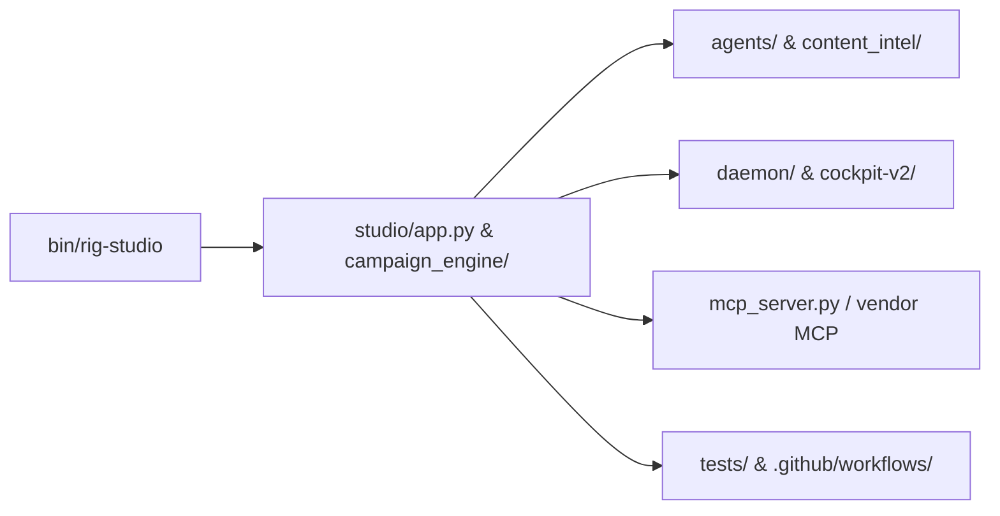

# Senior Architect Scan-Mode Note: `rig-linkedin-studio-luca`

## 1. Synthesis (Reader Priority — Rule 19)
- **Primary Recommendation:** Consolidate root sprawl (86 root files, 84 root dirs) and align root mcp_server.py with the Strict MCP 2 (2026-07-28) contract enforced by .github/workflows/rig-lattice.yml.
- **MCP 2 (`2026-07-28`) Status:** `Legacy MCP v1 (upgrade needed)`
- **Critical / High Findings:**
  - **[High | Direct] Architecture Debt — Root Directory Sprawl & Legacy Artifacts:** Root has 86 files and 84 directories including dated handoffs (HANDOFF-2026-08-11-factledger.md), broken venv (.venv.broken-2026-05-13), and overlapping UIs (cockpit/, cockpit-v2/, dashboard/, desktop/, RIG Studio.app).
  - **[High | Direct] Flow Conflict — MCP 2 CI vs. Root MCP Server:** .github/workflows/rig-lattice.yml checks mcp/server.py for protocolVersion 2026-07-28, while root exposes mcp_server.py (v1) and vendored stickerdaniel-linkedin-mcp-server carries 2026-07-28 separately.

## 2. Pass Level, Scope & Promotion Gate
- **Pass Level:** `Scan Mode` (Rule 0 default)
- **Scope:** Repository `rig-linkedin-studio-luca` at `/Users/rig128gb/Developer/linkedinstudio-build` (`lang=Python`, `private=True`)
- **Focus/Full Promotion Trigger:** Full Mode candidate — 170 root entries, 84 root dirs, multi-runtime (Python studio/daemon/cockpit-v2 + Electron/desktop + macOS RIG Studio.app), and 34 uncommitted dirty files
- **Architecture Areas Classified:** Frontend (cockpit, cockpit-v2, desktop), Backend (studio/, daemon/, campaign_engine/, alfred/), AI/Background (agents/, engines/, content_intel/), Infrastructure (.github/workflows/, deploy/, bin/), Tests & Quality Gates (tests/, .testsprite/, .playwright-mcp/)

## 3. Evidence Checked & Skipped Areas
- **Evidence Files Checked (17):** `pyproject.toml`, `requirements.txt`, `Makefile`, `README.md`, `ARCHITECTURE.md`, `AGENTS.md`, `.github/workflows/ci.yml`, `.github/workflows/cockpit-v2-ci.yml`, `.github/workflows/desktop-windows.yml`, `.github/workflows/rig-lattice.yml`, `.github/workflows/vercel-deploy.yml`, `tests/`, `scripts/`, `bin/`, `agents/`, `skills/`, `studio/`
- **Root Entries:** 170 items | **Last Commit:** `3bd1d8b 2026-10-10 17:37:26 -0600 Merge pull request #1 from mrodgersjs-web/fix/rig-lattice-skip-until-published` | **Dirty Files:** `34`
- **Workflows:** `ci.yml`, `cockpit-v2-ci.yml`, `desktop-windows.yml`, `rig-lattice.yml`, `vercel-deploy.yml`, `weekly.yml`
- **MCP Files:** Not observed
- **Skipped Areas (Scan-Mode Budget):** Deep line-by-line module bodies, runtime execution, and external service probes (not executed in read-only Scan Mode).

## 4. Confirmed Facts (`Direct`)
- Local checkout exists at `/Users/rig128gb/Developer/linkedinstudio-build` with 170 top-level entries.
- Build/package manifests observed: `pyproject.toml`, `requirements.txt`, `Makefile`.
- Top-level code/tool directories observed: `scripts/`, `bin/`, `agents/`, `skills/`, `studio/`.
- Test directories observed: `tests/`.
- MCP 2 (`2026-07-28`) status: `Legacy MCP v1 (upgrade needed)`.

## 5. Inferences & Assumptions (`Inferred` / `Assumed`)
- Inferred: cockpit-v2/ and studio/ are the active Python/FastAPI surfaces replacing earlier cockpit/ and alfred/ prototypes (Verify first: Yes).

## 6. System Map (Mermaid)

## 7. Findings (Debt, Separation of Concerns, Convention Drift, Flow Conflicts)
- **[High | Direct] Architecture Debt — Root Directory Sprawl & Legacy Artifacts**
  - *Evidence:* Root has 86 files and 84 directories including dated handoffs (HANDOFF-2026-08-11-factledger.md), broken venv (.venv.broken-2026-05-13), and overlapping UIs (cockpit/, cockpit-v2/, dashboard/, desktop/, RIG Studio.app).
  - *Impact & Proposed Smallest Safe Correction:* Taxes onboarding and change safety; proposed: archive stale handoffs/broken venvs and declare canonical runtime entrypoint.
- **[High | Direct] Flow Conflict — MCP 2 CI vs. Root MCP Server**
  - *Evidence:* .github/workflows/rig-lattice.yml checks mcp/server.py for protocolVersion 2026-07-28, while root exposes mcp_server.py (v1) and vendored stickerdaniel-linkedin-mcp-server carries 2026-07-28 separately.
  - *Impact & Proposed Smallest Safe Correction:* CI gate and runtime MCP surface are misaligned; proposed: expose Strict MCP 2 (2026-07-28) at mcp/server.py or update workflow target.
- **[Medium | Direct] Convention Drift — Working Tree Dirtiness**
  - *Evidence:* git status shows 34 uncommitted changes alongside multiple overlapping spec docs (ALFRED_ULTRAPLAN.md, LUCA_ULTRAPLAN.md).
  - *Impact & Proposed Smallest Safe Correction:* Increases merge/drift risk; proposed: triage and commit or discard stale local edits.

## 8. Open Questions, Risks & Safe Next Actions
- **Open Questions:** Which UI surface (cockpit-v2/, desktop/, or RIG Studio.app) is the canonical production frontend?
- **Risks:** Broken .venv.broken-2026-05-13 and 34 dirty files may mask failing tests or unpushed fixes.
- **Safe Next Actions (Proposed, Read-Only Until Approved):**
  - Run pytest on tests/ in a clean venv.
  - Reconcile mcp_server.py with .github/workflows/rig-lattice.yml Strict MCP 2 check.
  - Archive superseded ALFRED/HANDOFF root docs under docs/archive/ (requires owner approval).

## 9. Step-8 Validation Gate
1. **Claim traceability:** Yes — every file path, manifest, workflow, test directory, and MCP 2 status (`Legacy MCP v1 (upgrade needed)`) traces directly to inspected local files at `/Users/rig128gb/Developer/linkedinstudio-build`; inferences are explicitly labeled `Inferred`.
2. **Scope alignment:** Yes — bounded strictly to Scan Mode (Rule 0) read-only inspection of this single repository; no files inside the target repository were modified.
3. **Handoff readiness:** Yes — open questions, risks, and proposed smallest safe next actions are explicitly listed (or marked `None identified`).
