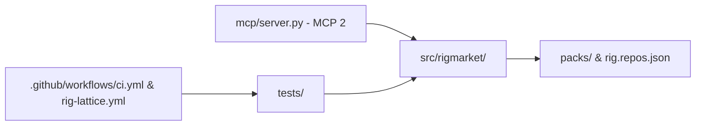

# Senior Architect Scan-Mode Note: `rig-marketplace`

## 1. Synthesis (Reader Priority — Rule 19)
- **Primary Recommendation:** Maintain current clean package boundary and resolve the 3 dirty working-tree files before next release.
- **MCP 2 (`2026-07-28`) Status:** `Strict MCP 2`
- **Critical / High Findings:** None identified.

## 2. Pass Level, Scope & Promotion Gate
- **Pass Level:** `Scan Mode` (Rule 0 default)
- **Scope:** Repository `rig-marketplace` at `/Users/rig128gb/Developer/rig-marketplace` (`lang=Python`, `private=False`)
- **Focus/Full Promotion Trigger:** None (clean bounded Python package with clear src/rigmarket, packs/, mcp/server.py, and CI)
- **Architecture Areas Classified:** Backend/CLI (src/rigmarket/), Shared Modules (packs/, .claude-plugin/), External Services/MCP (mcp/server.py), Infrastructure (.github/workflows/ci.yml, rig-lattice.yml), Tests & Quality Gates (tests/ with 11 test modules)

## 3. Evidence Checked & Skipped Areas
- **Evidence Files Checked (8):** `pyproject.toml`, `README.md`, `AGENTS.md`, `.github/workflows/ci.yml`, `.github/workflows/rig-lattice.yml`, `tests/`, `mcp/server.py`, `src/`
- **Root Entries:** 24 items | **Last Commit:** `9659557 2026-10-20 02:16:26 -0600 docs: README no longer shows a pip install of the unpublished name` | **Dirty Files:** `3`
- **Workflows:** `ci.yml`, `rig-lattice.yml`
- **MCP Files:** `mcp/server.py`
- **Skipped Areas (Scan-Mode Budget):** Deep line-by-line module bodies, runtime execution, and external service probes (not executed in read-only Scan Mode).

## 4. Confirmed Facts (`Direct`)
- Local checkout exists at `/Users/rig128gb/Developer/rig-marketplace` with 24 top-level entries.
- Build/package manifests observed: `pyproject.toml`.
- Top-level code/tool directories observed: `src/`.
- Test directories observed: `tests/`.
- MCP 2 (`2026-07-28`) status: `Strict MCP 2`.

## 5. Inferences & Assumptions (`Inferred` / `Assumed`)
- Inferred: rigmarket validates agent pack manifests in packs/ and exposes verified results via stdlib Strict MCP 2 (2026-07-28) server.

## 6. System Map (Mermaid)

## 7. Findings (Debt, Separation of Concerns, Convention Drift, Flow Conflicts)
- **[Low | Direct] Convention Drift — Uncommitted Local Changes**
  - *Evidence:* git status reports 3 dirty files in local checkout despite recent commit 9659557.
  - *Impact & Proposed Smallest Safe Correction:* Minor drift risk against origin/main; proposed: inspect git diff and commit or stash.

## 8. Open Questions, Risks & Safe Next Actions
- **Open Questions:** None identified
- **Risks:** Unpublished PyPI name noted in commit 9659557 requires local/git install paths for consumers.
- **Safe Next Actions (Proposed, Read-Only Until Approved):**
  - Inspect the 3 dirty files via git status.
  - Run pytest across tests/ to confirm green baseline.

## 9. Step-8 Validation Gate
1. **Claim traceability:** Yes — every file path, manifest, workflow, test directory, and MCP 2 status (`Strict MCP 2`) traces directly to inspected local files at `/Users/rig128gb/Developer/rig-marketplace`; inferences are explicitly labeled `Inferred`.
2. **Scope alignment:** Yes — bounded strictly to Scan Mode (Rule 0) read-only inspection of this single repository; no files inside the target repository were modified.
3. **Handoff readiness:** Yes — open questions, risks, and proposed smallest safe next actions are explicitly listed (or marked `None identified`).
