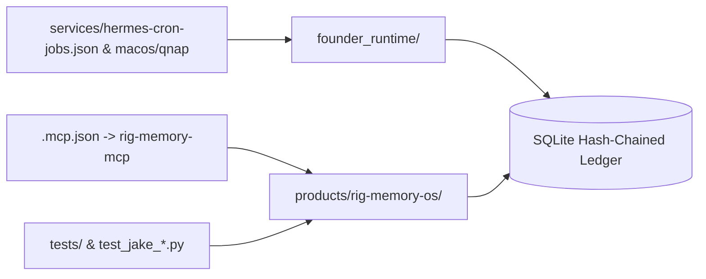

# Senior Architect Scan-Mode Note: `rig-memory-os`

## 1. Synthesis (Reader Priority — Rule 19)
- **Primary Recommendation:** Resolve the 92-file dirty working tree and dual MCP server split (founder_runtime/mcp_server.py vs products/rig-memory-os/src/rig_memory_os/mcp_server.py), and upgrade to Strict MCP 2 (2026-07-28).
- **MCP 2 (`2026-07-28`) Status:** `Legacy MCP v1 (upgrade needed)`
- **Critical / High Findings:**
  - **[High | Direct] Separation of Concerns — Dual Package & MCP Server Surface:** Root pyproject.toml defines founder-runtime, while products/rig-memory-os/ has its own pyproject.toml and mcp_server.py, alongside founder_runtime/mcp_server.py.
  - **[High | Direct] Architecture Debt — Heavy Working Tree Drift:** 92 uncommitted files plus RECONCILE-DRIFT.txt and root-level test_jake_*.py scripts outside tests/.

## 2. Pass Level, Scope & Promotion Gate
- **Pass Level:** `Scan Mode` (Rule 0 default)
- **Scope:** Repository `rig-memory-os` at `/Users/rig128gb/Developer/RIG-Memory-OS` (`lang=Python`, `private=True`)
- **Focus/Full Promotion Trigger:** Full Mode candidate — 92 dirty files, 28 root dirs spanning founder_runtime/, products/rig-memory-os/, platform/founder-runtime/, prime-jake-pai/, and .artifacts/
- **Architecture Areas Classified:** Backend (founder_runtime/, products/rig-memory-os/, services/), Database (migrations/, SQLite ledger), AI/Background (prime-jake-pai/, prompts/, tools/), External Services/MCP (.mcp.json, founder_runtime/mcp_server.py, products/rig-memory-os/src/rig_memory_os/mcp_server.py), Tests & Quality Gates (tests/, root test_jake_*.py)

## 3. Evidence Checked & Skipped Areas
- **Evidence Files Checked (8):** `pyproject.toml`, `README.md`, `.github/workflows/ci.yml`, `tests/`, `.mcp.json`, `scripts/`, `services/`, `tools/`
- **Root Entries:** 45 items | **Last Commit:** `cd5dbf5 2026-09-20 21:52:15 -0600 test_core: after cursor assertion tests the filter contract only (set equality, not order)` | **Dirty Files:** `92`
- **Workflows:** `ci.yml`
- **MCP Files:** `.mcp.json`
- **Skipped Areas (Scan-Mode Budget):** Deep line-by-line module bodies, runtime execution, and external service probes (not executed in read-only Scan Mode).

## 4. Confirmed Facts (`Direct`)
- Local checkout exists at `/Users/rig128gb/Developer/RIG-Memory-OS` with 45 top-level entries.
- Build/package manifests observed: `pyproject.toml`.
- Top-level code/tool directories observed: `scripts/`, `services/`, `tools/`.
- Test directories observed: `tests/`.
- MCP 2 (`2026-07-28`) status: `Legacy MCP v1 (upgrade needed)`.

## 5. Inferences & Assumptions (`Inferred` / `Assumed`)
- Inferred: .artifacts/ holds historical reindex/review receipts from 2026-10-20 that are excluded or untracked.

## 6. System Map (Mermaid)

## 7. Findings (Debt, Separation of Concerns, Convention Drift, Flow Conflicts)
- **[High | Direct] Separation of Concerns — Dual Package & MCP Server Surface**
  - *Evidence:* Root pyproject.toml defines founder-runtime, while products/rig-memory-os/ has its own pyproject.toml and mcp_server.py, alongside founder_runtime/mcp_server.py.
  - *Impact & Proposed Smallest Safe Correction:* Splits ownership of the memory MCP contract; proposed: designate products/rig-memory-os as canonical MCP surface and retire or delegate founder_runtime/mcp_server.py.
- **[High | Direct] Architecture Debt — Heavy Working Tree Drift**
  - *Evidence:* 92 uncommitted files plus RECONCILE-DRIFT.txt and root-level test_jake_*.py scripts outside tests/.
  - *Impact & Proposed Smallest Safe Correction:* High risk of unverified local state diverging from CI; proposed: audit git status and consolidate root tests into tests/.
- **[Medium | Direct] MCP 2 Compliance — Legacy MCP v1**
  - *Evidence:* .mcp.json and both mcp_server.py files lack Strict MCP 2 (2026-07-28) protocol revision and rig-lattice.yml CI check.
  - *Impact & Proposed Smallest Safe Correction:* Lacks 2026-07-28 capability/result envelope; proposed: upgrade to Strict MCP 2 and add rig-lattice.yml.

## 8. Open Questions, Risks & Safe Next Actions
- **Open Questions:** Are founder_runtime/ and products/rig-memory-os/ meant to be deployed separately or merged?
- **Risks:** 92 dirty files could break reproducibility across macOS and QNAP services.
- **Safe Next Actions (Proposed, Read-Only Until Approved):**
  - Run git status --short to triage the 92 dirty paths.
  - Upgrade products/rig-memory-os/src/rig_memory_os/mcp_server.py to Strict MCP 2 (2026-07-28) (requires approval).

## 9. Step-8 Validation Gate
1. **Claim traceability:** Yes — every file path, manifest, workflow, test directory, and MCP 2 status (`Legacy MCP v1 (upgrade needed)`) traces directly to inspected local files at `/Users/rig128gb/Developer/RIG-Memory-OS`; inferences are explicitly labeled `Inferred`.
2. **Scope alignment:** Yes — bounded strictly to Scan Mode (Rule 0) read-only inspection of this single repository; no files inside the target repository were modified.
3. **Handoff readiness:** Yes — open questions, risks, and proposed smallest safe next actions are explicitly listed (or marked `None identified`).
